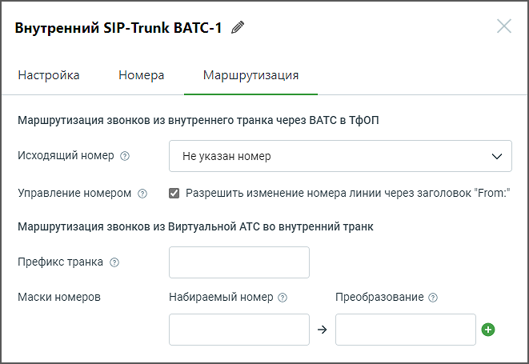

# 3.2.3. Маршрутизация

> Трассировка: PDF §3.2.3 · сквозные стр. 15-16 · источники: ч.1 `kb/sources/sip-trunk/MO_SIP_Trunk.pdf` с.15-16.

> **Описание иллюстрации SIPT-§3.2.3-1** (к §3.2.3 «Маршрутизация», стр. 15; 661×455 px). Снимок экрана / схема.
> Относится к тексту руководства: «…полей формы, руководствуйтесь инструкциями, предоставленными в разделе Номера для внешнего SIP Trunk. 3.2.3. Маршрутизация».
> Текст на изображении (OCR, требует сверки): Внутренний SIP-Trunk ВАТС-1 4; Настройка; Номера; Маршрутизация; Маршрутизация звонков из внутреннего транка через ВАТС в ТфОП; Исходящий номер @; Не указан номер; Управление номером ©; Разрешить изменение номера линии через заголовок "Ргогп:"; Маршрутизация звонков из Виртуальной АТС во внутренний транк; Префикс транка ©; Маски номеров; Набираемый номер ©; Преобразование ©

При заполнении полей формы, руководствуйтесь инструкциями, предоставленными в разделе Маршрутизация для внешнего SIP Trunk.
