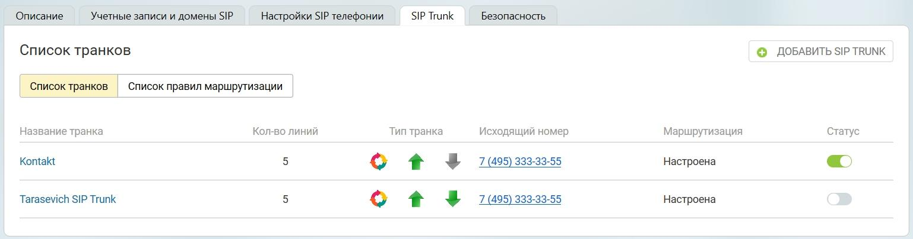

# 4.1. Список транков

> Трассировка: PDF §4.1 · сквозные стр. 18 · источники: ч.1 `kb/sources/sip-trunk/MO_SIP_Trunk.pdf` с.18.

> **Описание иллюстрации SIPT-§4.1-1** (к §4.1 «Список транков», стр. 18; 1538×404 px). Снимок экрана / схема.
> Относится к тексту руководства: «…4.1 Список транков».
> Текст на изображении (OCR, требует сверки): Описание; Учетные записи и домены SIP; SIP Trunk; Безопасность,; Настройки SIP телефонии; Список транков; © ДОБАВИТЬ SIP TRUNK; ‘Список транков; ‘Список правил маршрутизации; Кол-во линий; Название транка; Тип транка; Исходящий номер; Маршрутизация; Статус; Kontakt; ort 4; 495) 333-33-5:; Настроена; Tarasevich SIP Trunk; or 4

Название транка - название транка, установленное пользователем; Количество линий - максимальное количество одновременных звонков, устанавливаемое пользователем во вкладке «Настройки»; Тип транка - направление вызова для данного транка, устанавливаемое пользователем во вкладке «Номера»;

> **Описание иллюстрации SIPT-§4.1-2** (к §4.1 «Список транков», стр. 18; 25×25 px). Пиктограмма (значок элемента интерфейса).
> Относится к тексту руководства: «…ов, устанавливаемое пользователем во вкладке «Настройки»; Тип транка - направление вызова для данного транка, устанавливаемое пользователем во вкладке «Номера»;».
> Текста на изображении нет; назначение элемента — см. текст, к которому он относится.

● исходящие вызовы

> **Описание иллюстрации SIPT-§4.1-3** (к §4.1 «Список транков», стр. 18; 25×28 px). Пиктограмма (значок элемента интерфейса).
> Относится к тексту руководства: «… пользователем во вкладке «Настройки»; Тип транка - направление вызова для данного транка, устанавливаемое пользователем во вкладке «Номера»; ● исходящие вызовы».
> Текста на изображении нет; назначение элемента — см. текст, к которому он относится.

● входящие вызовы

> **Описание иллюстрации SIPT-§4.1-4** (к §4.1 «Список транков», стр. 18; 24×26 px). Пиктограмма (значок элемента интерфейса).
> Относится к тексту руководства: «…Тип транка - направление вызова для данного транка, устанавливаемое пользователем во вкладке «Номера»; ● исходящие вызовы ● входящие вызовы».
> Текста на изображении нет; назначение элемента — см. текст, к которому он относится.

● для данного транка установлены правила маршрутизации звонков;

> **Описание иллюстрации SIPT-§4.1-5** (к §4.1 «Список транков», стр. 18; 27×27 px). Пиктограмма (значок элемента интерфейса).
> Относится к тексту руководства: «…● исходящие вызовы ● входящие вызовы ● для данного транка установлены правила маршрутизации звонков;».
> Текста на изображении нет; назначение элемента — см. текст, к которому он относится.

● для данного транка не установлены правила маршрутизации звонков; Исходящий номер - номер, установленный в качестве исходящего во вкладке «Маршрутизация»; Маршрутизация - поле имеет статус “настроена”, если пользователь указал префикс транка или маски номеров во вкладке «Маршрутизация»; Статус транка :

> **Описание иллюстрации SIPT-§4.1-6** (к §4.1 «Список транков», стр. 18; 35×23 px). Пиктограмма (значок элемента интерфейса).
> Относится к тексту руководства: «…рутизация»; Маршрутизация - поле имеет статус “настроена”, если пользователь указал префикс транка или маски номеров во вкладке «Маршрутизация»; Статус транка :».
> Текста на изображении нет; назначение элемента — см. текст, к которому он относится.

| у транка присутствует подключение; |
| --- |
| у транка отсутствует подключение; |

> **Описание иллюстрации SIPT-§4.1-7** (к §4.1 «Список транков», стр. 18; 35×24 px). Пиктограмма (значок элемента интерфейса).
> Относится к тексту руководства: «…”, если пользователь указал префикс транка или маски номеров во вкладке «Маршрутизация»; Статус транка : ● транк активирован, у транка присутствует подключение;».
> Текста на изображении нет; назначение элемента — см. текст, к которому он относится.

> **Описание иллюстрации SIPT-§4.1-8** (к §4.1 «Список транков», стр. 18; 34×21 px). Пиктограмма (значок элемента интерфейса).
> Относится к тексту руководства: «…меров во вкладке «Маршрутизация»; Статус транка : ● транк активирован, у транка присутствует подключение; ● транк активирован, у транка отсутствует подключение;».
> Текста на изображении нет; назначение элемента — см. текст, к которому он относится.

● транк деактивирован;
