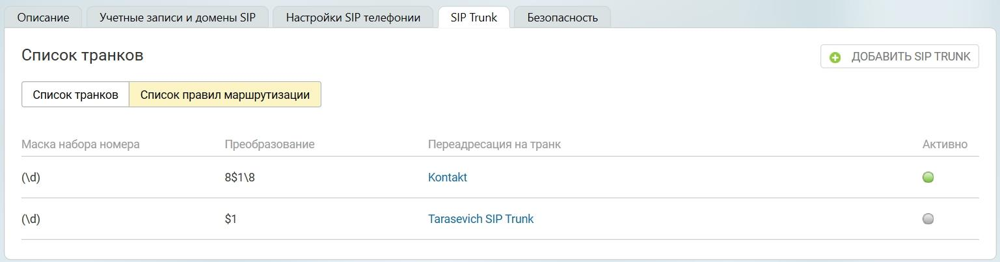

# 4.2. Список правил маршрутизации

> Трассировка: PDF §4.2 · сквозные стр. 18-19 · источники: ч.1 `kb/sources/sip-trunk/MO_SIP_Trunk.pdf` с.18-19.

> **Описание иллюстрации SIPT-§4.2-1** (к §4.2 «Список правил маршрутизации», стр. 18; 1537×403 px). Снимок экрана / схема.
> Относится к тексту руководства: «…к активирован, у транка присутствует подключение; ● транк активирован, у транка отсутствует подключение; ● транк деактивирован; 4.2. Список правил маршрутизации».
> Текст на изображении (OCR, требует сверки): Описание; Учетные записи и домены SIP; SIP Trunk; Безопасность,; Настройки SIP телефонии; Список транков; © ДОБАВИТЬ SIP TRUNK; ‘Список правил маршрутизации; | ‘Список транков; Маска набора номера; Преобразование; Переадресация на транк; Активно; 8$1\8; Kontakt; Tarasevich SIP Trunk

Маска набора номера - задается пользователем во вкладке «Маршрутизация»; Преобразование - задается пользователем во вкладке «Маршрутизация»;

Переадресация на транк - название транка, для которого установлена данная маска; Активно - отображает текущий статус маски.
