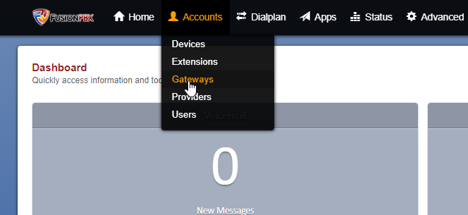
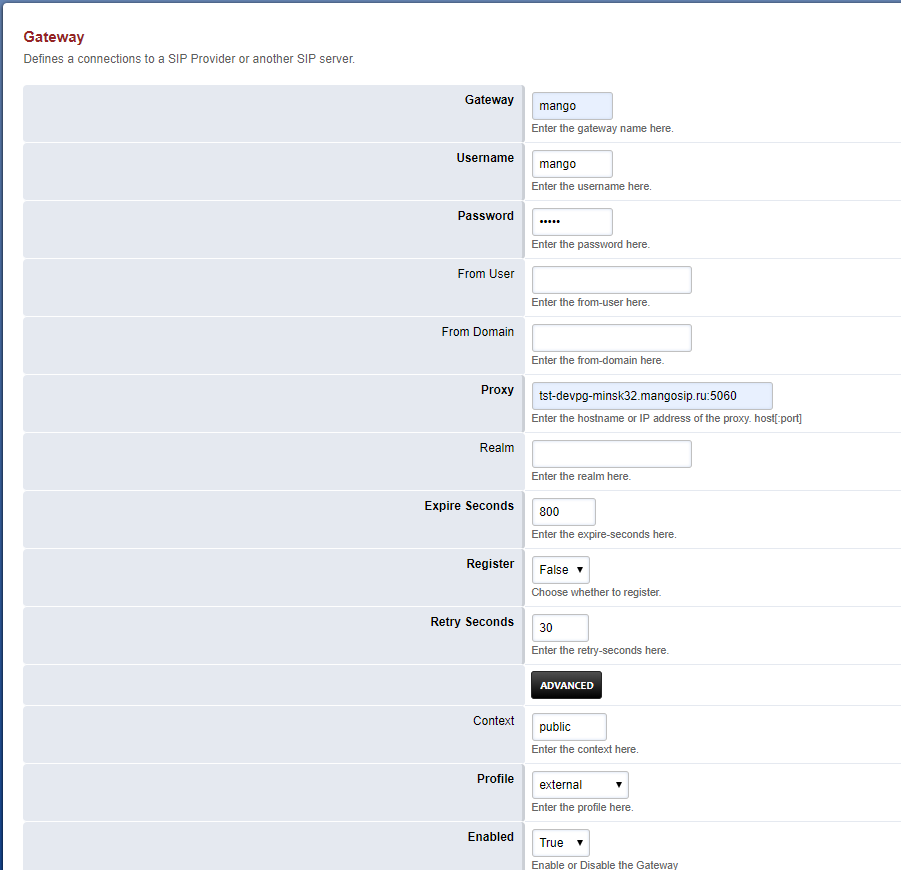
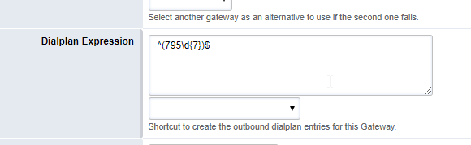

# 7.2. Создание SIP trunk для FusionPBX (Freeswitch)

> Трассировка: PDF §7.2 · сквозные стр. 38-40 · источники: ч.1 `kb/sources/sip-trunk/MO_SIP_Trunk.pdf` с.38-40.

Откройте меню администрирования транков во вкладке Gateways раздела Accounts.

> **Описание иллюстрации SIPT-§7.2-1** (к §7.2 «Создание SIP trunk для FusionPBX (Freeswitch)», стр. 38; 664×305 px). Снимок экрана / схема.
> Относится к тексту руководства: «…из 10 цифр начинающимся на 795. 7.2. Создание SIP trunk для FusionPBX (Freeswitch) Откройте меню администрирования транков во вкладке Gateways раздела Accounts.».
> Текст на изображении (OCR, требует сверки): = Dialplan 4 Apps; == Status; 3 Advanced; Devices; Extensions; Dashboard; Quic; Providers; Users

Для добавления нового транка нажмите пиктограмму “+”.

> **Описание иллюстрации SIPT-§7.2-2** (к §7.2 «Создание SIP trunk для FusionPBX (Freeswitch)», стр. 39; 168×168 px). Снимок экрана / схема.
> Относится к тексту руководства: «…Для добавления нового транка нажмите пиктограмму “+”.».

> **Описание иллюстрации SIPT-§7.2-3** (к §7.2 «Создание SIP trunk для FusionPBX (Freeswitch)», стр. 39; 901×870 px). Снимок экрана / схема.
> Относится к тексту руководства: «…Для добавления нового транка нажмите пиктограмму “+”.».
> Текст на изображении (OCR, требует сверки): Gateway; Defines а connections to a SIP Provider or another SIP server.; mango; Enter the gateway name here,; Username; Enter the username here.; Password; Enter the password here; From User; Enter the from-user here.; From Domain; Enter the from-domain here.; {st-devpg-minsk32.mangosip.ru:5060; Enter the hostname or IP address of the proxy. hos!-por!]; Realm; Enter the realm here.; Expire Seconds; 300; Ener the expire-seconds here.; Register; False у; Choose whether to register.; Retry Seconds; 30; Enter the retry-seconds here.; Context; public; Enter the content here,; Profile; extemal; Ente…

В открывшейся форме необходимо заполнить поля: Gateway – имя транка. В примере используем имя mango.

Username, Password- обязательные поля заполняются любыми значениями Proxy- SIP сервер провайдера Register – выставляем false Context - по умолчанию Public Profile - по умолчанию External Enabled - True Сохраните введенные данные кнопкой Save.

> **Описание иллюстрации SIPT-§7.2-4** (к §7.2 «Создание SIP trunk для FusionPBX (Freeswitch)», стр. 40; 580×179 px). Снимок экрана / схема.
> Относится к тексту руководства: «…я правила исходящей маршрутизации выбираем Dialplan-Outbound Routes Выберете основной gateway для вызовов Введите шаблон (pattern) набираемого номера, например:».
> Текст на изображении (OCR, требует сверки): Select another gateway аз ап altemative to use if the second one fails.; Dialplan Expression || a-795\g17))5; Shortcut to create the outbound dialplan entries for this Gateway.
