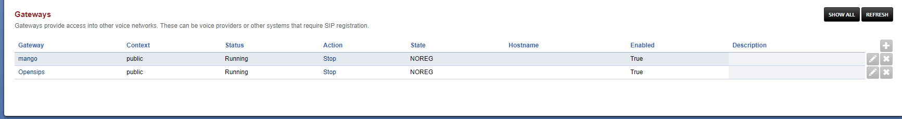
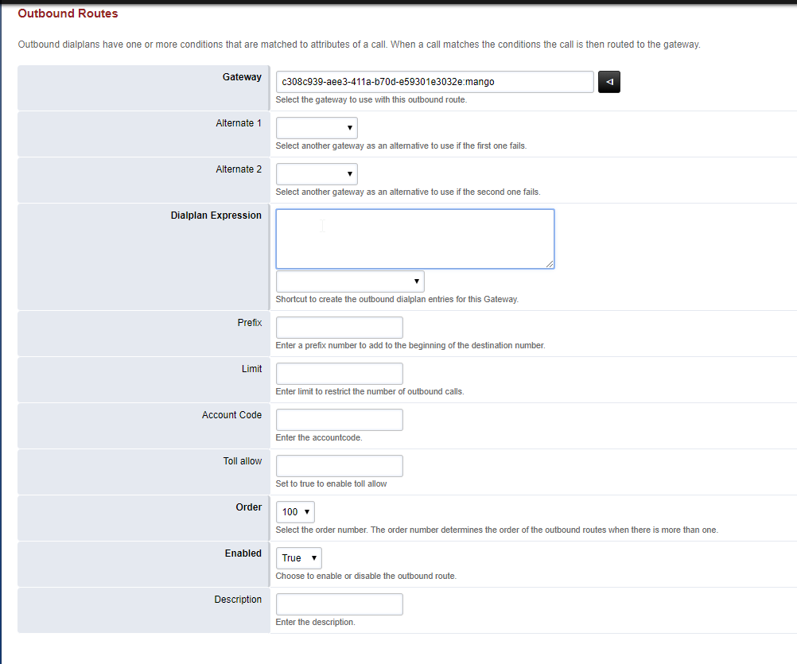

# 7.2.1.Исходящая маршрутизация

> Трассировка: PDF §7.2 · сквозные стр. 40-42 · источники: ч.1 `kb/sources/sip-trunk/MO_SIP_Trunk.pdf` с.40-42.

Outbound Routes - Исходящая маршрутизация FusionPBX (Freeswitch). Для создания правила исходящей маршрутизации выбираем Dialplan-Outbound Routes Выберете основной gateway для вызовов Введите шаблон (pattern) набираемого номера, например:

> **Описание иллюстрации SIPT-§7.2-1** (к §7.2 «7.2.1.Исходящая маршрутизация», стр. 40; 1733×231 px). Снимок экрана / схема.
> Относится к тексту руководства: «…вер провайдера Register – выставляем false Context - по умолчанию Public Profile - по умолчанию External Enabled - True Сохраните введенные данные кнопкой Save.».
> Текст на изображении (OCR, требует сверки): Gateways; Gateways provide access into other voice networks. These can be voice providers or other systems that require SIP registration,; Gateway; Context; Status; Action; State; Hostname; Enabled; Description; ‘mango; public; Running; Stop; NOREG; True; сабы; Opensips; ‘Stop; ва

Данный шаблон соответствует номерам из 10 цифр начинающимся на 795

> **Описание иллюстрации SIPT-§7.2-2** (к §7.2 «7.2.1.Исходящая маршрутизация», стр. 41; 1002×835 px). Снимок экрана / схема.
> Относится к тексту руководства: «… Выберете основной gateway для вызовов Введите шаблон (pattern) набираемого номера, например: Данный шаблон соответствует номерам из 10 цифр начинающимся на 795».
> Текст на изображении (OCR, требует сверки): Outbound Routes; Outbound dialplans have one or more conditions that are matched to attributes of a call. When a call matches the conditions the callis then routed to the gateway.; Gateway | -308c939-aee3-4112-b70d-25930123032e:mango; re); Select the gateway to use with this outbound route; Alternate 1; Select another gateway аз an altemative to use ifthe first one falls.; Alternate 2; Select another gateway as ап allemative to use ifthe second one fails; Dialplan Expression; ‘Shortcut to create the outbound diaiplan entries for his Gateway.; Prefix; Enter a prefix number to add tothe beginnin…
