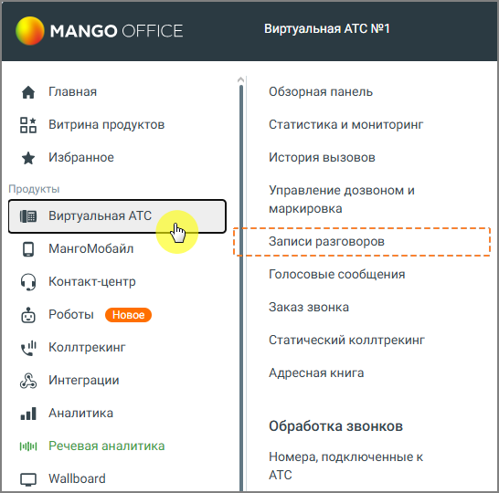
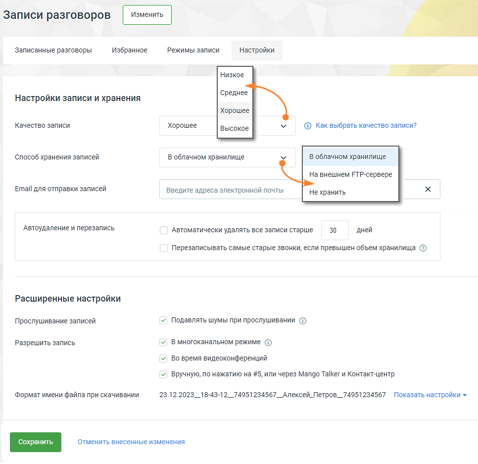

# 1. Общие сведения

> Трассировка: PDF §1 · сквозные стр. 4-6 · источники: ч.1 `kb/sources/speech-analytics/RECHEVAYA-ANALITIKA_1.26.42.pdf` с.4-6.

Речевая аналитика распознает записанные разговоры и текстовые сообщения, и производит в них поиск — вручную или автоматически — необходимой информации.

Документация по API Речевой аналитики: API Речевой аналитики.

Как работает поиск по распознанным записям разговоров, читайте здесь.

Рабочая область раздела Речевая аналитика содержит следующие вкладки:

Отчеты

Тегирование разговоров

Текстовые коммуникации

Настройки

ИИ Помощники

Расходы Речевой аналитики

После подключения Речевой аналитики пользователю доступны следующие функции:

• Поиск в распознанных записях разговоров заданных слов и выражений • Текстовая расшифровка разговора • Автоматическое проставление тематики звонка • Аналитика текстовых коммуникаций • Составление отчетов • Получение уведомлений • Формирования чек-листов и получение статистики по чек-листам • Подача заявок на распознавание, для улучшения качества распознавания

**Внимание:**

Для распознавания Речевой аналитикой звонков необходимо подключить Записи разговоров.

> **Описание иллюстрации SA-§1-1** · к разделу §1 «Общие сведения» · стр. 4 · снимок экрана / схема, 546×540 px.
> Относится к тексту руководства: «Для распознавания Речевой аналитикой звонков необходимо подключить Записи разговоров.»
> Следующий за иллюстрацией текст: «Если в настройках способа хранения записей разговоров пользователем выбран способ Не хранить, записи и расшифровки разговоров не сохраняются. Параметр Качество записи на работу Речевой аналитики не вл…»
> Текст на изображении (OCR, требует сверки): MANGO OFFICE; Виртуальная АТС №1; Главная; Обзорная панель; Ох; Витрина продуктов; Статистика и мониторинг; oo; Избранное; История вызовов; Продукты; Управление дозвоном и; маркировка; Записи разговоров; МангоМобайл; Голосовые сообщения; Контакт-центр; Заказ звонка; cs); Роботы; Статический коллтрекинг; wl; Коллтрекинг; Адресная книга; Интеграции; alll; Аналитика; Обработка звонков; РН; Речевая аналитика; Номера, подключенные к; АТС; Wallboard

> **Описание иллюстрации SA-§1-2** · к разделу §1 «Общие сведения» · стр. 5 · снимок экрана / схема, 966×937 px.
> Относится к тексту руководства: «Для распознавания Речевой аналитикой звонков необходимо подключить Записи разговоров.»
> Следующий за иллюстрацией текст: «Если в настройках способа хранения записей разговоров пользователем выбран способ Не хранить, записи и расшифровки разговоров не сохраняются. Параметр Качество записи на работу Речевой аналитики не вл…»
> Текст на изображении (OCR, требует сверки): Записи разговоров; Записанные разговоры; Избранное; Режимы записи; Настройки; Низкое; Среднее; Настройки записи и хранения; Хорошее; Качество записи; Высокое; Ф Каквыбрать качество записи?; Способ хранения записей; B облачном хранилище; На внешнем ЕТР-сервере; Email для отправки записей; Введите адреса электронной почты; He хранить; Автоудаление и перезапись; Автоматически удалять все записи старше; 30; дней; Перезаписывать самые старые звонки, если превышен объем хранилища ©; Расширенные настройки; Прослушивание записей; У) Подавлять шумы при прослушивании @; Разрешить запись; У) B многоканал…

Если в настройках способа хранения записей разговоров пользователем выбран способ Не хранить, записи и расшифровки разговоров не сохраняются.

Параметр Качество записи на работу Речевой аналитики не влияет.

Помимо функции автоудаления записей разговоров, в системе также доступна опция автоматического удаления расшифровок. Если включена соответствующая опция, расшифровки будут удалены вместе с аудиофайлами и отчеты Речевой аналитики не будут доступны по данным разговорам.

****Совет:****

Рекомендуется использовать многоканальный режим записи. Это важно, так как одноканальные записи не могут быть расшифрованы системой. Если услуга Речевой аналитики была подключена после создания одноканальных записей, они не подлежат расшифровке.

Подробнее о подключении и настройках Записи разговоров читайте в Справочнике ВАТС.
