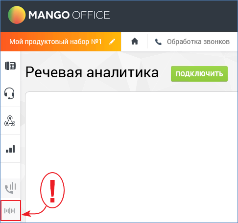
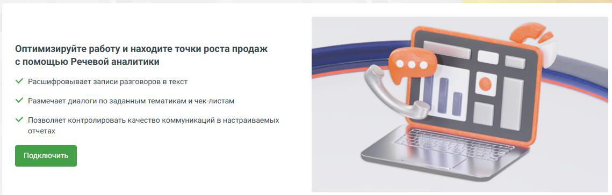
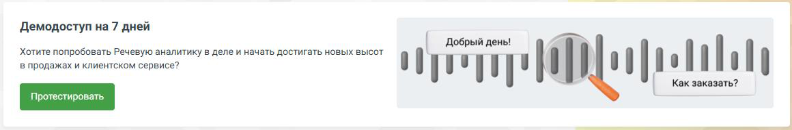
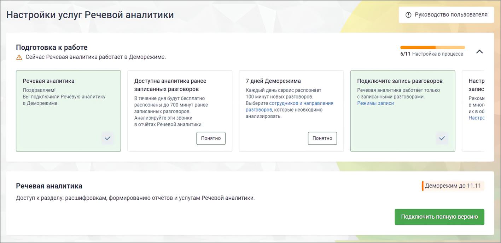

## 2.1. Подключение в демо-режиме

> Трассировка: PDF §2.1 · сквозные стр. 6-9 · источники: ч.1 `kb/sources/speech-analytics/RECHEVAYA-ANALITIKA_1.26.42.pdf` с.6-9.

Функционал демо-версии услуги Речевая аналитика полностью соответствует функционалу полной версии за исключением следующих ограничений:

• длительность демо-периода составляет 7 дней с момента подключения;

• суммарная длительность распознаваемых аудиозаписей ограничена 100 минутами аудиозаписи в сутки;

• функциональность аналитики Текстовой коммуникации доступна для пяти сотрудников.

Пользователь не может самостоятельно отключить демо-режим Речевой аналитики. Если пользователь не осуществит переход на платный тариф в течение 7 календарных дней, по истечении этого срока демоверсия деактивируется.

Повторно подключить услугу в демо-режиме невозможно.

Для подключения услуги Речевая аналитика в демо-режиме зайдите в Личный кабинет и найдите

> **Описание иллюстрации SA-§2.1-1** · к разделу §2.1 «Подключение в демо-режиме» · стр. 6 · пиктограмма (значок элемента интерфейса), 36×30 px.
> Относится к тексту руководства: «Для подключения услуги Речевая аналитика в демо-режиме зайдите в Личный кабинет и найдите»
> Следующий за иллюстрацией текст: «на боковой навигационной панели иконку .»
> Текста на изображении нет; назначение значка — см. текст, к которому он относится.

на боковой навигационной панели иконку .

> **Описание иллюстрации SA-§2.1-2** · к разделу §2.1 «Подключение в демо-режиме» · стр. 6 · снимок экрана / схема, 486×456 px.
> Относится к тексту руководства: «на боковой навигационной панели иконку .»
> Следующий за иллюстрацией текст: «Перейдите в подраздел Речевая аналитика.»
> Текст на изображении (OCR, требует сверки): MANGO OFFICE; Мой продуктовый набор №1 #; & Обработка звонков; Речевая аналитика; alll

Перейдите в подраздел Речевая аналитика.

Главная страница подраздела в краткой форме описывает возможности пользователя Речевой аналитики.

> **Описание иллюстрации SA-§2.1-3** · к разделу §2.1 «Подключение в демо-режиме» · стр. 7 · снимок экрана / схема, 1139×364 px.
> Относится к тексту руководства: «Главная страница подраздела в краткой форме описывает возможности пользователя Речевой аналитики.»
> Следующий за иллюстрацией текст: «На экране ниже располагается кнопка подключения демо-версии Речевой аналитики.»
> Текст на изображении (OCR, требует сверки): Оптимизируйте работу и находите точки роста продаж; с помощью Речевой аналитики; eee; У расшифровывает записи разговоров в текст; У Размечает диалоги по заданным тематикам и чек-листам.; У Позволяет контролировать качество коммуникаций в настраиваемых; отчетах

На экране ниже располагается кнопка подключения демо-версии Речевой аналитики.

> **Описание иллюстрации SA-§2.1-4** · к разделу §2.1 «Подключение в демо-режиме» · стр. 7 · снимок экрана / схема, 1160×192 px.
> Относится к тексту руководства: «На экране ниже располагается кнопка подключения демо-версии Речевой аналитики.»
> Следующий за иллюстрацией текст: «После подключения на боковой навигационной панели ВАТС отобразится меню демо-версии Речевой аналитики. Количество оставшихся дней использования демоверсии отображается в плашке уведомления. На страниц…»
> Текст на изображении (OCR, требует сверки): Демодоступ на 7 дней; Добрый pene!; Хотите попробовать Речевую аналитику в деле и начать достигать новых высот; в продажах и клиентском сервисе?; ПИ; Как заказать?; Мо

После подключения на боковой навигационной панели ВАТС отобразится меню демо-версии Речевой аналитики.

Количество оставшихся дней использования демоверсии отображается в плашке уведомления. На странице Настройки отображаются возможности Речевой аналитики в демо-режиме.

> **Описание иллюстрации SA-§2.1-5** · к разделу §2.1 «Подключение в демо-режиме» · стр. 7 · снимок экрана / схема, 1417×690 px.
> Относится к тексту руководства: «Количество оставшихся дней использования демоверсии отображается в плашке уведомления. На странице Настройки отображаются возможности Речевой аналитики в демо-режиме.»
> Следующий за иллюстрацией текст: «Из демо-режима вы можете в любой момент перейти к полной версии Речевой аналитики. Для перехода на полную версию щелкните по кнопке Подключить полную версию. Далее действуйте в соответствии с инструкц…»
> Текст на изображении (OCR, требует сверки): Настройки услуг Речевой аналитики; Подготовка к работе; 6/11 Настройка в процессе; (А, Сейчас Речевая аналитика работает в Деморежиме.; Речевая аналитика; Доступна аналитика ранее; 7 дней Деморежима; Подключите запись разговоров; Настр; запис; Поздравляем!; записанных разговоров.; каждый день сервис распознает; Речевая аналитика работает только; Вы подключили Речевую аналитику; В течение дня будут бесплатно; 100 минут новых разговоров.; ‘с записанными разговорами; Рекоме; в Деморежиме.; Выберите сотрудников и направления; Режимы записи; распознаны до 700 минут ранее; в мноп; разговоров, которы…

Из демо-режима вы можете в любой момент перейти к полной версии Речевой аналитики. Для перехода на полную версию щелкните по кнопке Подключить полную версию. Далее действуйте в соответствии с инструкцией.

Для новых пользователей Речевой аналитики предусмотрен онбординг — пошаговое руководство по настройке и активации всех ключевых функций, необходимых для полноценной работы с сервисом. Карточки для онбординга расположены в верхней части страницы Настройки в блоке «Подготовка к работе». Онбординг помогает пользователю пройти все этапы настройки.

Онбординг для демо-пользователей Речевой аналитики (9 шагов)

• Речевая аналитика (демо) – после подключения демо-режима карточка помечена, как просмотренная. • Вам доступна аналитика ранее записанных разговоров (ретроспективных записей разговоров). • Вам доступны 7 дней Деморежима. В течение 7 дней сервис будет распознавать до 100 минут новых разговоров в день. • Подключите запись разговоров перейдя в настройки Записи разговоров по ссылке в тексте карточки. • Настройте параметры хранения записей перейдя в настройки многоканальной записи и облачного хранения по ссылке в тексте карточки. • Подключите ИИ Конспекты, в Деморежиме или полную версию. • Настройте Тематики. Перейдите на страницу «Тематики» по ссылке в карточке и произведите необходимые настройки. • Настройте Аналитику текстовых коммуникаций. В модальном окне выберите удобный тариф и сотрудников для аналитики. • Попробуйте ИИ Тегирование в Деморежиме: в течение 7 дней вы сможете бесплатно тегировать до 100 минут расшифрованных разговоров ежедневно. • Настройте ИИ Тегирование перейдя в настройки по ссылке в тексте карточки.

**Аналитика ретроспективных записей разговоров**

Если Речевая аналитика (в демо- или платном режиме) подключается впервые, пользователю доступна аналитика ретроспективных записей разговоров. Это аналитика по последним записям, сделанным до момента подключения услуги, но суммарной длительностью не более 700 минут. Данные ретро-записей предоставляются без оплаты, в обучающих целях.

По распознанным разговорам можно производить поиск, по ключевым словам, а также поиск по тематикам в интерфейсе раздела «Запись разговоров». На основании распознавания и простановки на разговоры тематик можно просматривать отчеты.

Попавшие в ретроспективу вызовы, на момент совершения которых была отключена запись разговора, учитываются только в отчетах речевой аналитики (поиск, по ключевым словам, и по тематикам в интерфейсе раздела «Запись разговоров» невозможен).
