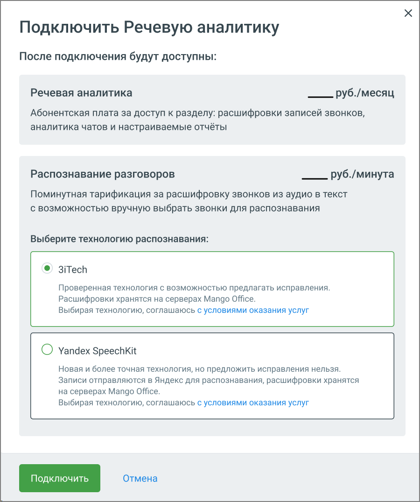
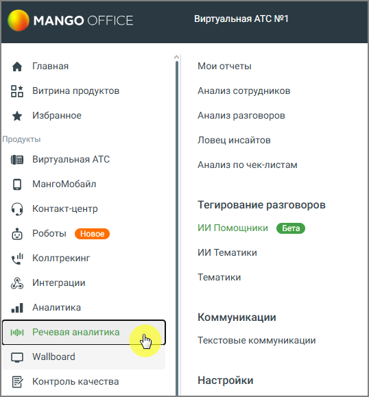

## 2.2. Подключение услуги в платном режиме

> Трассировка: PDF §2.2 · сквозные стр. 9-11 · источники: ч.1 `kb/sources/speech-analytics/RECHEVAYA-ANALITIKA_1.26.42.pdf` с.9-11.

Для подключения услуги "Речевая аналитика" последовательно перейдите в подраздел Речевая аналитика → Настройки.

После нажатия на кнопку Подключить полную версию появляется всплывающее окно с детальным описанием расходов на подключение услуги.

> **Описание иллюстрации SA-§2.2-1** · к разделу §2.2 «Подключение услуги в платном режиме» · стр. 9 · снимок экрана / схема, 900×1075 px.
> Относится к тексту руководства: «После нажатия на кнопку Подключить полную версию появляется всплывающее окно с детальным описанием расходов на подключение услуги.»
> Следующий за иллюстрацией текст: «Стоимость услуг расшифровки и распознавания разговора зависит от версии ВАТС. Подробнее о версии продукта и тарифах здесь. Всплывающее окно содержит следующие настройки:»
> Текст на изображении (OCR, требует сверки): Подключить Речевую аналитику; После подключения будут доступны:; Речевая аналитика; руб./месяц; Абонентская плата за доступ к разделу: расшифровки записей звонков,; аналитика чатов и настраиваемые отчёты; Распознавание разговоров; руб./минута; Поминутная тарификация за расшифровку звонков из аудио в текст; с возможностью вручную выбрать звонки для распознавания; Выберите технологию распознавания:; © 3iTech; Проверенная технология с возможностью предлагать исправления.; Расшифровки хранятся на серверах Mango Office.; Выбирая технологию, соглашаюсь с условиями оказания услуг; Yandex SpeechkKit; …

Стоимость услуг расшифровки и распознавания разговора зависит от версии ВАТС.

Подробнее о версии продукта и тарифах здесь.

Всплывающее окно содержит следующие настройки:

1) Речевая аналитика – в рамках этой платы пользователь получает возможность пользоваться функционалом модуля «Речевая аналитика». Списание абонентской платы происходит ежедневно. Для удобства пользователя распознанные разговоры могут быть расшифрованы и представлены в виде текста.

Для получения расшифровки разговора, необходимо: чтобы на момент совершения вызова на ВАТС была подключена услуга "Распознавание".

2) Распознавание разговоров – плата за распознавание снимается за фактическое количество распознанных минут аудиозаписей. Распознавание начинает работать сразу после его включения и распространяется только на новые записанные разговоры. Запись разговора не распознается мгновенно – допускается задержка по времени в несколько часов.

При первом подключении услуги “Речевая аналитика” обязательно подключите распознавание разговоров.

3) Выбор технологии распознавания – предлагается две технологии на выбор:

• 3iTech • Yandex SpeechKit

В дальнейшем пользователь может сменить технологию распознавания.

Ознакомьтесь с условиями оплаты и нажмите Подключить.

После нажатия кнопки Подключить услуга активируется, а пользователь перенаправляется на страницу Настройки.

На боковой навигационной панели ВАТС вам будет доступно меню:

> **Описание иллюстрации SA-§2.2-2** · к разделу §2.2 «Подключение услуги в платном режиме» · стр. 10 · снимок экрана / схема, 538×579 px.
> Относится к тексту руководства: «На боковой навигационной панели ВАТС вам будет доступно меню:»
> Следующий за иллюстрацией текст: «Отображение меню может различаться в зависимости от подключенных продуктов и услуг. Подробнее о настройках распознавания записей разговоров узнайте здесь. Пользователь может изменить ранее установленн…»
> Текст на изображении (OCR, требует сверки): MANGO OFFICE; Виртуальная АТС №1; Главная; Мои отчеты; Ох; Витрина продуктов; Анализ сотрудников; oo; Избранное; Анализ разговоров; Продукты; Ловец инсайтов; ia; Виртуальная ATC; Анализ по чек-листам; МангоМобайл; Контакт-центр; Тегирование разговоров; ИИ Помощники; Роботы; ИИ Тематики; wl; Коллтрекинг; Тематики; Интеграции; Аналитика; alll; Коммуникации; bale; Речевая аналитика; Текстовые коммуникации; Wallboard; Контроль качества; Настройки

Отображение меню может различаться в зависимости от подключенных продуктов и услуг.

Подробнее о настройках распознавания записей разговоров узнайте здесь.

Пользователь может изменить ранее установленные настройки подключения. Для этого перейдите в раздел Настройки, введите новые данные и сохраните изменения.
