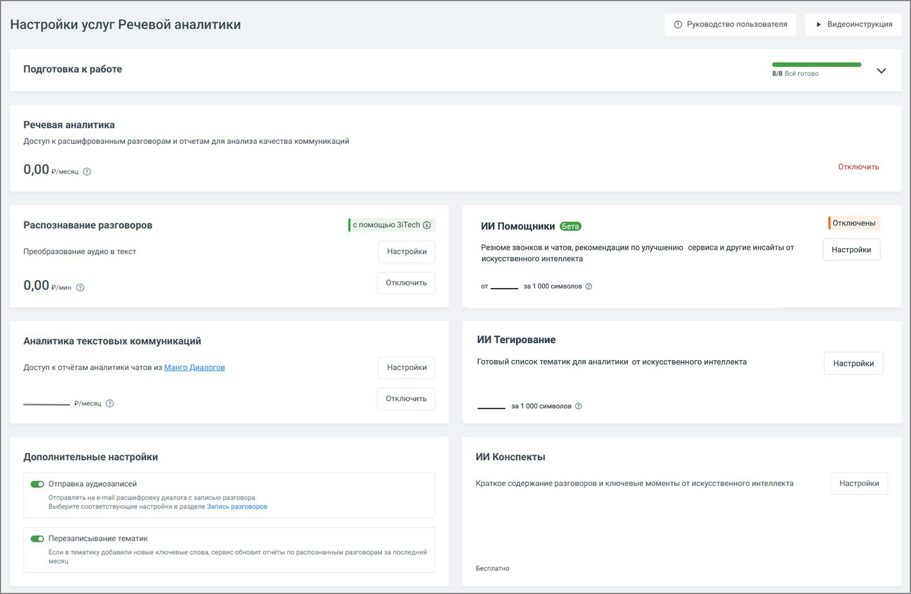
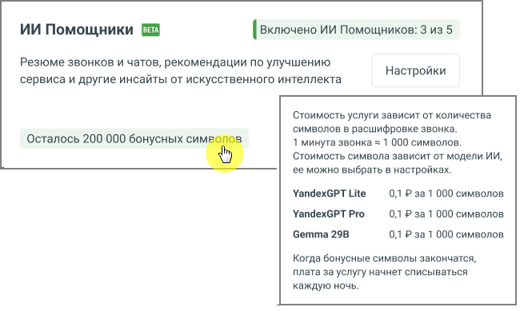

# 3. Настройки

> Трассировка: PDF §3 · сквозные стр. 11-12 · источники: ч.1 `kb/sources/speech-analytics/RECHEVAYA-ANALITIKA_1.26.42.pdf` с.11-12.

Вкладка Настройки модуля Речевая аналитика содержит блок онбординга, а также следующие блоки.

> **Описание иллюстрации SA-§3-1** · к разделу §3 «Настройки» · стр. 11 · снимок экрана / схема, 1619×1056 px.
> Относится к тексту руководства: «Вкладка Настройки модуля Речевая аналитика содержит блок онбординга, а также следующие блоки.»
> Следующий за иллюстрацией текст: «Услуга «Речевая аналитика» – отображается абонентская плата за услугу. Распознавание разговоров – отображается стоимость расшифровки и распознавания аудиозаписей разговоров. В настройках можно настрои…»
> Текст на изображении (OCR, требует сверки): Настройки услуг Речевой аналитики; © Рководство пользователя; > видеоинструкция; Подготовка к работе; 8/8 Всё готово; Речевая аналитика; Доступ к расшифрованным разговорам и отчетам для анализа качества коммуникаций; Отключить; 0,00 рес @; [отключены; Распознавание разговоров; [с помощью siTech ©; И Помощники; Преобразование аудио в текст; Настройки; Резюме звонков и чатов, рекомендации по улучшению сервиса и другие инсайты от; искусственного интеллекта.; от; 3a 1000 символов ®; 0,00 ram ©; Аналитика текстовых коммуникаций; ИИ Тегирование; Готовый список тематик для аналитики от искусственного…

Услуга «Речевая аналитика» – отображается абонентская плата за услугу.

Распознавание разговоров – отображается стоимость расшифровки и распознавания аудиозаписей разговоров. В настройках можно настроить условия распознавания аудиозаписей разговоров и выбрать технологию распознавания. Пользователь может отправлять на распознавание только нужные звонки.

Аналитика текстовых коммуникаций – выбор тарифа и сотрудников, чьи текстовые коммуникации будут анализироваться.

ИИ-инструменты

1. ИИ Помощники – инструмент для автоматического анализа диалогов по заданным правилам, который выдаёт не только краткое содержание, но также полезные выводы и рекомендации.

2. ИИ Конспекты – данная услуга Речевой Аналитики позволяет автоматически формировать краткое содержание диалога и выделять ключевые моменты с помощью искусственного интеллекта.

3. ИИ Тегирование – услуга предоставляет возможность смыслового анализа разговоров и чатов на основе запросов к ИИ без подбора ключевых слов. Анализ разговоров с использованием ИИ-запросов доступен только при активированных услугах «Абонентская плата» и «Распознавание разговоров». Элементы настройки услуги:

a. Сотрудники: Выбор диапазона сотрудников для анализа. Пользователь может

выбрать конкретных сотрудников для фильтрации разговоров и чатов. Необходимо

убедиться, что выбранные для анализа сотрудники совпадают с теми, кто уже выбран для распознавания разговоров.

b. Направление звонка: Позволяет выбрать направление (входящие, исходящие или

внутренние звонки) по которому разговоры будут фильтроваться для отправки на тегирование.

**Внимание:**

Стоимость ИИ Помощников и ИИ Тематик рассчитывается по количеству символов и зависит от выбранной модели LLM. Оплачиваются только символы промпта и ответа ИИ, длина самого разговора не тарифицируется. Для ИИ Помощников и ИИ Тематик действуют отдельные бесплатные лимиты символов; их остаток отображается в блоках ИИ Помощники и ИИ Тегирование, а после исчерпания лимита там отображается цена за 1 000 символов. Списание средств происходит каждую ночь.

> **Описание иллюстрации SA-§3-2** · к разделу §3 «Настройки» · стр. 12 · снимок экрана / схема, 650×389 px.
> Относится к тексту руководства: «…ощников и ИИ Тематик действуют отдельные бесплатные лимиты символов; их остаток отображается в блоках ИИ Помощники и ИИ Тегирование, а после исчерпания лимита там отображается цена за 1 000 символов. Списание средств происходит каждую ночь.»
> Следующий за иллюстрацией текст: «Все действия, произведенные в настройках Речевой аналитики, отражаются в Личном кабинете пользователя ВАТС в разделе Безопасность и ограничения/Журнал действий. Для удобного и последовательного ознако…»
> Текст на изображении (OCR, требует сверки): ИИ Помощники; / Включено ИИ Помощников: 3 из 5; Резюме звонков и чатов, рекомендации по улучшению; Настройки; сервиса и другие инсайты от искусственного интеллекта; Стоимость услуги зависит от количества; символов в расшифровке звонка.; Осталось 200 000 бонусных симв; 1 минута звонка = 1 000 символов.; Стоимость символа зависит от модели ИИ,; е можно выбрать в настройках.; YandexGPT Lite; 0,1 P 3a 1 000 символов; YandexGPT Pro; Gemma 29B; Когда бонусные символы закончатся,; плата за услугу начнет списываться; каждую ночь.

Все действия, произведенные в настройках Речевой аналитики, отражаются в Личном кабинете пользователя ВАТС в разделе Безопасность и ограничения/Журнал действий.

Для удобного и последовательного ознакомления с функционалом Речевой аналитики разработан блок онбординга, который помогает быстро настроить все ключевые параметры и начать работу с сервисом.
