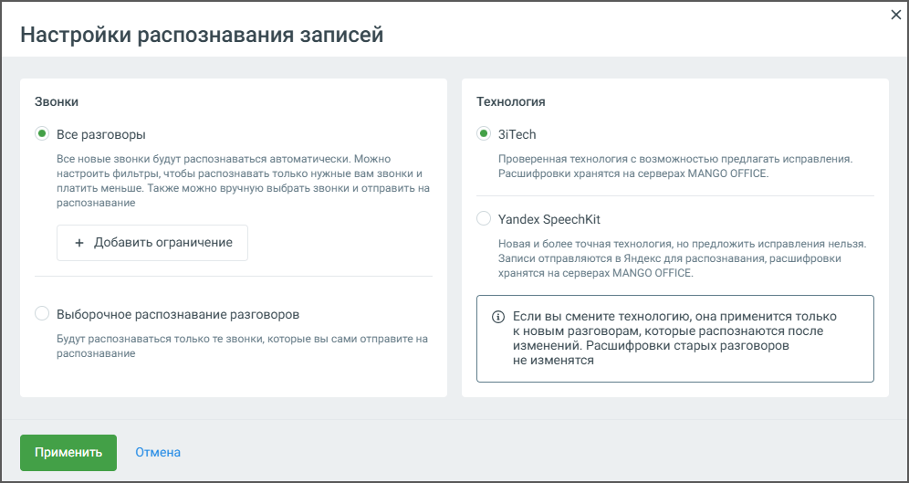

## 3.2. Настройки распознавания записей

> Трассировка: PDF §3.2 · сквозные стр. 14-15 · источники: ч.1 `kb/sources/speech-analytics/RECHEVAYA-ANALITIKA_1.26.42.pdf` с.14-15.

Блок Настройка распознавания записей позволяет настроить функции распознавания и пересылки разговоров сотрудников. По нажатию на кнопку Настройки открывается окно настроек распознавания:

> **Описание иллюстрации SA-§3.2-1** · к разделу §3.2 «Настройки распознавания записей» · стр. 14 · снимок экрана / схема, 996×529 px.
> Относится к тексту руководства: «Блок Настройка распознавания записей позволяет настроить функции распознавания и пересылки разговоров сотрудников. По нажатию на кнопку Настройки открывается окно настроек распознавания:»
> Следующий за иллюстрацией текст: «1. Режим распознавания:  Все разговоры — в этом режиме будут распознаваться все новые разговоры и записи, автоматически отправляемые на распознавание со страницы "Записи разговоров".  Выберу вручную…»
> Текст на изображении (OCR, требует сверки): Настройки распознавания записей; Звонки; Технология; © Все разговоры; © 3iTech; Все новые звонки будут распознаваться автоматически. Можно; Проверенная технология с возможностью предлагать исправления.; настроить фильтры, чтобы распознавать только нужные вам звонки и; Расшифровки хранятся на серверах MANGO OFFICE.; платить меньше. Также можно вручную выбрать звонки и отправить на; распознавание; Yandex Speechkit; + Добавить ограничение; Новая и более точная технология, но предложить исправления нельзя.; Записи отправляются в Яндекс для распознавания, расшифровки; хранятся на серверах MANGO OFF…

1. Режим распознавания:

• Все разговоры — в этом режиме будут распознаваться все новые разговоры и записи, автоматически отправляемые на распознавание со страницы "Записи разговоров". • Выберу вручную — распознаются только те записи, которые вручную отправлены пользователем со страницы "Записи разговоров".

2. Управление сотрудниками — Распознавать/Убрать:

• Возможность выбрать сотрудников, чьи разговоры должны распознаваться или исключаться из распознавания.

3. Ограничения по номерам (если соответствующая услуга подключена):

• В настройках распознавания возможно добавление ограничения по номерам телефонов, на которые будет распространяться функция распознавания. Эта настройка доступна не для всех пользователей и зависит от подключенной конфигурации услуги. Если данная опция активна, пользователю предоставляется возможность указать конкретные номера телефонов для входящих и исходящих вызовов, которые будут отправляться на распознавание.

4. Лимит распознавания в день:

• Вводимое значение ограничивает количество минут разговоров, которые могут быть распознаны за один день. Пользователь может задать минимальное количество для обработки.

5. Направление звонков для распознавания (если соответствующая услуга подключена):

Пользователь может выбрать направление звонков, которые будут распознаваться:

• Входящие • Исходящие • Внутренние

6. Расписание распознавания (если соответствующая услуга подключена):

• Пользователь может настроить время работы системы распознавания по дням недели. Клик по кнопке Задать расписание откроет окно настройки расписания. Зеленым цветом отмечено время, когда разговоры будут отправляться на распознавание. В соответствии с настроенным расписанием под распознавание будут попадать все (с учетом других настроек распознавания) записанные разговоры, время начала которых лежит в заданном интервале. Часовой пояс – Москва. • При необходимости можно обновить расписание через кнопку Обновить.

7. Выбор технологии распознавания – предлагается две технологии на выбор:

• 3iTech – проверенная технология с возможностью предлагать исправления, хранение расшифровок на серверах Mango Office. При выборе 3iTech пользователю доступны 700 приветственных минут для распознавания звонков. • Yandex SpeechKit – более точная технология, но без возможности внесения исправлений. Отправка записей в Яндекс для распознавания с последующим хранением расшифровок на серверах Mango Office.

После настройки всех параметров необходимо нажать кнопку Применить для сохранения изменений.

Если внесенные изменения не требуются, можно выбрать Отмена, чтобы вернуться к предыдущим настройкам.

Эти настройки дают гибкость в управлении процессом распознавания аудиозаписей, позволяют ограничить количество обрабатываемых записей, а также задать удобное расписание для работы системы.

**Внимание:**

Для подключения отсутствующих услуг необходимо обращаться к Персональному менеджеру.
