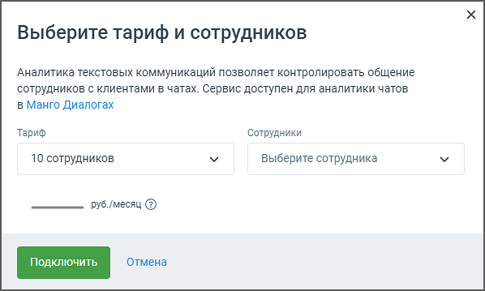

## 3.3. Аналитика текстовых коммуникаций

> Трассировка: PDF §3.3 · сквозные стр. 15-17 · источники: ч.1 `kb/sources/speech-analytics/RECHEVAYA-ANALITIKA_1.26.42.pdf` с.15-17.

**Внимание:**

Раздел доступен только при подключенной услуге «Диалоги» (омниканальные коммуникации). Если услуга не подключена, вместо настроек аналитики отображается ссылка для перехода на страницу подключения услуги «Диалоги».

Блок Аналитика текстовых коммуникаций позволяет настроить услугу аналитики текстовых коммуникаций, которая контролирует взаимодействие сотрудников с клиентами в чатах через

сервис МангоДиалоги. По нажатию на кнопку Настройки открывается окно "Выберите тариф и сотрудников":

> **Описание иллюстрации SA-§3.3-1** · к разделу §3.3 «Аналитика текстовых коммуникаций» · стр. 16 · снимок экрана / схема, 598×359 px.
> Относится к тексту руководства: «сервис МангоДиалоги. По нажатию на кнопку Настройки открывается окно "Выберите тариф и сотрудников":»
> Следующий за иллюстрацией текст: «В данном разделе пользователю предлагаются следующие возможности: 1. Выбор тарифа:  Пользователь может выбрать один из доступных тарифных планов в выпадающем списке. Тариф определяется количеством со…»
> Текст на изображении (OCR, требует сверки): Выберите тариф и сотрудников; Аналитика текстовых коммуникаций позволяет контролировать общение; сотрудников с клиентами в чатах. Сервис доступен для аналитики чатов; в Манго Диалогах; Тариф; Сотрудники; 10 сотрудников; Vv; Выберите сотрудника; отмена

В данном разделе пользователю предлагаются следующие возможности:

1. Выбор тарифа:

• Пользователь может выбрать один из доступных тарифных планов в выпадающем списке. Тариф определяется количеством сотрудников, чаты которых будут анализироваться (в примере на скриншоте выбран тариф на 10 сотрудников).

2. Выбор сотрудников:

• В данном поле отображается количество сотрудников, выбранных для аналитики (в примере на скриншоте Выбрано 9 из 10 сотрудников). В выпадающем списке можно выбрать сотрудников, чаты которых будут контролироваться. Для выбора доступны только те сотрудники, кто уже выбран для распознавания разговоров.

3. Стоимость услуги:

• В зависимости от выбранного тарифа автоматически рассчитывается ежемесячная стоимость услуги.

После выбора тарифа и сотрудников необходимо нажать кнопку Применить, чтобы активировать или изменить услугу.

Если пользователь передумал или не хочет вносить изменения, можно нажать кнопку Отмена, чтобы вернуться к предыдущему экрану без сохранения изменений.

Эта настройка позволяет гибко управлять количеством сотрудников, чаты которых будут анализироваться, а также контролировать расходы на услугу в зависимости от выбранного тарифа.
