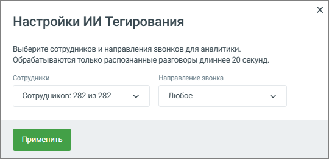

### 3.4.2. ИИ Тегирование

> Трассировка: PDF §3.4.2 · сквозные стр. 19-20 · источники: ч.1 `kb/sources/speech-analytics/RECHEVAYA-ANALITIKA_1.26.42.pdf` с.19-20.

Блок ИИ Тегирование позволяет настроить анализ разговоров и чатов сотрудников с использованием ИИ. Сервис анализирует разговоры не только по словам, но и по смыслу, что делает аналитику более точной и детализированной.

ИИ Тегирование доступно для клиентов с подключённой услугой распознавания разговоров и включено по умолчанию.

> **Описание иллюстрации SA-§3.4.2-1** · к разделу §3.4.2 «ИИ Тегирование» · стр. 19 · снимок экрана / схема, 540×262 px.
> Относится к тексту руководства: «ИИ Тегирование доступно для клиентов с подключённой услугой распознавания разговоров и включено по умолчанию.»
> Следующий за иллюстрацией текст: «1. Настройки сотрудников и направлений: По нажатию на кнопку Настройки пользователь может выбрать сотрудников, чьи звонки и чаты отправляются на анализ через ИИ. Открывается дополнительное окно Сотруд…»
> Текст на изображении (OCR, требует сверки): Настройки ИИ Тегирования; Выберите сотрудников и направления звонков для аналитики.; Обрабатываются только распознанные разговоры длиннее 20 секунд.; Сотрудники; Направление звонка; Сотрудников: 282 из 282; Любое

1. Настройки сотрудников и направлений: По нажатию на кнопку Настройки пользователь может выбрать сотрудников, чьи звонки и чаты отправляются на анализ через ИИ. Открывается дополнительное окно Сотрудники и направления для ИИ аналитики, где можно:

• Выбрать сотрудников (в примере на скриншоте выбрано 200 сотрудников из 226 возможных). Для выбора доступны только те сотрудники, кто уже настроен на распознавание разговоров и/или на аналитику текстовых коммуникаций. • Указать направления звонков для анализа: любое, входящие, исходящие или внутренние звонки. Разговоры короче 20 секунд не обрабатываются для определения ИИ-тематики.

2. После настройки сотрудников и направлений нужно нажать кнопку Применить, чтобы сохранить изменения и запустить анализ для выбранных параметров.

Эта настройка дает пользователю гибкость в управлении, позволяя выбирать конкретных сотрудников и направления звонков для более точного анализа с помощью ИИ.

Если сотрудника убирают из настроек распознавания и/или ИИ Тегирования, пользователь получает соответствующее уведомление.
