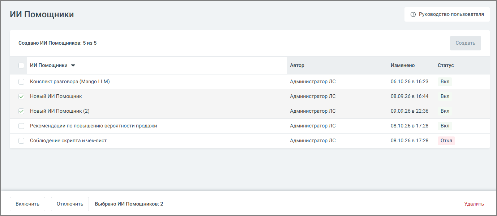
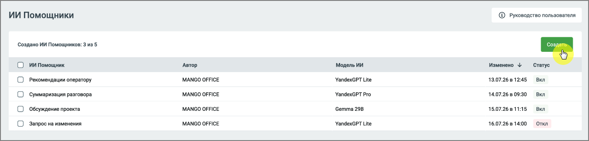
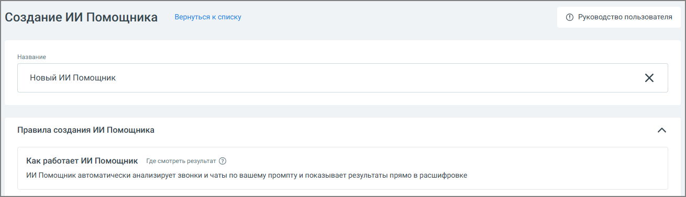
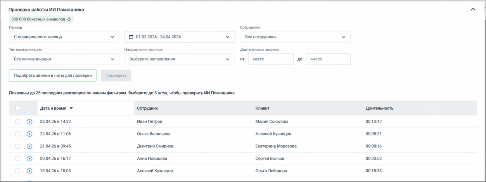
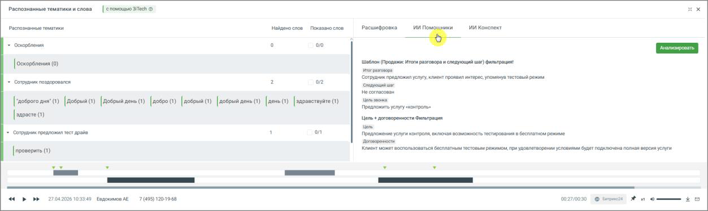

### 3.4.3. ИИ Помощники

> Трассировка: PDF §3.4.3 · сквозные стр. 20-28 · источники: ч.1 `kb/sources/speech-analytics/RECHEVAYA-ANALITIKA_1.26.42.pdf` с.20-28.

3.4.3.1 Что это такое и зачем нужно

ИИ Помощники - это инструмент, который позволяет автоматически анализировать разговоры по заданным вами правилам и получать не только краткое содержание, но и полезные выводы и рекомендации.

> **Описание иллюстрации SA-§3.4.3-1** · к разделу §3.4.3 «ИИ Помощники» · стр. 20 · снимок экрана / схема, 1375×600 px.
> Относится к тексту руководства: «ИИ Помощники - это инструмент, который позволяет автоматически анализировать разговоры по заданным вами правилам и получать не только краткое содержание, но и полезные выводы и рекомендации.»
> Следующий за иллюстрацией текст: «Чтобы включить, отключить или удалить сразу несколько ИИ Помощников, отметьте их чекбоксы в таблице. Панель групповых действий появляется внизу страницы только после того, как отмечен хотя бы один чек…»
> Текст на изображении (OCR, требует сверки): ИИ Помощники; © Руководство пользователя; ‘Создано ИИ Помощников: 5 из 5; Создать; ИИ Помощники У; Автор; Изменено; Конспект разговора (Mango LLM); ‘Администратор ЛС; 06.10.26 8 16:23; Вкл; Новый ИИ Помощник; 08.09.26 в 16:44; 09.09.26 в 22:36; Новый ИИ Помощник (2); Рекомендации по повышению вероятности продажи; 08.10.26 в 17:28; ‘Соблюдение скрипта и чек-лист; `Откл; Включить; Отключить; Выбрано ИИ Помощников: 2; Удалить

Чтобы включить, отключить или удалить сразу несколько ИИ Помощников, отметьте их чекбоксы в таблице. Панель групповых действий появляется внизу страницы только после того, как отмечен хотя бы один чекбокс. На панели отображается количество выбранных помощников и кнопки Включить, Отключить и Удалить. Чекбокс в заголовке таблицы отмечает всех помощников сразу.

В отличие от стандартных ИИ Конспектов, ИИ Помощники можно настраивать под конкретные задачи бизнеса. Вы сами определяете, что именно нужно искать и как интерпретировать разговор.

С помощью ИИ Помощников вы можете:

• контролировать соблюдение скриптов

• выявлять проблемы в диалогах с клиентами • получать рекомендации по улучшению работы сотрудников • анализировать разговоры с разных точек зрения одновременно

Один и тот же разговор может быть обработан несколькими помощниками, и каждый из них даст свой результат.

**Внимание:**

Настройки ИИ Помощника доступны и в том случае, если услуга «Распознавание разговоров» не подключена, — например, если планируется анализировать только чаты. Для новых пользователей раздел дополнен карточками онбординга, которые помогают быстрее разобраться с настройкой.

В Настройках, в блоке ИИ Помощники, отображается остаток бесплатных символов. Когда лимит исчерпан, вместо остатка отображается цена «от _ руб. за 1 000 символов». Оплачиваются только символы промпта и ответа ИИ, длина самого разговора не тарифицируется. Списание происходит каждую ночь, стоимость зависит от выбранной модели LLM.

3.4.3.2 Как создать ИИ Помощника

1. Перейдите в раздел ИИ Помощники 2. Нажмите кнопку Создать

> **Описание иллюстрации SA-§3.4.3-2** · к разделу §3.4.3 «ИИ Помощники» · стр. 21 · снимок экрана / схема, 1304×313 px.
> Относится к тексту руководства: «1. Перейдите в раздел ИИ Помощники 2. Нажмите кнопку Создать»
> Следующий за иллюстрацией текст: «3. Откроется форма создания нового ИИ Помощника»
> Текст на изображении (OCR, требует сверки): ИИ Помощники; @® руководство пользователя; ‘Создано ИИ Помощников: 3 из 5; Wi Помощник.; Автор; Модель ИИ; Изменено +; Статус:; MANGO OFFICE; YandexGPT Lite; 13.07.26 8 1245; Вкл; Рекомендации оператору; ‘Суммаризация разговора; ‘YandexGPT Pro; 14.07.26 в 09:30; ‘Обсуждение проекта; Gemma 298; 15.07.26 81115; Запрос на изменения; 16.07.26 8 14:00; ‘откл

3. Откроется форма создания нового ИИ Помощника

> **Описание иллюстрации SA-§3.4.3-3** · к разделу §3.4.3 «ИИ Помощники» · стр. 21 · снимок экрана / схема, 1310×377 px.
> Относится к тексту руководства: «3. Откроется форма создания нового ИИ Помощника»
> Следующий за иллюстрацией текст: «3.4.3.3 Настройка ИИ Помощника 1. Название - введите название помощника. Рекомендуется указывать название по задаче, например:  Контроль скрипта  Анализ жалоб  Проверка качества общения»
> Текст на изображении (OCR, требует сверки): Вернуться к списку; © Руководство пользователя; Создание ИИ Помощника; Название; Новый ИИ Помощник; Правила создания ИИ Помощника; Как работает ИИ Помощник Гдесмотреть результат ®; ИИ Помощник автоматически анализирует звонки и чаты по вашему промпту и показывает результаты прямо в расшифровке

3.4.3.3 Настройка ИИ Помощника

1. Название - введите название помощника. Рекомендуется указывать название по задаче, например:

• Контроль скрипта • Анализ жалоб • Проверка качества общения

Модель ИИ – выберите модель, на которой будет работать помощник. По умолчанию используется YandexGPT Lite. Если на аккаунте доступна модель MANGO GPT, ее также можно выбрать. Рядом с полем отображается подсказка с ценой за 1 000 символов. Если поменять модель у сохраненного помощника, новая цена применяется только к новым диалогам.

2. Промпт - определяет, какой именно результат будет получать пользователь. По сути, это описание задачи для анализа разговора. Чтобы результат был полезным:

• формулируйте задачу конкретно • указывайте, что именно нужно определить или сформулировать • задавайте формат ответа (например, кратко, с примерами, с оценкой и т.д.)

Один и тот же разговор может анализироваться по-разному в зависимости от промпта, поэтому рекомендуется создавать отдельные ИИ Помощники под разные задачи.

• введите текст задания для анализа разговора • при необходимости нажмите Улучшить, чтобы система помогла уточнить формулировку • можно использовать Библиотеку шаблонов и выбрать нужный промт

> **Описание иллюстрации SA-§3.4.3-4** · к разделу §3.4.3 «ИИ Помощники» · стр. 22 · снимок экрана / схема, 750×622 px.
> Относится к тексту руководства: «• введите текст задания для анализа разговора • при необходимости нажмите Улучшить, чтобы система помогла уточнить формулировку • можно использовать Библиотеку шаблонов и выбрать нужный промт»
> Следующий за иллюстрацией текст: «Примеры промта:  «Проанализируй диалог сотрудника с клиентом. Определи цель звонка, итог разговора, был ли согласован следующий шаг (какой именно) и на какую дату/время, а также наличие отказа и его …»
> Текст на изображении (OCR, требует сверки): Библиотека шаблонов; м Поиск; м Контроль скрипта для отдела продаж; v Анализ данных клиентов; м Обучение новых сотрудников; У Оптимизация процессов продаж; Vv Разработка стратегии маркетинга; @ Библиотека шаблонов; Промпт; Распознай текст; Проанализируй запись разговора и определи, содержит ли она вопросы или; Улучшить; утверждения, которые можно однозначно оценить как «Да» или «Нет».; $ Улучшить; Вернуть свой вариант

Примеры промта:

• «Проанализируй диалог сотрудника с клиентом. Определи цель звонка, итог разговора, был ли согласован следующий шаг (какой именно) и на какую дату/время, а также наличие отказа и его причины словами клиента.»

• «Ты оцениваешь диалог сотрудника контактного центра и клиента. В данном диалоге сотрудник пытался продать товар или услугу. Проанализируй диалог и дай свои рекомендации - что сотрудник мог бы улучшить в работе для повышения вероятности продажи. Отвечай емко и по существу. К каждой рекомендации делай отсылку к элементу диалога где обнаружена зона роста с указанием времени. Сделай максимум 5 ключевых рекомендаций не больше чем на 300 слов.»

3. Ответ ИИ Помощника - результат работы ИИ Помощника можно настроить под нужный уровень детализации. Возможны два подхода:

• единый общий вывод по разговору • структурированный ответ, разбитый на несколько частей

Разделение на части удобно, если требуется анализ по нескольким аспектам - например, в плеере отдельно выделить содержание разговора, принятые решения и последующие действия.

На примере ниже показан вариант настроек структурированного ответа в блоке настроек, а также итоговое отображение ответа в плеере звонка.

> **Описание иллюстрации SA-§3.4.3-5** · к разделу §3.4.3 «ИИ Помощники» · стр. 23 · снимок экрана / схема, 1042×610 px.
> Относится к тексту руководства: «На примере ниже показан вариант настроек структурированного ответа в блоке настроек, а также итоговое отображение ответа в плеере звонка.»
> Следующий за иллюстрацией текст: «4. Звонки и чаты для анализа - здесь задаётся, какие разговоры будет анализировать помощник. Можно указать:  сотрудников или группы  номера  тип коммуникации (звонки, чаты)  направление звонков  …»
> Текст на изображении (OCR, требует сверки): `Ответ ИИ Помощника; ` Название поля; ‘Итог разговора; ‘Описание:; ИИ Nom; mK; ИИ Конспект; Укажи итог звонка с точки зрения сценария продаж; Расшифровка; `Шаблон (Продажи: Итоги разговора и следующий шаг) фильтрация!; Итог разговора; Следующий war; ру; дник предложил; угу, клиент проявил интерес, упомянув тестовый режим; He согласован; ‘Согласованный следующий шаг с клиентом; редложить услугу «контроль».; Цель + договоренности Фильтрация; Цель; Предложение услуги контроля, включая возможность тестирования в бесплатном режиме; `Договоренности; Клиент может воспользоваться бесплатным тестовым р…

4. Звонки и чаты для анализа - здесь задаётся, какие разговоры будет анализировать помощник. Можно указать:

• сотрудников или группы • номера • тип коммуникации (звонки, чаты) • направление звонков • длительность разговора

Это позволяет применять помощника только к нужным диалогам.

5. Проверка работы ИИ Помощника

Перед использованием рекомендуется проверить работу:

1. Выберите период и фильтры

2. Нажмите Подобрать звонки и чаты для проверки 3. Выберите до 5 разговоров 4. Нажмите Проверить

Вы увидите, как помощник анализирует реальные диалоги.

> **Описание иллюстрации SA-§3.4.3-6** · к разделу §3.4.3 «ИИ Помощники» · стр. 24 · снимок экрана / схема, 1051×475 px.
> Относится к тексту руководства: «Вы увидите, как помощник анализирует реальные диалоги.»
> Следующий за иллюстрацией текст: «Если бесплатные символы еще доступны, в окне проверки отображается плашка с их остатком, обновить значение можно кнопкой рядом. Если лимит исчерпан, отображается предупреждение «Бесплатный лимит симво…»
> Текст на изображении (OCR, требует сверки): Se; Показаны до 25 последних разговоров по вашим фильтрам. Выберите до 5 штук, чтобы проверить ИИ Помощника; "Дата и время *; ‘Сотрудник; Клиент; Длительность,; 27.04.26 8 13:30; 7 (495) 120-19-68; Клиент #469545972; 00:00:12; итог разговора; Разговор не содержит информации о сценарии продаж, была только проверка связи; ‘Следующий шаг; Следующий шаг не согласован; Цель звонка; Проверка качества связи; 27.04.26 8 10:17; Евдокимов АЕ; Заказ перенесён на завтра; Перенос забора заказа на завтра; Клиент сообщил о невозможности забрать заказ в запланированный день и предложил перенести забор заказа

Если бесплатные символы еще доступны, в окне проверки отображается плашка с их остатком, обновить значение можно кнопкой рядом. Если лимит исчерпан, отображается предупреждение «Бесплатный лимит символов исчерпан. Тестирование будет тарифицироваться по цене выбранной модели». Проверка выполняется на модели, выбранной в форме в момент запуска, и оплачивается независимо от того, будет ли помощник сохранен.

Тестирование позволяет заранее проверить, как ИИ Помощник будет анализировать реальные разговоры, до его сохранения и включения в работу. Это даёт пользователю следующие преимущества:

• позволяет убедиться, что помощник правильно понимает задачу • помогает выявить неточности или ошибки в формулировке промпта • даёт возможность сравнить результат на нескольких разговорах • снижает риск получения некорректных или бесполезных выводов после запуска • экономит время, исключая необходимость последующей переработки настроек

В результате пользователь получает более точный и предсказуемый анализ разговоров сразу после включения помощника.

Для сохранения данных нажмите кнопку Создать. После этого помощник начнёт автоматически анализировать подходящие разговоры.

3.4.3.4 Где смотреть результаты

Чтобы посмотреть результат анализа:

1. Настройте фильтры

> **Описание иллюстрации SA-§3.4.3-7** · к разделу §3.4.3 «ИИ Помощники» · стр. 25 · снимок экрана / схема, 1253×471 px.
> Относится к тексту руководства: «1. Настройте фильтры»
> Следующий за иллюстрацией текст: «2. Откройте запись разговора 3. Нажмите кнопку прослушивания 4. В плеере перейдите во вкладку ИИ Помощник»
> Текст на изображении (OCR, требует сверки): Проверка работы ИИ Помощника; 500000 бонусных символов ©; epwon; Сотрудники; С позапрошлого месяца,; © 01.02.2026 -24.04.2026; Boe сотрудники,; Tun коммуникации; "Направления звонков; Длительность звонков; Boe коммуникации; Выберите направления; от; мысе:; до; Показаны до 25 последних разговоров по вашим фильтрам. Выберите до 5 штук, чтобы проверить ИИ Помощника; "Дата ивремя +; Сотрудник.; 23.0426 в1432; ‘иван Петров,; Мария Соколова; 0:12:47; 22.08.26 8 11:08; Ольга Васильева,; 000521; Алексей Кузнецов:; 21.0426 90945; 00:08:16; ` Дмитрий Смирнов; "Екатерина Морозова.; 20.0426 8 16:17; `Анна…

2. Откройте запись разговора 3. Нажмите кнопку прослушивания 4. В плеере перейдите во вкладку ИИ Помощник

> **Описание иллюстрации SA-§3.4.3-8** · к разделу §3.4.3 «ИИ Помощники» · стр. 25 · снимок экрана / схема, 1253×375 px.
> Относится к тексту руководства: «2. Откройте запись разговора 3. Нажмите кнопку прослушивания 4. В плеере перейдите во вкладку ИИ Помощник»
> Следующий за иллюстрацией текст: «Здесь отображаются:  ответы всех активных помощников  результаты анализа по каждому из них Один разговор может содержать несколько ответов - по числу активных помощников. Особенности работы  каждый…»
> Текст на изображении (OCR, требует сверки): Pacnoananinie тематики и слова; спомещь Tech @; Pacrosnaiense reat; ныщеносиов oxasako creo; + Ooops; oo; ae Sigg ==; wasn (Продаж итоги pasresepe ennui war) фильтрация; [osxennema 0; прок; сотурникпредуюмияуелуз момент гроявмя интерес yous Tres режим; = Corpynim coanepoesren; on; Creat ar; ie coenacca; ока; [rescore С) [добрый [добры non 1) [добъо С) [лобвый С) [добрые день (0 [лень [зиравстьуне 1); предрожить yey ивнтроль; farer; цель договоренности Cumerpawe; ene; + Cormac обедом ст доз; предтонания золу coupon arian возможность аетировзнии в беспл pene; ео; комент мометвоспользовтьсябесоло…

Здесь отображаются:

• ответы всех активных помощников • результаты анализа по каждому из них

Один разговор может содержать несколько ответов - по числу активных помощников.

Особенности работы

• каждый помощник работает независимо • один разговор может содержать несколько ответов - по числу активных ИИ Помощников • по умолчанию обрабатываются разговоры от 20 секунд, если иная длительность не задана в фильтре; система не позволяет задать в фильтре длительность менее 20 секунд • результаты отображаются вместе с расшифровкой, ИИ Конспектом и тематиками из любых отчетов • список созданных ИИ Помощников можно отсортировать по столбцу «Наименование» • помощники анализируют разговоры автоматически после их расшифровки

Рекомендации

• создавайте отдельных помощников под разные задачи • формулируйте промпт максимально конкретно • проверяйте результат на тестовых звонках перед использованием • при необходимости используйте кнопку Улучшить для доработки запроса

Примеры пользовательских сценариев

Пример 1. Контроль соблюдения скрипта продаж

Ситуация: Руководителю важно понимать, задают ли менеджеры обязательные вопросы клиенту.

Действия:

1. Пользователь создаёт ИИ Помощника 2. В поле «Промпт» указывает: «Проверь, задал ли сотрудник вопрос о потребностях клиента. Ответь Да или Нет и приведи фрагмент диалога» 3. В фильтрах выбирает: сотрудников отдела продаж o входящие звонки o

Результат: В плеере для каждого звонка появляется ответ:

• Да / Нет • цитата из разговора

Польза: Можно быстро выявить сотрудников, которые не соблюдают скрипт.

Пример 2. Поиск причин отказа клиента

Ситуация: Компания хочет понять, почему клиенты не покупают.

Действия:

1. Создаётся ИИ Помощник 2. Промпт: «Определи, была ли в разговоре причина отказа. Если была - сформулируй её кратко» 3. Фильтр: все звонки o длительность более 30 секунд o

Результат: В каждом разговоре появляется:

• причина отказа (если есть) • либо отметка, что отказ не выявлен

Польза: Позволяет собрать статистику причин отказов без ручного прослушивания.

Пример 3. Контроль качества общения

Ситуация: Нужно оценить, насколько корректно сотрудники общаются с клиентами.

Действия:

1. Создаётся ИИ Помощник 2. Промпт: «Оцени вежливость сотрудника по шкале от 1 до 5 и объясни оценку» 3. Фильтр: все сотрудники контакт-центра o

Результат: Для каждого звонка:

• оценка • комментарий

Польза: Можно быстро выявить проблемные диалоги и сотрудников.

Пример 4. Разные виды анализа одного звонка

Ситуация: В звонках нужно одновременно контролировать несколько аспектов.

Действия: Создаются несколько ИИ Помощников:

• один - проверяет скрипт • второй - ищет жалобы • третий - оценивает результат звонка

Результат: В одном разговоре отображаются:

• несколько ответов от разных помощников

Польза: Один звонок анализируется сразу по нескольким критериям.

Пример 5. Анализ только нужных звонков

Ситуация: Нужно анализировать только длинные разговоры поддержки.

Действия:

1. Создаётся ИИ Помощник 2. Настраивается фильтр: входящие звонки o длительность более 2 минут o сотрудники поддержки o

Результат: Анализируются только релевантные разговоры

Польза: Снижается шум, анализ становится точечным
