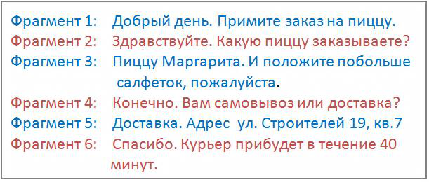

## 4.1. Термины и определения

> Трассировка: PDF §4.1 · сквозные стр. 30-32 · источники: ч.1 `kb/sources/speech-analytics/RECHEVAYA-ANALITIKA_1.26.42.pdf` с.30-32.

Канал – участник разговора, речь/текст которого анализируется. Пользователь может выбрать один из трех каналов:

• сотрудник • клиент • сотрудник и клиент

Фрагмент разговора – непрерывная речь или одно текстовое сообщение одного из участников разговора до момента вступления в разговор второго участника.

> **Описание иллюстрации SA-§4.1-1** · к разделу §4.1 «Термины и определения» · стр. 30 · снимок экрана / схема, 611×260 px.
> Относится к тексту руководства: «Фрагмент разговора – непрерывная речь или одно текстовое сообщение одного из участников разговора до момента вступления в разговор второго участника.»
> Следующий за иллюстрацией текст: «Терма – ключевое слово или словосочетание, которое необходимо найти в аудиозаписи разговора или в текстовом сообщении. Виды терм Простое слово. Например, слово окно. Допустим, пользователь ищет это сл…»
> Текст на изображении (OCR, требует сверки): Фрагмент 1; Добрый день. Примите заказ на пиццу.; Фрагмент 2; Здравствуйте. Какую пиццу заказываете?; Фрагмент 3; Пиццу Маргарита. И положите побольше; салфеток, пожалуйста.; Фрагмент 4; Конечно. Вам самовывоз или доставка?; Фрагмент 5; Доставка. Адрес ул. Строителей 19, кв.7; Фрагмент 6; Спасибо. Курьер прибудет в течение 40; минут.

Терма – ключевое слово или словосочетание, которое необходимо найти в аудиозаписи разговора или в текстовом сообщении.

Виды терм

Простое слово.

Например, слово окно.

Допустим, пользователь ищет это слово в речи клиента

Вхождение засчитывается, когда слово окно (с учетом словоформ: окна, окон и т. д.) будет найдено в каком-то из фрагментов разговора клиента.

Если слово окно будет найдено 5 раз в одном фрагменте или слово окно будет найдено в 5-ти разных фрагментах, то количество вхождений слова окно будет равно 5.

Словосочетание

Например, словосочетание купить окно.

Допустим, пользователь ищет это словосочетание в речи клиента

Вхождение засчитывается, когда одновременно слово купить и слово окно (с учетом словоформ) встретятся во фрагменте разговора клиента.

Например, если клиент сказал Хочу купить ваше пластиковое окно, терма купить окно засчитается.

Словосочетание в точном соответствии

Например “купить окно” (отличается от обычной фразы ТОЛЬКО кавычками)

Допустим, пользователь ищет в речи клиента словосочетание “купить окно”.

Вхождение засчитается только в том случае, когда во фрагменте речи клиента встретится фраза купить окно (с учетом словоформ).

Например, если клиент сказал Хочу купить ваше пластиковое окно, терма “купить окно” НЕ засчитается.

А если клиент сказал Я очень хочу купить окна, терма “купить окно” засчитается.

Слово или словосочетание без учета словоформ

Например !окно (отличается от обычной фразы ТОЛЬКО символом «!»)

Допустим, пользователь ищет это слово в речи клиента

Вхождение засчитывается, когда слово окно (без учета словоформ) будет найдено в каком-то из фрагментов разговора клиента.

Например, если в каком-то из фрагментов разговора клиент скажет Я купил одно окно в этой организации.

Чтобы закрепить все словоформы словосочетания, необходимо использовать символ «!» перед первым словом словосочетания - !купить окно.

Вхождение засчитывается, если в каком-то из фрагментов разговора клиент скажет Я хочу купить одно окно в этой организации.

Важно: Закрепить одно слово в словосочетании нельзя. Терма вида купить !окно является некорректной.

Для поискового запроса !окно, найденные слова "окна", "окон" не засчитываются как вхождение.

Слово или словосочетание в точном соответствии, без учета словоформ

«!купить окно» – используйте кавычки и символ ! для закрепления словоформы поискового запроса в точном соответствии.

!«купить окно» – второй вариант для закрепления словоформы поискового запроса в точном соответствии.

Вхождение засчитывается, если в каком-то из фрагментов разговора клиент скажет Я хочу купить окно с установкой.

Вхождение – факт наличия термы во фрагменте разговора. У одной термы может быть сколько угодно вхождений, в зависимости от того, сколько раз она встречалась в разговоре.

Фрагмент Разговор Канал Вхождение / Терма разговора

Фрагмент1 Примите заказ на пиццу Клиент

Какую пиццу

Фрагмент 2

заказываете? Сотрудник

Пиццу Маргарита и

Вхождение 1:

Вхождение 2: терма

Фрагмент 3

Четыре сезона Клиент

терма Маргарита

Четыре сезона

Самовывоз или

Фрагмент 4

доставка? Сотрудник

Сезоны с доставкой,

Вхождение 3:

Вхождение 4: терма

Фрагмент 5

Маргариту самовывоз Клиент

терма Маргарита

Доставка

Сообщите адрес

Фрагмент 6

доставки Сотрудник
