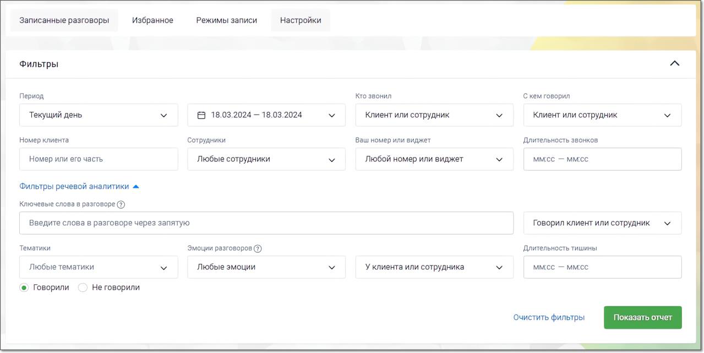
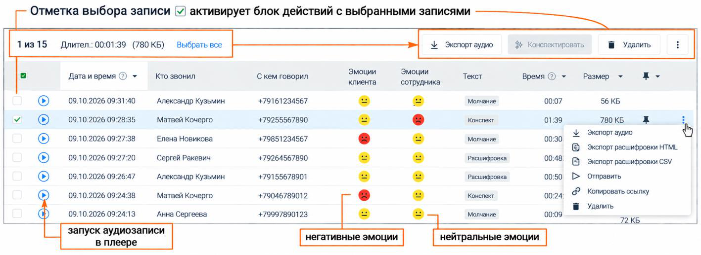

## 5.1. Поля формы модуля поиска в записях разговоров

> Трассировка: PDF §5.1 · сквозные стр. 34-36 · источники: ч.1 `kb/sources/speech-analytics/RECHEVAYA-ANALITIKA_1.26.42.pdf` с.34-36.

Во вкладке «Записанные разговоры» раздела Запись разговоров ЛК ВАТС можно просмотреть и отсортировать информацию, а также прослушать и скачать записанные разговоры.

Для поиска записанных разговоров воспользуйтесь фильтрами:

• Из выпадающего списка выберите период отчета либо укажите произвольный;

• Укажите значение в поле «Кто звонил»: Клиент либо Сотрудник;

• Для значения «Клиент» укажите часть номера или номер, с которого звонил клиент;

• Для значения «Сотрудник» выберите группу, конкретного сотрудника либо выберите значение «Любой сотрудник»;

• Аналогичным образом укажите значения для поля «С кем говорил»;

• Укажите номер или виджет МангоДиалоги, на который осуществился дозвон;

• При необходимости укажите длительность беседы: предусмотрена возможность выбора определенной длительности либо ввода произвольной длины разговора в формате мм:сс.;

**Дополнительные фильтры Речевой аналитики:**

• Поиск по распознанным записям разговоров. Введите ключевое слово или словосочетание, которое вы хотите найти в разговоре (например, "акция", "доставка", "оплата"). Нажмите кнопку "Enter", чтобы слово, которое вы ввели, стало поисковым тегом. Разрешенные для ввода в данное поле символы:

• Кавычки. " " и « »

• Дефис (тире)

• Запятая

• Буквы (кириллица, латиница)

• Пробел

Поиск доступен, если на ВАТС подключена услуга «Распознавание разговоров».

ПРИМЕР:

Требуется выяснить интерес покупателей к акции “Скоро лето“. Вводим в поле поиска запрос “скоро лето”, выбираем канал Клиент и получаем список распознанных записей разговоров, где клиенты интересовались акцией. Далее можно прослушать записи и выяснить степень заинтересованности клиента и другую информацию.

• Выберите, кто говорил эти слова: клиент или сотрудник. Также доступен вариант "никто не говорил".

• Выберите тематику разговора (например, "продажи", "поддержка", "технические вопросы").

• Выберите, хотите ли вы найти разговоры, относящиеся или не относящиеся к данным тематикам:

• Если выбрано Говорили, то в списке записей разговоров выводятся записи, на которые проставилась хотя бы одна из выбранных тематик.

• Если выбрано Не говорили, то не выводится ни одна запись, которая соответствует хотя бы одной из выбранных тематик. В списке разговоров будут только те записи, на которые не проставилась ни одна из выбранных тематик. Этот вариант может быть полезен,

например, при выявлении – кто из сотрудников забывает предлагать акционные продукты в разговоре с клиентом.

• Выберите эмоции, которые были выражены в разговоре: "любые эмоции", "негативные", "нейтральные". Эмоции разговоров определяет специальный алгоритм искусственного интеллекта, который анализирует как акустические (тембр, громкость), так и лингвистические характеристики.

• Если выбраны "негативные" или "нейтральные" эмоции, можно указать, кто именно – клиент или сотрудник – проявил эти эмоции в ходе разговора.

• Укажите длительность тишины. Изучение интервалов тишины может помочь руководителю выявить узкие места в рабочих процессах и процедурах обслуживания клиентов.

Нажмите Показать отчет для формирования списка записанных разговоров, удовлетворяющего условиям фильтров. Нажатие кнопки Очистить фильтры сбрасывает выбранные фильтры.

Если пользователь имеет ограниченные права доступа на прослушивание записей разговоров (например, “прослушивать только свои записи”), то в результатах поиска, по ключевым словам, будут только эти записи.

> **Описание иллюстрации SA-§5.1-1** · к разделу §5.1 «Поля формы модуля поиска в записях разговоров» · стр. 35 · снимок экрана / схема, 1279×641 px.
> Относится к тексту руководства: «Если пользователь имеет ограниченные права доступа на прослушивание записей разговоров (например, “прослушивать только свои записи”), то в результатах поиска, по ключевым словам, будут только эти записи.»
> Следующий за иллюстрацией текст: «При выборе одной или нескольких записей становятся доступными следующие действия:  Экспорт аудио – скачать выбранные записи на компьютер пользователя (не более 1 ГБ единоразово);  Конспектировать – …»
> Текст на изображении (OCR, требует сверки): Записанные разговоры; Избранное; Режимы записи; Настройки; Фильтры; Период; Кто звонил; С кем говорил; Текущий день.; В 18.03.2024 — 18.03.2024; Клиент или сотрудник; Номер клиента; Сотрудники; Ваш номер или виджет; Длительность звонков; Номер или его часть; Любые сотрудники; Любой номер или виджет; Mice — ммес; Фильтры речевой аналитики ^; Ключевые слова в разговоре @); Введите слова в разговоре через запятую; Говорил клиент или сотрудник; Тематики; Эмоции разговоров @); Длительность тишины; Любые тематики; Любые эмоции; Уклиента или сотрудника; ммсс — ммес; ©) Говорили; Не говорили; зать; че…

При выборе одной или нескольких записей становятся доступными следующие действия:

• Экспорт аудио – скачать выбранные записи на компьютер пользователя (не более 1 ГБ единоразово);

• Конспектировать – отправить выбранные записи на конспектирование с помощью ИИ. Если запись еще не расшифрована, она сначала отправляется на расшифровку.

• Удалить – удалить выбранные записи без возможности восстановления.

> **Описание иллюстрации SA-§5.1-2** · к разделу §5.1 «Поля формы модуля поиска в записях разговоров» · стр. 35 · пиктограмма (значок элемента интерфейса), 34×32 px.
> Относится к тексту руководства: «• Удалить – удалить выбранные записи без возможности восстановления.»
> Следующий за иллюстрацией текст: «Под пиктограммой доступны следующие опции:  Экспорт расшифровки HTML / Экспорт расшифровки CSV – скачать текстовую расшифровку записи в формате HTML или CSV (доступно, если запись расшифрована);  От…»
> Текста на изображении нет; назначение значка — см. текст, к которому он относится.

Под пиктограммой доступны следующие опции:

• Экспорт расшифровки HTML / Экспорт расшифровки CSV – скачать текстовую расшифровку записи в формате HTML или CSV (доступно, если запись расшифрована);

• Отправить – отправить запись на e-mail;

• Копировать ссылку – скопировать ссылку на запись.

Такое же меню открывается по пиктограмме ⋮ в строке записи; в нем также доступны Экспорт аудио и Удалить.

Также при выборе одной или нескольких записей выполняется подсчет общей длительности разговоров и объем файлов.

> **Описание иллюстрации SA-§5.1-3** · к разделу §5.1 «Поля формы модуля поиска в записях разговоров» · стр. 36 · снимок экрана / схема, 1417×517 px.
> Относится к тексту руководства: «Также при выборе одной или нескольких записей выполняется подсчет общей длительности разговоров и объем файлов.»
> Следующий за иллюстрацией текст: «Столбец Текст – тип текстового результата по записи: Расшифровка, Конспект или Молчание. Столбец Время – длительность разговора. Для того, чтобы добавить запись разговора в список «избранных», следует…»
> Текст на изображении (OCR, требует сверки): Отметка выбора записи; активирует блок действий с выбранными записями; 1из15 — Длител.: 00:01:39 (780 KB); Выбрать все; Экспорт аудио; нспектировать,; Удалить,; Эмоции; Дата и время © ~; Кто звонил; С кем говорил; клиента; Текст; Размер; ‘сотрудника; 09.10.2026 09:31:40; Александр Кузьмин; +79161234567; ` Молчание; 00:07; 56 КБ; 09.10.2026 09:28:35; Матвей Кочерго; +79255567890; Конспект; 01:39; 780 КБ; 09.10.2026 09:27:38; Елена Новикова; +79851234567; ' Молчание; 00:30; Экспорт расшифровки НТМЕ; 09.10.2026 09:27:20; Сергей Ракевич; +79264567890; Расшифровка; 00:48; Экспорт расшифровки CSV; 0…

Столбец Текст – тип текстового результата по записи: Расшифровка, Конспект или Молчание. Столбец Время – длительность разговора.

Для того, чтобы добавить запись разговора в список «избранных», следует в строке щелкнуть в

> **Описание иллюстрации SA-§5.1-4** · к разделу §5.1 «Поля формы модуля поиска в записях разговоров» · стр. 36 · пиктограмма (значок элемента интерфейса), 44×53 px.
> Относится к тексту руководства: «Для того, чтобы добавить запись разговора в список «избранных», следует в строке щелкнуть в»
> Следующий за иллюстрацией текст: «области столбца с пиктограммой и выбрать одну из следующих меток:»
> Текста на изображении нет; назначение значка — см. текст, к которому он относится.

области столбца с пиктограммой и выбрать одну из следующих меток:

> **Описание иллюстрации SA-§5.1-5** · к разделу §5.1 «Поля формы модуля поиска в записях разговоров» · стр. 36 · пиктограмма (значок элемента интерфейса), 42×41 px.
> Относится к тексту руководства: «области столбца с пиктограммой и выбрать одну из следующих меток:»
> Следующий за иллюстрацией текст: « – метка «Хороший звонок»; »
> Текста на изображении нет; назначение значка — см. текст, к которому он относится.

• – метка «Хороший звонок»;

•

> **Описание иллюстрации SA-§5.1-6** · к разделу §5.1 «Поля формы модуля поиска в записях разговоров» · стр. 36 · пиктограмма (значок элемента интерфейса), 42×41 px.
> Относится к тексту руководства: «•»
> Следующий за иллюстрацией текст: «– метка «Плохой звонок»;»
> Текста на изображении нет; назначение значка — см. текст, к которому он относится.

– метка «Плохой звонок»;

> **Описание иллюстрации SA-§5.1-7** · к разделу §5.1 «Поля формы модуля поиска в записях разговоров» · стр. 36 · пиктограмма (значок элемента интерфейса), 31×36 px.
> Относится к тексту руководства: «– метка «Плохой звонок»;»
> Следующий за иллюстрацией текст: « – метка «В избранное». Кликните по метке, чтобы ее снять.»
> Текста на изображении нет; назначение значка — см. текст, к которому он относится.

• – метка «В избранное».

Кликните по метке, чтобы ее снять.
