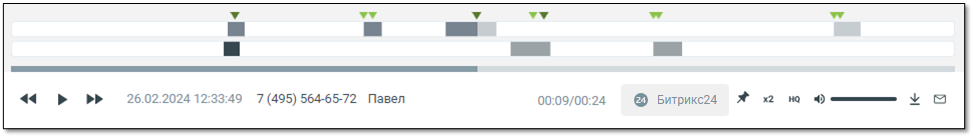
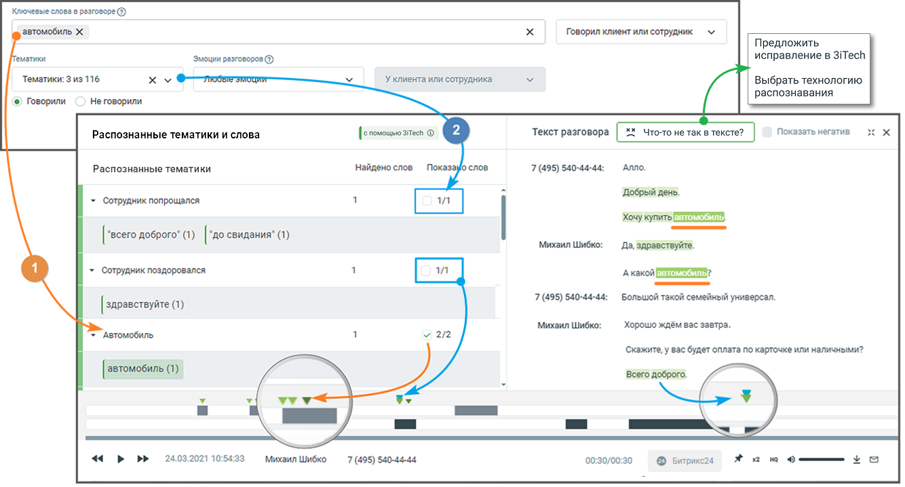
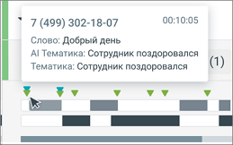
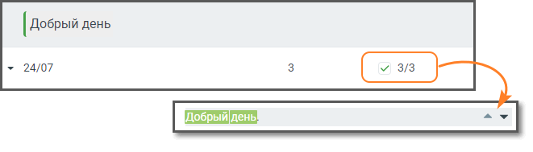
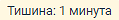
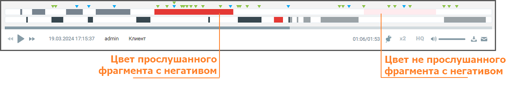
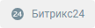
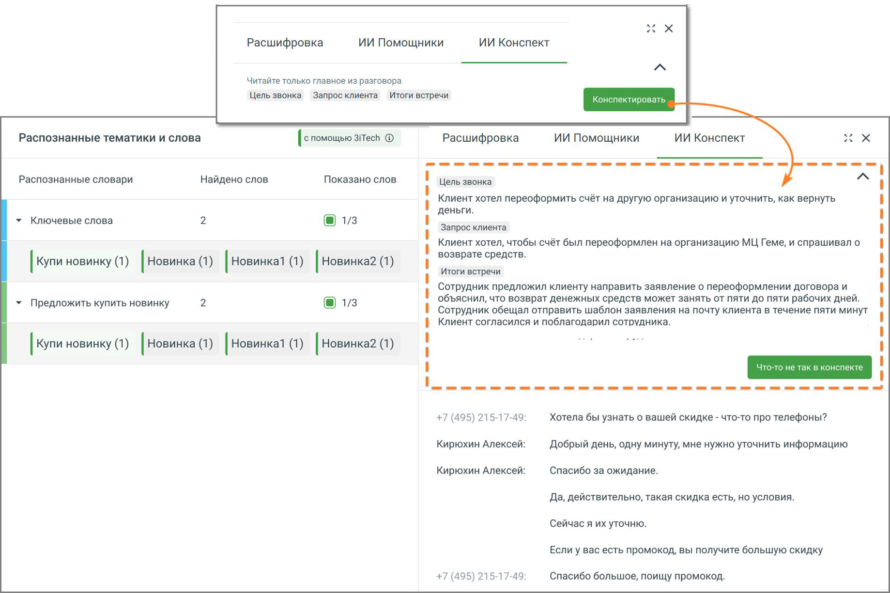
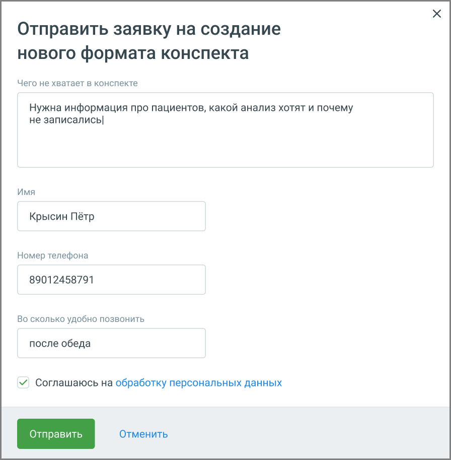

## 5.2. Прослушивание записей

> Трассировка: PDF §5.2 · сквозные стр. 36-41 · источники: ч.1 `kb/sources/speech-analytics/RECHEVAYA-ANALITIKA_1.26.42.pdf` с.36-41.

> **Описание иллюстрации SA-§5.2-1** · к разделу §5.2 «Прослушивание записей» · стр. 36 · пиктограмма (значок элемента интерфейса), 38×38 px.
> Относится к тексту руководства: начало раздела «Прослушивание записей».
> Следующий за иллюстрацией текст: «Для прослушивания записи следует нажать на иконку напротив наименования нужной записи.»
> Текста на изображении нет; назначение значка — см. текст, к которому он относится.

Для прослушивания записи следует нажать на иконку напротив наименования нужной записи.

> **Описание иллюстрации SA-§5.2-2** · к разделу §5.2 «Прослушивание записей» · стр. 36 · пиктограмма (значок элемента интерфейса), 30×29 px.
> Относится к тексту руководства: «Для прослушивания записи следует нажать на иконку напротив наименования нужной записи.»
> Следующий за иллюстрацией текст: «При этом иконка меняет вид на , что свидетельствует о том, что запись была добавлена в список воспроизведения в плеере. Одновременно в плеер допускается добавить не более одной записи.»
> Текста на изображении нет; назначение значка — см. текст, к которому он относится.

При этом иконка меняет вид на , что свидетельствует о том, что запись была добавлена в список воспроизведения в плеере. Одновременно в плеер допускается добавить не более одной записи.

> **Описание иллюстрации SA-§5.2-3** · к разделу §5.2 «Прослушивание записей» · стр. 36 · пиктограмма (значок элемента интерфейса), 20×20 px.
> Относится к тексту руководства: «При этом иконка меняет вид на , что свидетельствует о том, что запись была добавлена в список воспроизведения в плеере. Одновременно в плеер допускается добавить не более одной записи.»
> Следующий за иллюстрацией текст: «Пиктограмма означает, что доступна только текстовая расшифровка звонка.»
> Текста на изображении нет; назначение значка — см. текст, к которому он относится.

Пиктограмма означает, что доступна только текстовая расшифровка звонка.

> **Описание иллюстрации SA-§5.2-4** · к разделу §5.2 «Прослушивание записей» · стр. 36 · пиктограмма (значок элемента интерфейса), 29×29 px.
> Относится к тексту руководства: «Пиктограмма означает, что доступна только текстовая расшифровка звонка.»
> Следующий за иллюстрацией текст: «Запись, которая воспроизводится на данный момент, обозначается пиктограммой . Для управления прослушиванием используется встроенный плеер. Для отображения результатов поиска в распознанных записях раз…»
> Текста на изображении нет; назначение значка — см. текст, к которому он относится.

Запись, которая воспроизводится на данный момент, обозначается пиктограммой .

Для управления прослушиванием используется встроенный плеер.

Для отображения результатов поиска в распознанных записях разговоров используется осциллограмма на встроенном плеере, с выделенными фрагментами разговора.

> **Описание иллюстрации SA-§5.2-5** · к разделу §5.2 «Прослушивание записей» · стр. 36 · снимок экрана / схема, 974×138 px.
> Относится к тексту руководства: «Для отображения результатов поиска в распознанных записях разговоров используется осциллограмма на встроенном плеере, с выделенными фрагментами разговора.»
> Следующий за иллюстрацией текст: «В области плеера на тех участках разговора, где были вхождения ключевых слов, отображаются метки:»
> Текст на изображении (OCR, требует сверки): 26.02.2024 12:33:49 7 (495) 564-65-72 Павел; (00:09/00:24; © трико; оно

В области плеера на тех участках разговора, где были вхождения ключевых слов, отображаются метки:

> **Описание иллюстрации SA-§5.2-6** · к разделу §5.2 «Прослушивание записей» · стр. 36 · пиктограмма (значок элемента интерфейса), 24×24 px.
> Относится к тексту руководства: «В области плеера на тех участках разговора, где были вхождения ключевых слов, отображаются метки:»
> Следующий за иллюстрацией текст: «1) для ключевых слов, найденных из строки ввода поисковых запросов»
> Текста на изображении нет; назначение значка — см. текст, к которому он относится.

1)

для ключевых слов, найденных из строки ввода поисковых запросов

> **Описание иллюстрации SA-§5.2-7** · к разделу §5.2 «Прослушивание записей» · стр. 37 · пиктограмма (значок элемента интерфейса), 24×24 px.
> Относится к тексту руководства: «для ключевых слов, найденных из строки ввода поисковых запросов»
> Следующий за иллюстрацией текст: «2) для ключевых слов (терм) из пользовательских тематик»
> Текста на изображении нет; назначение значка — см. текст, к которому он относится.

2)

для ключевых слов (терм) из пользовательских тематик

> **Описание иллюстрации SA-§5.2-8** · к разделу §5.2 «Прослушивание записей» · стр. 37 · пиктограмма (значок элемента интерфейса), 18×16 px.
> Относится к тексту руководства: «для ключевых слов (терм) из пользовательских тематик»
> Следующий за иллюстрацией текст: «3) для ключевых слов (терм) из ИИ-тематик Если в левом блоке «Распознанные словари и слова» отметить какой-либо чекбокс, то в правом блоке «Текст разговора» ключевые слова будут визуально выделяться. …»
> Текста на изображении нет; назначение значка — см. текст, к которому он относится.

3) для ключевых слов (терм) из ИИ-тематик

Если в левом блоке «Распознанные словари и слова» отметить какой-либо чекбокс, то в правом блоке «Текст разговора» ключевые слова будут визуально выделяться. Метки на осциллограмме, соответствующие выбранному чекбоксу, также будут визуально выделяться более темным цветом:

> **Описание иллюстрации SA-§5.2-9** · к разделу §5.2 «Прослушивание записей» · стр. 37 · пиктограмма (значок элемента интерфейса), 19×16 px.
> Относится к тексту руководства: «… словари и слова» отметить какой-либо чекбокс, то в правом блоке «Текст разговора» ключевые слова будут визуально выделяться. Метки на осциллограмме, соответствующие выбранному чекбоксу, также будут визуально выделяться более темным цветом:»
> Следующий за иллюстрацией текст: «(см. пример 1 на рисунке ниже)»
> Текста на изображении нет; назначение значка — см. текст, к которому он относится.

> **Описание иллюстрации SA-§5.2-10** · к разделу §5.2 «Прослушивание записей» · стр. 37 · пиктограмма (значок элемента интерфейса), 18×16 px.
> Относится к тексту руководства: «… словари и слова» отметить какой-либо чекбокс, то в правом блоке «Текст разговора» ключевые слова будут визуально выделяться. Метки на осциллограмме, соответствующие выбранному чекбоксу, также будут визуально выделяться более темным цветом:»
> Следующий за иллюстрацией текст: «(см. пример 1 на рисунке ниже)»
> Текста на изображении нет; назначение значка — см. текст, к которому он относится.

(см. пример 1 на рисунке ниже)

> **Описание иллюстрации SA-§5.2-11** · к разделу §5.2 «Прослушивание записей» · стр. 37 · пиктограмма (значок элемента интерфейса), 24×24 px.
> Относится к тексту руководства: «(см. пример 1 на рисунке ниже)»
> Следующий за иллюстрацией текст: «Если чекбокс не отмечен (см. пример 2 на рисунке ниже), метка не меняет цвет.»
> Текста на изображении нет; назначение значка — см. текст, к которому он относится.

Если чекбокс не отмечен (см. пример 2 на рисунке ниже), метка не меняет цвет.

> **Описание иллюстрации SA-§5.2-12** · к разделу §5.2 «Прослушивание записей» · стр. 37 · снимок экрана / схема, 1334×718 px.
> Относится к тексту руководства: «Если чекбокс не отмечен (см. пример 2 на рисунке ниже), метка не меняет цвет.»
> Следующий за иллюстрацией текст: «Результаты поиска ключевых слов, заданных в строке поиска, с учетом тематик (инструмент расшифровки разговора включен).»
> Текст на изображении (OCR, требует сверки): Ключевые слова в разговоре @; ‚автомобиль X; Говорил клиент или сотрудник; Предложить; Тематики; Эмоции разговоров (©); исправление в 3iTech; Тематики: 3 из 116; ху; ou; `Уклиента или сотрудника; Выбрать технологию; распознавания; © Говорили; Неговорили; Распознанные тематики и слова; Ат; Текст разговора; 5% что-то He так в тексте?; Показать негатив; Распознанные тематики; ‘найдено слов; зауо слов; 7 (495) 540-44-44:; Anno.; "Добрый день.; > Сотрудник попрощался; р звтомобиль; / “всего доброго" (1) /“до свидания" (1); Михаил Шибко:; Да, здравствуйте.; > Сотрудник поздоровался; РС Давтомобиль:;…

Результаты поиска ключевых слов, заданных в строке поиска, с учетом тематик (инструмент расшифровки

разговора включен).

> **Описание иллюстрации SA-§5.2-13** · к разделу §5.2 «Прослушивание записей» · стр. 37 · пиктограмма (значок элемента интерфейса), 31×30 px.
> Относится к тексту руководства: «разговора включен).»
> Следующий за иллюстрацией текст: «Иконкой в блоке Распознанные тематики и слова обозначаются ИИ тематики.»
> Текста на изображении нет; назначение значка — см. текст, к которому он относится.

Иконкой в блоке Распознанные тематики и слова обозначаются ИИ тематики.

> **Описание иллюстрации SA-§5.2-14** · к разделу §5.2 «Прослушивание записей» · стр. 37 · фрагмент интерфейса (кнопка, переключатель, поле или подпись), 213×30 px.
> Относится к тексту руководства: «Иконкой в блоке Распознанные тематики и слова обозначаются ИИ тематики.»
> Следующий за иллюстрацией текст: «При наведении курсора на метки плеера отображается всплывающее окно с указанием канала, в рамках которого была распознаны ключевые слова, а также сами ключевые слова.»
> Текст на изображении (OCR, требует сверки): / # Сотрудник поздоровался

> **Описание иллюстрации SA-§5.2-15** · к разделу §5.2 «Прослушивание записей» · стр. 37 · пиктограмма (значок элемента интерфейса), 24×24 px.
> Относится к тексту руководства: «Иконкой в блоке Распознанные тематики и слова обозначаются ИИ тематики.»
> Следующий за иллюстрацией текст: «При наведении курсора на метки плеера отображается всплывающее окно с указанием канала, в рамках которого была распознаны ключевые слова, а также сами ключевые слова.»
> Текста на изображении нет; назначение значка — см. текст, к которому он относится.

> **Описание иллюстрации SA-§5.2-16** · к разделу §5.2 «Прослушивание записей» · стр. 37 · пиктограмма (значок элемента интерфейса), 18×16 px.
> Относится к тексту руководства: «Иконкой в блоке Распознанные тематики и слова обозначаются ИИ тематики.»
> Следующий за иллюстрацией текст: «При наведении курсора на метки плеера отображается всплывающее окно с указанием канала, в рамках которого была распознаны ключевые слова, а также сами ключевые слова.»
> Текста на изображении нет; назначение значка — см. текст, к которому он относится.

> **Описание иллюстрации SA-§5.2-17** · к разделу §5.2 «Прослушивание записей» · стр. 37 · пиктограмма (значок элемента интерфейса), 19×16 px.
> Относится к тексту руководства: «Иконкой в блоке Распознанные тематики и слова обозначаются ИИ тематики.»
> Следующий за иллюстрацией текст: «При наведении курсора на метки плеера отображается всплывающее окно с указанием канала, в рамках которого была распознаны ключевые слова, а также сами ключевые слова.»
> Текста на изображении нет; назначение значка — см. текст, к которому он относится.

> **Описание иллюстрации SA-§5.2-18** · к разделу §5.2 «Прослушивание записей» · стр. 37 · пиктограмма (значок элемента интерфейса), 18×16 px.
> Относится к тексту руководства: «Иконкой в блоке Распознанные тематики и слова обозначаются ИИ тематики.»
> Следующий за иллюстрацией текст: «При наведении курсора на метки плеера отображается всплывающее окно с указанием канала, в рамках которого была распознаны ключевые слова, а также сами ключевые слова.»
> Текста на изображении нет; назначение значка — см. текст, к которому он относится.

При наведении курсора на метки плеера отображается всплывающее окно с указанием канала, в рамках которого была распознаны ключевые слова, а также сами ключевые слова.

> **Описание иллюстрации SA-§5.2-19** · к разделу §5.2 «Прослушивание записей» · стр. 37 · снимок экрана / схема, 259×162 px.
> Относится к тексту руководства: «При наведении курсора на метки плеера отображается всплывающее окно с указанием канала, в рамках которого была распознаны ключевые слова, а также сами ключевые слова.»
> Следующий за иллюстрацией текст: «Выбор метки на плеере переводит воспроизведение записи разговора на участок, соответствующий метке.»
> Текст на изображении (OCR, требует сверки): * 7(499) 302-18-07; 00:10:05; Слово: Добрый день; Al Тематика: Сотрудник поздоровался; Тематика: Сотрудник поздоровался; vv; Le!; BO

Выбор метки на плеере переводит воспроизведение записи разговора на участок, соответствующий метке.

> **Описание иллюстрации SA-§5.2-20** · к разделу §5.2 «Прослушивание записей» · стр. 37 · пиктограмма (значок элемента интерфейса), 46×15 px.
> Относится к тексту руководства: «Выбор метки на плеере переводит воспроизведение записи разговора на участок, соответствующий метке.»
> Следующий за иллюстрацией текст: «Если разговор содержит несколько одинаковых терм или ключевых слов, пиктограммы позволяют быстро переключаться между фрагментами, содержащими выбранные термы/ключевые»
> Текста на изображении нет; назначение значка — см. текст, к которому он относится.

Если разговор содержит несколько одинаковых терм или ключевых слов, пиктограммы позволяют быстро переключаться между фрагментами, содержащими выбранные термы/ключевые

слова. Предварительно в левом блоке «Распознанные словари и слова» необходимо отметить соответствующие чекбоксы.

> **Описание иллюстрации SA-§5.2-21** · к разделу §5.2 «Прослушивание записей» · стр. 38 · снимок экрана / схема, 661×189 px.
> Относится к тексту руководства: «слова. Предварительно в левом блоке «Распознанные словари и слова» необходимо отметить соответствующие чекбоксы.»
> Следующий за иллюстрацией текст: «Если разговор содержит интервалы тишины, заданные в фильтрах, они отобразятся в»
> Текст на изображении (OCR, требует сверки): Добрый день; я 24/07

Если разговор содержит интервалы тишины, заданные в фильтрах, они отобразятся в

> **Описание иллюстрации SA-§5.2-22** · к разделу §5.2 «Прослушивание записей» · стр. 38 · фрагмент интерфейса (кнопка, переключатель, поле или подпись), 119×20 px.
> Относится к тексту руководства: «Если разговор содержит интервалы тишины, заданные в фильтрах, они отобразятся в»
> Следующий за иллюстрацией текст: «соответствующем месте расшифровки разговора: Если услуга «Расшифровка разговоров» отключена, тексты разговоров на плеере не отображаются.»

соответствующем месте расшифровки разговора:

Если услуга «Расшифровка разговоров» отключена, тексты разговоров на плеере не отображаются.

> **Описание иллюстрации SA-§5.2-23** · к разделу §5.2 «Прослушивание записей» · стр. 38 · пиктограмма (значок элемента интерфейса), 22×22 px.
> Относится к тексту руководства: «Если услуга «Расшифровка разговоров» отключена, тексты разговоров на плеере не отображаются.»
> Следующий за иллюстрацией текст: «Нажатие на иконку сворачивает окно записи разговора в компактный формат. Для отображения»
> Текста на изображении нет; назначение значка — см. текст, к которому он относится.

Нажатие на иконку сворачивает окно записи разговора в компактный формат. Для отображения

> **Описание иллюстрации SA-§5.2-24** · к разделу §5.2 «Прослушивание записей» · стр. 38 · пиктограмма (значок элемента интерфейса), 22×22 px.
> Относится к тексту руководства: «Нажатие на иконку сворачивает окно записи разговора в компактный формат. Для отображения»
> Следующий за иллюстрацией текст: «окна в полной форме следует нажать на иконку . При отметке чек-боксов «Показать негатив» в транскрибации и на плеере разговора, определенные, как содержащие негатив, будут выделяться фоновым цветом.»
> Текста на изображении нет; назначение значка — см. текст, к которому он относится.

окна в полной форме следует нажать на иконку .

При отметке чек-боксов «Показать негатив» в транскрибации и на плеере разговора, определенные, как содержащие негатив, будут выделяться фоновым цветом.

> **Описание иллюстрации SA-§5.2-25** · к разделу §5.2 «Прослушивание записей» · стр. 38 · снимок экрана / схема, 1278×215 px.
> Относится к тексту руководства: «При отметке чек-боксов «Показать негатив» в транскрибации и на плеере разговора, определенные, как содержащие негатив, будут выделяться фоновым цветом.»
> Следующий за иллюстрацией текст: «При закрытии ВАТС аудиозаписи разговоров становятся недоступны пользователю, но все еще находятся в файловом хранилище. Через 30 календарных дней аудиозаписи полностью удаляются из файлового хранилища…»
> Текст на изображении (OCR, требует сверки): у уу wrvy v; vwvwy; wy; уу уу; vy; Г м; ИИ; «pr; 19.03.2024 17:15:37; admin; Клиент; на; Цвет прослушанного; Цвет не прослушанного; фрагмента с негативом

При закрытии ВАТС аудиозаписи разговоров становятся недоступны пользователю, но все еще находятся в файловом хранилище. Через 30 календарных дней аудиозаписи полностью удаляются из файлового хранилища.

Плеер содержит основную информацию о звонке:

• ФИО клиента;

• Дата и время звонка;

• Длительность записи.

При необходимости нажмите:

> **Описание иллюстрации SA-§5.2-26** · к разделу §5.2 «Прослушивание записей» · стр. 38 · фрагмент интерфейса (кнопка, переключатель, поле или подпись), 126×20 px.
> Относится к тексту руководства: «При необходимости нажмите:»
> Следующий за иллюстрацией текст: « – приостановить/продолжить воспроизведение; переключиться на предыдущую\следующую запись;»

• – приостановить/продолжить воспроизведение; переключиться на предыдущую\следующую запись;

> **Описание иллюстрации SA-§5.2-27** · к разделу §5.2 «Прослушивание записей» · стр. 38 · фрагмент интерфейса (кнопка, переключатель, поле или подпись), 108×32 px.
> Относится к тексту руководства: «• – приостановить/продолжить воспроизведение; переключиться на предыдущую\следующую запись;»
> Следующий за иллюстрацией текст: « – перейти в CRM для ознакомления со статусом клиента. Включение функции возможно только если подключена интеграция с Bitrix24 (расширенный пакет), а также настроена передача данных в Речевую аналити…»
> Текст на изображении (OCR, требует сверки): @ Битрикс24

• – перейти в CRM для ознакомления со статусом клиента. Включение функции возможно только если подключена интеграция с Bitrix24 (расширенный пакет), а также настроена передача данных в Речевую аналитику.

> **Описание иллюстрации SA-§5.2-28** · к разделу §5.2 «Прослушивание записей» · стр. 38 · пиктограмма (значок элемента интерфейса), 22×20 px.
> Относится к тексту руководства: «• – перейти в CRM для ознакомления со статусом клиента. Включение функции возможно только если подключена интеграция с Bitrix24 (расширенный пакет), а также настроена передача данных в Речевую аналитику.»
> Следующий за иллюстрацией текст: « – добавить запись в список «избранных» и установить метку; »
> Текста на изображении нет; назначение значка — см. текст, к которому он относится.

• – добавить запись в список «избранных» и установить метку;

•

> **Описание иллюстрации SA-§5.2-29** · к разделу §5.2 «Прослушивание записей» · стр. 38 · пиктограмма (значок элемента интерфейса), 19×13 px.
> Относится к тексту руководства: «•»
> Следующий за иллюстрацией текст: «– изменить скорость воспроизведения. Варианты – 1х / 1,5х / 2х; »
> Текста на изображении нет; назначение значка — см. текст, к которому он относится.

– изменить скорость воспроизведения. Варианты – 1х / 1,5х / 2х;

•

> **Описание иллюстрации SA-§5.2-30** · к разделу §5.2 «Прослушивание записей» · стр. 38 · пиктограмма (значок элемента интерфейса), 19×13 px.
> Относится к тексту руководства: «•»
> Следующий за иллюстрацией текст: «– включение функции шумоподавления. Наличие функции зависит от текущего тарифного плана ВАТС. Включение функции возможно только при установленном флаге «Подавлять шумы при прослушивании» на закладке «…»
> Текста на изображении нет; назначение значка — см. текст, к которому он относится.

– включение функции шумоподавления. Наличие функции зависит от текущего тарифного плана ВАТС. Включение функции возможно только при установленном флаге «Подавлять шумы при прослушивании» на закладке «Настройки»;

•

> **Описание иллюстрации SA-§5.2-31** · к разделу §5.2 «Прослушивание записей» · стр. 38 · фрагмент интерфейса (кнопка, переключатель, поле или подпись), 118×16 px.
> Относится к тексту руководства: «•»
> Следующий за иллюстрацией текст: «– изменить громкость воспроизведения;»

– изменить громкость воспроизведения;

> **Описание иллюстрации SA-§5.2-32** · к разделу §5.2 «Прослушивание записей» · стр. 38 · пиктограмма (значок элемента интерфейса), 18×19 px.
> Относится к тексту руководства: «– изменить громкость воспроизведения;»
> Следующий за иллюстрацией текст: « – скачать запись;»
> Текста на изображении нет; назначение значка — см. текст, к которому он относится.

• – скачать запись;

> **Описание иллюстрации SA-§5.2-33** · к разделу §5.2 «Прослушивание записей» · стр. 39 · пиктограмма (значок элемента интерфейса), 19×15 px.
> Относится к тексту руководства: «• – скачать запись;»
> Следующий за иллюстрацией текст: « – отправить запись на e-mail. Если в настройках Речевой аналитики включена услуга ИИ Конспекты, в разделе Запись разговоров становится доступна функция просмотра автоматически сформированных резюме …»
> Текста на изображении нет; назначение значка — см. текст, к которому он относится.

• – отправить запись на e-mail.

Если в настройках Речевой аналитики включена услуга ИИ Конспекты, в разделе Запись разговоров становится доступна функция просмотра автоматически сформированных резюме звонков.

**Внимание:**

Функция доступна пользователям с доступом «Настройки распознавания, конспектов и агентов по сотрудникам и номерам». Доступ настраивается в ЛК ВАТС → Безопасность и ограничения → Настройка доступа → [выбрать роль] → Речевая аналитика.

Чтобы открыть конспект:

1. Перейдите в раздел Запись разговоров. Откройте нужный звонок. Нажмите кнопку Конспектировать.

2. В окне расшифровки звонка над текстом разговора сформируется ИИ Конспект — краткое содержание диалога, подготовленное ИИ. В нём будут выделены:

• цель звонка, • запрос клиента, • итоги встречи.

> **Описание иллюстрации SA-§5.2-34** · к разделу §5.2 «Прослушивание записей» · стр. 39 · снимок экрана / схема, 1838×1226 px.
> Относится к тексту руководства: «• цель звонка, • запрос клиента, • итоги встречи.»
> Следующий за иллюстрацией текст: «Персональные данные клиентов из конспекта исключены. Если в содержании конспекта что-то не соответствует реальному разговору, нажмите кнопку «Что- то не так в конспекте». Откроется форма, в которой мо…»
> Текст на изображении (OCR, требует сверки): Расшифровка; ИИ Помощники; ИИ Конспект; Читайте только главное из разговора; Цель звонка; Запрос клиента; Итоги встречи; Конспектировать; ne; Распознанные тематики и слова; / с помощью 3iTech @); Распознанные словари; Найдено слов; Показано слов; Клиент хотел переоформить счёт на другую организацию и уточнить, как вернуть; деньги.; > Ключевые слова; Клиент хотел, чтобы счёт был переоформлен на организацию МЦ Геме, и спрашивал о; возврате средств.; [Купи новинку (1) [ Новинка (1) / Новинкат (1) / Новинка? (1); Сотрудник предложил клиенту направить заявление о переоформлении договора и; объяснил…

Персональные данные клиентов из конспекта исключены.

Если в содержании конспекта что-то не соответствует реальному разговору, нажмите кнопку «Что- то не так в конспекте». Откроется форма, в которой можно:

• оставить комментарий;

• предложить, что добавить или изменить;

• указать контактные данные для обратной связи.

> **Описание иллюстрации SA-§5.2-35** · к разделу §5.2 «Прослушивание записей» · стр. 40 · снимок экрана / схема, 896×913 px.
> Относится к тексту руководства: «• указать контактные данные для обратной связи.»
> Следующий за иллюстрацией текст: «Также вы можете предложить свой вариант оформления резюме – собственный промт. Это полезно, если в стандартном конспекте не хватает информации или структура не соответствует задачам вашего бизнеса. Пр…»
> Текст на изображении (OCR, требует сверки): Отправить заявку на создание; нового формата конспекта; Чего не хватает в конспекте; Нужна информация про пациентов, какой анализ хотят и почему; не записались]; Имя; Крысин Пётр; Номер телефона; 89012458791; Во сколько удобно ПОЗВОНИТЬ; после обеда; У Соглашаюсь Ha обработку персональных данных

Также вы можете предложить свой вариант оформления резюме – собственный промт. Это полезно, если в стандартном конспекте не хватает информации или структура не соответствует задачам вашего бизнеса.

Промт — это текстовая инструкция, по которой ИИ формирует краткое содержание разговора. Вы можете указать, какие элементы должны быть включены, что стоит убрать или изменить. Это позволяет настраивать конспекты под особенности вашего бизнеса, например, добавить причины отказа клиента, эмоциональную реакцию или этапы обработки запроса.

Чтобы отправить предложение, откройте расшифровку любого звонка и нажмите кнопку Что-то не так в конспекте. Откроется форма обратной связи. В ней укажите, что именно вы хотите изменить, оставьте контактные данные и отметьте удобное время для связи.

Отправленные заявки поступают в команду продукта и сохраняются в системе. На основе пользовательских предложений разрабатываются новые шаблоны, которые могут быть добавлены в список доступных форматов конспектов.

Таким образом, вы получаете возможность влиять на работу ИИ и адаптировать резюме разговоров под потребности вашей компании.
