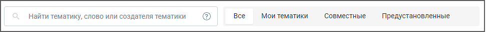
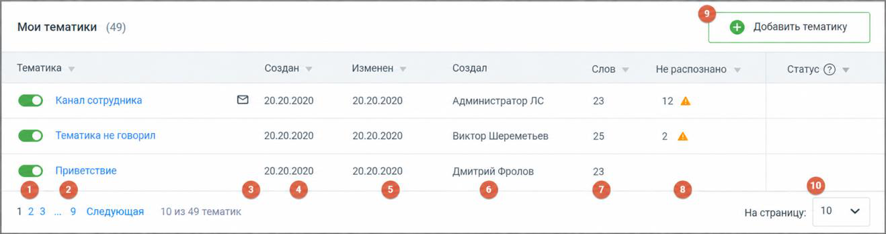

## 6.1. Тематики

> Трассировка: PDF §6.1 · сквозные стр. 41-42 · источники: ч.1 `kb/sources/speech-analytics/RECHEVAYA-ANALITIKA_1.26.42.pdf` с.41-42.

Рабочая область вкладки «Тематики» содержит:

• Поиск по тематикам;

• Фильтр по группам тематик;

• Кнопка добавления тематики;

• Таблицы по каждой группе тематик.

**Поиск по тематикам**

> **Описание иллюстрации SA-§6.1-1** · к разделу §6.1 «Тематики» · стр. 41 · снимок экрана / схема, 971×65 px.
> Относится к тексту руководства: «• Таблицы по каждой группе тематик.»
> Следующий за иллюстрацией текст: «Поле поиска позволяет искать тематики по запросу (без учета словоформ запроса):  в названиях тематик – найденная строка подсвечивается в результатах поиска;  в термах в составе тематик – включая пре…»
> Текст на изображении (OCR, требует сверки): найти тематику, слово или создателя тематики; Boe; Мои тематики; ‘Совместные; Предустановленные

Поле поиска позволяет искать тематики по запросу (без учета словоформ запроса):

• в названиях тематик – найденная строка подсвечивается в результатах поиска;

• в термах в составе тематик – включая предустановленные тематики (полное содержимое таких тематик скрыто в целях защиты авторских прав);

• в создателях тематик (ФИО) – найденная строка подсвечивается в результатах поиска.

**Фильтр по группам тематик**

Фильтр-переключатель ограничивает вывод тематик по группам: Мои тематики, Совместные, Предустановленные.

Доступность групп тематик определяется правами пользователя.

Тематика может иметь статус Активна/Неактивна. Распознанному разговору может присваиваться только активная тематика.

> **Описание иллюстрации SA-§6.1-2** · к разделу §6.1 «Тематики» · стр. 42 · снимок экрана / схема, 1318×348 px.
> Относится к тексту руководства: «Тематика может иметь статус Активна/Неактивна. Распознанному разговору может присваиваться только активная тематика.»
> Следующий за иллюстрацией текст: «1. Тумблер – для новых тематик по умолчанию включен. Система проверяет на вхождение только записи, распознанные после включения тумблера; 2. Название тематики; 3. Пиктограмма «e-mail» – отображается в…»
> Текст на изображении (OCR, требует сверки): Мои тематики (49); Тематика; Изменен; Слов; Создан >; Создал; Не распознано >; Статус @ т; «канал сотрудника; 20.20.2020; ‘Администратор ЛС; 23; 12 А; © тематика не говорил; Виктор Шереметьев; 25; 24; © приветствие; Дмитрий Фролов:; оо; 123; 9 Следующая; 10 из 49 тематик; Ha страницу:; 10

> **Описание иллюстрации SA-§6.1-3** · к разделу §6.1 «Тематики» · стр. 42 · пиктограмма (значок элемента интерфейса), 41×27 px.
> Относится к тексту руководства: «Тематика может иметь статус Активна/Неактивна. Распознанному разговору может присваиваться только активная тематика.»
> Следующий за иллюстрацией текст: «1. Тумблер – для новых тематик по умолчанию включен. Система проверяет на вхождение только записи, распознанные после включения тумблера; 2. Название тематики; 3. Пиктограмма «e-mail» – отображается в…»
> Текста на изображении нет; назначение значка — см. текст, к которому он относится.

1. Тумблер – для новых тематик по умолчанию включен. Система проверяет на вхождение только записи, распознанные после включения тумблера;

2. Название тематики;

3. Пиктограмма «e-mail» – отображается в случае настроенного уведомления на e-mail и/или СМС; 4. Когда создана тематика – дата в формате "ДД.ММ.ГГГГ"; 5. Когда изменена тематика – дата в формате "ДД.ММ.ГГГГ"; 6. Кем создана тематика – ФИО, для всех тематик, кроме предустановленных; 7. Количество слов в тематике – общее количество распознанных и нераспознанных терм в составе тематики; 8. Количество не распознанных слов – общее количество нераспознанных слов в составе тематики на момент отображения данных; 9. Кнопка добавления новой тематики. 10. Статус – показывает, на каком этапе находится повторное распознавание разговоров после изменения тематики. Для сортировки данных таблицы кликните по наименованию столбца.
