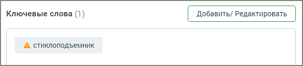
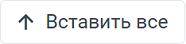
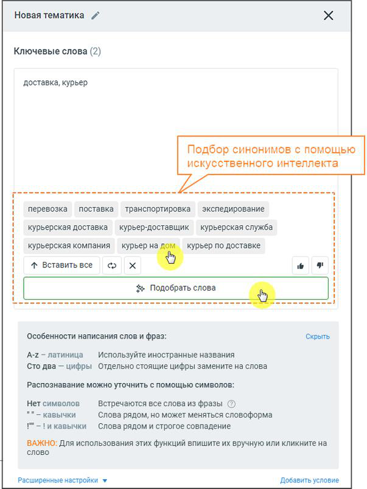

### 6.2.1. Ключевые слова

> Трассировка: PDF §6.2.1 · сквозные стр. 43-45 · источники: ч.1 `kb/sources/speech-analytics/RECHEVAYA-ANALITIKA_1.26.42.pdf` с.43-45.

Блок ключевых слов содержит следующие поля:

Название тематики. По умолчанию новая тематика именуется Новая тематика. Изменить

> **Описание иллюстрации SA-§6.2.1-1** · к разделу §6.2.1 «Ключевые слова» · стр. 43 · пиктограмма (значок элемента интерфейса), 28×30 px.
> Относится к тексту руководства: «Название тематики. По умолчанию новая тематика именуется Новая тематика. Изменить»
> Следующий за иллюстрацией текст: «название можно, щелкнув по пиктограмме . Допускается ввод не более 64 символов. Ключевые слова. При вводе терм в поле "Ключевые слова" производится проверка на наличие каждого слова в словаре распозна…»
> Текста на изображении нет; назначение значка — см. текст, к которому он относится.

название можно, щелкнув по пиктограмме . Допускается ввод не более 64 символов.

Ключевые слова. При вводе терм в поле "Ключевые слова" производится проверка на наличие каждого слова в словаре распознавания (с учетом словоформ). Если введенное слово отсутствует в словаре, оно выделяется пиктограммой «!». Вероятно, в написании слова имеется ошибка, поэтому оно не может быть распознано.

Речевая аналитика предложит исправить слово или добавить его в словарь распознавания.

Языковая модель Речевой аналитики регулярно обновляется новыми словами, добавленными пользователями в словарь распознавания.

> **Описание иллюстрации SA-§6.2.1-2** · к разделу §6.2.1 «Ключевые слова» · стр. 43 · снимок экрана / схема, 594×130 px.
> Относится к тексту руководства: «Языковая модель Речевой аналитики регулярно обновляется новыми словами, добавленными пользователями в словарь распознавания.»
> Следующий за иллюстрацией текст: «Подробнее о том, как сформулировать поисковый запрос, узнайте здесь. При помощи ИИ (искусственного интеллекта) пользователь может подобрать синонимы и аналогичные выражения к своему списку ключевых сл…»
> Текст на изображении (OCR, требует сверки): Добавить/ Редактировать; Ключевые слова (1); A стиклоподъемник

Подробнее о том, как сформулировать поисковый запрос, узнайте здесь.

При помощи ИИ (искусственного интеллекта) пользователь может подобрать синонимы и аналогичные выражения к своему списку ключевых слов. Для этого требуется указать несколько ключевых слов и нажать на кнопку «Подобрать слова». После этого в появившемся списке можно выбрать любое слово, и оно автоматически добавится в поле ключевых слов тематики. Лимит на количество запросов синонимов - 8 запросов в час.

Также в блоке ИИ доступны следующие действия:

> **Описание иллюстрации SA-§6.2.1-3** · к разделу §6.2.1 «Ключевые слова» · стр. 43 · снимок экрана / схема, 234×56 px.
> Относится к тексту руководства: «Также в блоке ИИ доступны следующие действия:»
> Следующий за иллюстрацией текст: «– клик по кнопке добавляет все предложенные синонимы в поле ключевых слов тематики.»
> Текст на изображении (OCR, требует сверки): \ Вставить все

– клик по кнопке добавляет все предложенные синонимы в поле ключевых слов тематики.

> **Описание иллюстрации SA-§6.2.1-4** · к разделу §6.2.1 «Ключевые слова» · стр. 43 · пиктограмма (значок элемента интерфейса), 58×56 px.
> Относится к тексту руководства: «– клик по кнопке добавляет все предложенные синонимы в поле ключевых слов тематики.»
> Следующий за иллюстрацией текст: «– обновить список синонимов.»
> Текста на изображении нет; назначение значка — см. текст, к которому он относится.

– обновить список синонимов.

> **Описание иллюстрации SA-§6.2.1-5** · к разделу §6.2.1 «Ключевые слова» · стр. 43 · пиктограмма (значок элемента интерфейса), 51×56 px.
> Относится к тексту руководства: «– обновить список синонимов.»
> Следующий за иллюстрацией текст: «– удалить все синонимы.»
> Текста на изображении нет; назначение значка — см. текст, к которому он относится.

– удалить все синонимы.

> **Описание иллюстрации SA-§6.2.1-6** · к разделу §6.2.1 «Ключевые слова» · стр. 44 · фрагмент интерфейса (кнопка, переключатель, поле или подпись), 109×56 px.
> Относится к тексту руководства: «– удалить все синонимы.»
> Следующий за иллюстрацией текст: «– отметить предложенные синонимы как подходящие или неподходящие.»
> Текст на изображении (OCR, требует сверки): gl

– отметить предложенные синонимы как подходящие или неподходящие.

> **Описание иллюстрации SA-§6.2.1-7** · к разделу §6.2.1 «Ключевые слова» · стр. 44 · снимок экрана / схема, 603×803 px.
> Относится к тексту руководства: «– отметить предложенные синонимы как подходящие или неподходящие.»
> Следующий за иллюстрацией текст: «После ввода ключевых слов следует настроить опции распознавания, кликнув по кнопке Расширенные настройки.»
> Текст на изображении (OCR, требует сверки): Новая тематика /; Ключевые слова (2); доставка, курьер; Подбор синонимов с помощью; искусственного интеллекта; перевозка; поставка; транспортировка; экспедирование; курьерская доставка; курьер-доставщик; курьерская служба; курьерская компания; курьерн; 4 Вставить все; со; oe 9; # Подобрать слова; Особенности написания слов и фраз:; A-Z — латиница; Используйте иностранные названия; Сто два — цифры Отдельно стоящие цифры замените на слова; Распознавание можно уточнить с помощью символов:; Нет символов; Встречаются все слова из фразы ©); ""- кавычки; Слова рядом, но может меняться словоформа; /" …

После ввода ключевых слов следует настроить опции распознавания, кликнув по кнопке Расширенные настройки.
