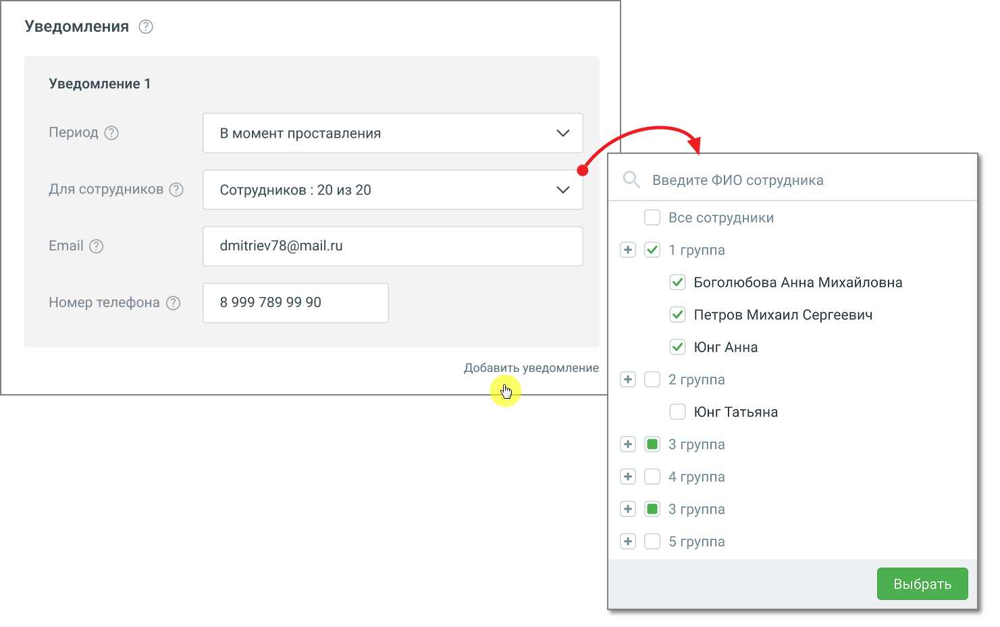

### 6.2.3. Настройка уведомлений

> Трассировка: PDF §6.2.3 · сквозные стр. 46-48 · источники: ч.1 `kb/sources/speech-analytics/RECHEVAYA-ANALITIKA_1.26.42.pdf` с.46-48.

При добавлении тематики пользователь задает ряд условий. Если срабатывают все заданные условия и звонок отмечается на соответствие тематике, пользователь получает уведомление по электронной почте или посредством СМС-сообщения.

> **Описание иллюстрации SA-§6.2.3-1** · к разделу §6.2.3 «Настройка уведомлений» · стр. 47 · снимок экрана / схема, 1481×929 px.
> Относится к тексту руководства: «При добавлении тематики пользователь задает ряд условий. Если срабатывают все заданные условия и звонок отмечается на соответствие тематике, пользователь получает уведомление по электронной почте или посредством СМС-сообщения.»
> Следующий за иллюстрацией текст: «Блок уведомлений состоит из строк. Каждая строка – отдельная настройка рассылки; для одной тематики можно добавить не более 10 строк. Строка содержит поля: Когда отправлять:  Не выбрано – установлено…»
> Текст на изображении (OCR, требует сверки): Уведомления ©; Уведомление 1; Период @; В момент проставления; Введите ФИО сотрудника; Для сотрудников (2); Сотрудников : 20 из 20; Все сотрудники; Email @; dmitriev78@mail.ru; У! 1 rpynna; У Боголюбова Анна Михайловна; Номер телефона (2); 8999 789 99 90; У. Петров Михаил Сергеевич; У ЮнгАнна; Добавить уведомление; 2 группа; Юнг Татьяна; @ Згруппа; 4 группа; 5 группа

Блок уведомлений состоит из строк. Каждая строка – отдельная настройка рассылки; для одной тематики можно добавить не более 10 строк. Строка содержит поля:

Когда отправлять:

• Не выбрано – установлено по умолчанию;

• В момент проставления – при выборе этого значения вам понадобится указать действующий адрес электронной почты, на который будут поступать уведомления о простановке звонку тематики; СМС-уведомления для этого периода недоступны: поле «Номер телефона» становится неактивным.

• За прошлый день – уведомление о проставлении звонкам тематик будут поступать один раз в день, в 11 часов по московскому времени. При выборе этого значения вам также необходимо указать действующий адрес электронной почты и/или номер телефона для СМС-сообщений;

• За прошлую неделю – уведомление о проставлении звонкам тематик будут поступать каждый понедельник, в 11 часов по московскому времени. При выборе этого значения необходимо указать действующий адрес электронной почты и/или номер телефона для СМС-сообщений (дополнительной оплаты доставки СМС-сообщений не требуется);

Кому отправлять – выбор сотрудников и групп.

Почта – адрес электронной почты для e-mail-уведомлений.

Номер телефона – номер для СМС-уведомлений. СМС-уведомления доступны только для периодов «За прошлый день» и «За прошлую неделю».

Значок корзины удаляет строку уведомления. Значок «+» в последней строке добавляет новую строку; после добавления 10 строк значок не отображается.

Поля проверяются при нажатии кнопки «Создать» или «Сохранить». Для периода «В момент проставления» необходимо указать почту, для периодов «За прошлый день» и «За прошлую неделю» – почту или номер телефона. Поля с ошибками подсвечиваются, под ними отображается текст ошибки; тематика не сохраняется, пока ошибки не исправлены. Полностью пустая строка удаляется при сохранении тематики.

После установки обновления модуля «Речевая аналитика» параметры уведомлений, настроенные до обновления, сохраняются.

**Правила рассылки уведомлений:**

1. Отдельные уведомления независимы друг от друга.

ПРИМЕР: В двух уведомлениях выбраны идентичные сотрудники, e-mail и номера телефона. В этом случае каждое из этих уведомлений рассылается независимо от другого.

2. Если на один e-mail/номер телефона настроено более одного уведомления "за прошлый день" (на, соответственно, более чем одну тематику), то информация агрегируется в одном письме/СМС.

3. Если на один e-mail/номер телефона настроено более одного уведомления "за прошлую неделю" (на, соответственно, более чем одну тематику), то информация агрегируется в одном письме/СМС.

4. Пользователям, желающим получать уведомления на звонках «клиент-клиент» (например, на ВАТС без сотрудников, используемой только для Речевой аналитики) для получения таких уведомлений необходимо выбрать в настройках хотя бы одного сотрудника.
