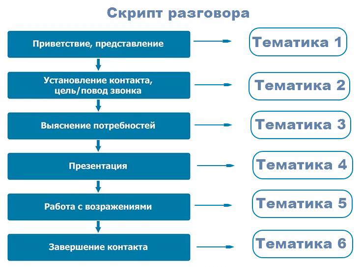
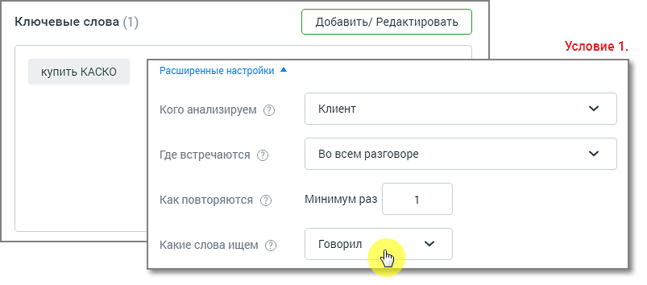
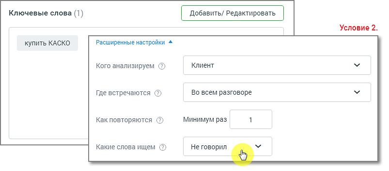
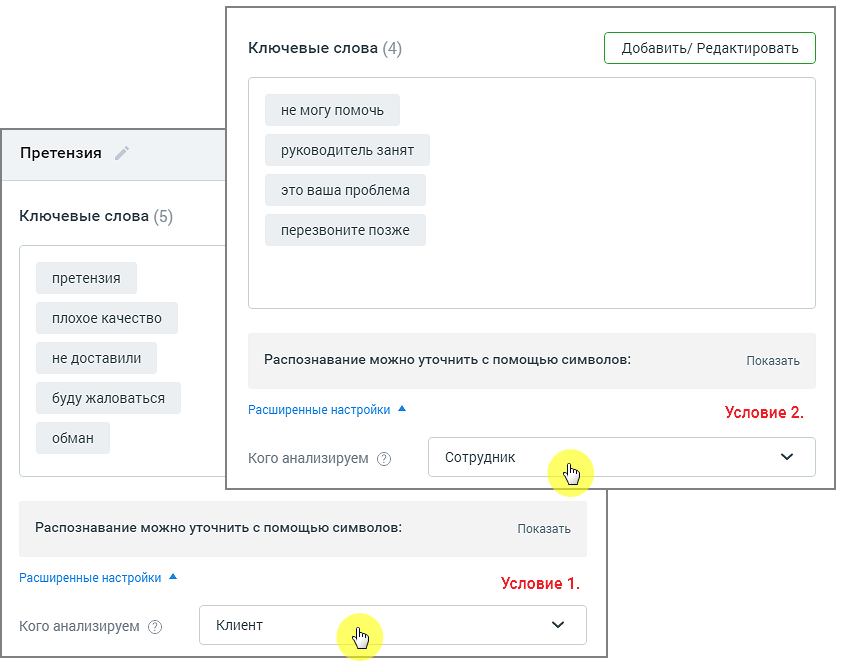

## 6.3. Советы по настройке тематик

> Трассировка: PDF §6.3 · сквозные стр. 48-51 · источники: ч.1 `kb/sources/speech-analytics/RECHEVAYA-ANALITIKA_1.26.42.pdf` с.48-51.

**Создавайте простые тематики, чтобы одна тематика решала максимум одну задачу.**

Лучше создать несколько узконаправленных тематик, нежели одну общую.

ПРИМЕР

Известны основные конкуренты компании, их преимущества, отличия и т. д. Клиенты в разговоре с сотрудниками сравнивают продукты компании с продуктами конкурентов, и руководителю важно понимать, с какими конкурентами сравнивают. Знать параметры по каким компания выигрывает, по каким проигрывает. Таким образом можно запланировать изменения в продукте/ ценовой политике/ позиционировании на рынке и т. д.

Решение: Создаем отдельные тематики для каждого из конкурентов с условиями Клиент, Говорил, Во всем разговоре и смотрим, как их упоминание меняется в динамике по времени.

На основании полученных данных в работу компании вносятся изменения: меняется ценовая политика, корректируются позиционирование продукта, уникальное торговое предложение, скрипты продаж.

**Создавайте несколько тематик для решения одной задачи.**

По данным отчетов вы сможете увидеть, на каком этапе разговора у сотрудников возникают проблемы.

> **Описание иллюстрации SA-§6.3-1** · к разделу §6.3 «Советы по настройке тематик» · стр. 49 · снимок экрана / схема, 735×545 px.
> Относится к тексту руководства: «По данным отчетов вы сможете увидеть, на каком этапе разговора у сотрудников возникают проблемы.»
> Следующий за иллюстрацией текст: «При настройке тематик не задавайте противоречащие друг другу условия. Пример двух противоречащих Условий 1 и 2 в одной тематике:»
> Текст на изображении (OCR, требует сверки): Скрипт разговора; Установление контакта,; цель/ повод звонка; — без; Выяснение потребностей; — биз; Работа с возражениями; ЕО

**При настройке тематик не задавайте противоречащие друг другу условия.**

Пример двух противоречащих Условий 1 и 2 в одной тематике:

> **Описание иллюстрации SA-§6.3-2** · к разделу §6.3 «Советы по настройке тематик» · стр. 49 · снимок экрана / схема, 803×354 px.
> Относится к тексту руководства: «Пример двух противоречащих Условий 1 и 2 в одной тематике:»
> Следующий за иллюстрацией текст: «Для заполнения поля “Какие слова ищем” ознакомьтесь с тем, как работает поиск по разговорам. Создавайте тематику из нескольких условий, только если это необходимо для решения конкретной задачи. Наприм…»
> Текст на изображении (OCR, требует сверки): Ключевые слова (1); Добавить/ Редактировать; Условие 1.; купить КАСКО; Расширенные настройки ^; Клиент; Кого анализируем (2); Где встречаются (5); Во всем разговоре; Как повторяются (5); Минимум раз; Какие слова ищем (5); Говорил

> **Описание иллюстрации SA-§6.3-3** · к разделу §6.3 «Советы по настройке тематик» · стр. 50 · снимок экрана / схема, 803×354 px.
> Относится к тексту руководства: «Пример двух противоречащих Условий 1 и 2 в одной тематике:»
> Следующий за иллюстрацией текст: «Для заполнения поля “Какие слова ищем” ознакомьтесь с тем, как работает поиск по разговорам. Создавайте тематику из нескольких условий, только если это необходимо для решения конкретной задачи. Наприм…»
> Текст на изображении (OCR, требует сверки): Ключевые слова (1); Добавить/ Редактировать; Условие 2.; купить КАСКО; Расширенные настройки ^; Клиент; Кого анализируем (2); Где встречаются (5); Во всем разговоре; Как повторяются (5); Минимум раз; Какие слова ищем (5); Не говорил

Для заполнения поля “Какие слова ищем” ознакомьтесь с тем, как работает поиск по разговорам.

**Создавайте тематику из нескольких условий, только если это необходимо для**

**решения конкретной задачи.**

Например, если в одном разговоре требуется проанализировать отдельно два канала – сотрудник и клиент – на соответствие разным условиям.

> **Описание иллюстрации SA-§6.3-4** · к разделу §6.3 «Советы по настройке тематик» · стр. 50 · снимок экрана / схема, 844×664 px.
> Относится к тексту руководства: «Например, если в одном разговоре требуется проанализировать отдельно два канала – сотрудник и клиент – на соответствие разным условиям.»
> Текст на изображении (OCR, требует сверки): Ключевые слова (4); Добавить/ Редактировать; не могу помочь; руководитель занят; Претензия; это ваша проблема; Ключевые слова (5); перезвоните позже; плохое качество; не доставили; Распознавание можно уточнить с помощью символов:; Показать; буду жаловаться; Расширенные настройки ^; Условие 2.; обман; Кого анализируем (5); Сотрудник; Условие 1.; Клиент
