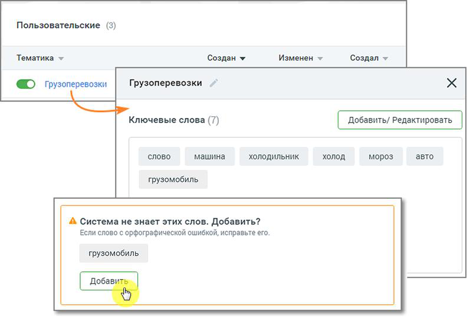
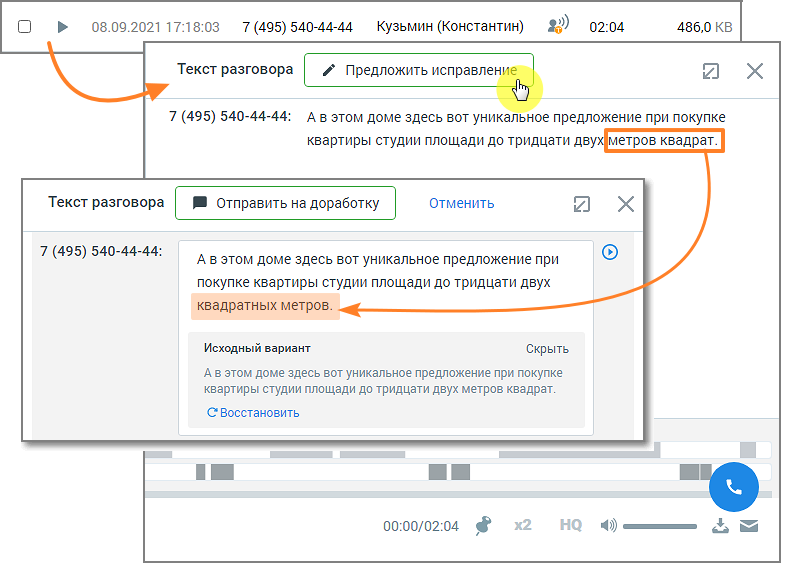
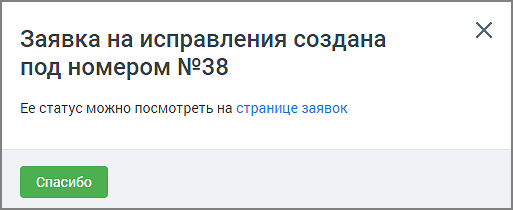
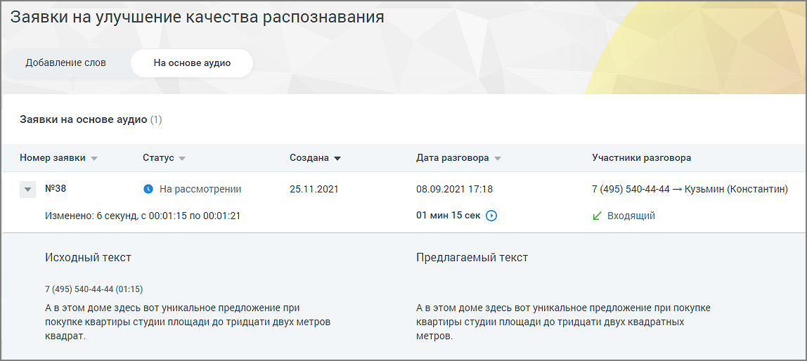

## 6.6. Заявки на улучшение качества распознавания

> Трассировка: PDF §6.6 · сквозные стр. 53-56 · источники: ч.1 `kb/sources/speech-analytics/RECHEVAYA-ANALITIKA_1.26.42.pdf` с.53-56.

Пользователь, который выбрал для распознавания технологию 3iTech, может отправить заявку на улучшение качества распознавания и отслеживать статус заявки в ЛК ВАТС.

**Внимание:**

Для доступа пользователя к разделу необходимо наличие права «Просматривать и создавать/изменять тематики»

**Добавление слов**

Чтобы отправить заявку на добавление слова, которое не знакомо «Речевой аналитике», следует в разделе «Тематики» выбрать тематику, в которой имеются незнакомые слова, и открыть карточку тематики.

> **Описание иллюстрации SA-§6.6-1** · к разделу §6.6 «Заявки на улучшение качества распознавания» · стр. 53 · снимок экрана / схема, 797×539 px.
> Относится к тексту руководства: «Чтобы отправить заявку на добавление слова, которое не знакомо «Речевой аналитике», следует в разделе «Тематики» выбрать тематику, в которой имеются незнакомые слова, и открыть карточку тематики.»
> Следующий за иллюстрацией текст: «Внизу карточки тематики будет присутствовать уведомление о незнакомом слове и предложение добавить его в систему. Нажмите кнопку Добавить. Заявка отобразится в окне раздела «Заявки на улучшение качест…»
> Текст на изображении (OCR, требует сверки): Пользовательские (3); Тематика ~; Создан v; Изменен *; Создал »; Грузоперевозки ~~; {О грузоперевозки; Ключевые слова (7); слово; машина; ХОЛОДИЛЬНИК; холод; мороз; авто; грузомобиль; А Система не знает этих слов. Добавить?; Если слово с орфографической ошибкой, исправьте его.

Внизу карточки тематики будет присутствовать уведомление о незнакомом слове и предложение добавить его в систему. Нажмите кнопку Добавить.

Заявка отобразится в окне раздела «Заявки на улучшение качества распознавания», на вкладке «Добавление слов».

> **Описание иллюстрации SA-§6.6-2** · к разделу §6.6 «Заявки на улучшение качества распознавания» · стр. 54 · снимок экрана / схема, 960×494 px.
> Относится к тексту руководства: «Заявка отобразится в окне раздела «Заявки на улучшение качества распознавания», на вкладке «Добавление слов».»
> Следующий за иллюстрацией текст: «Окно заявки содержит следующие данные:  Номер заявки  Статус заявки – на рассмотрении, исправления приняты, исправления отклонены.  Дата создания заявки  Дата, до которой будет рассмотрена заявка …»
> Текст на изображении (OCR, требует сверки): Заявки на улучшение качества распознавания; Добавление слов; На основе аудио; Заявки на добавление слов (1); Номер заявки; Статус; Создана *; Рассмотрение до; №1609; 24.05.2024 12:46; 08.06.2024; {© На рассмотрении; Слова для анализа:; © грузомобиль

Окно заявки содержит следующие данные:

• Номер заявки

• Статус заявки – на рассмотрении, исправления приняты, исправления отклонены.

• Дата создания заявки

• Дата, до которой будет рассмотрена заявка

Также в окне можно ознакомиться с предлагаемым для анализа словом.

**На основе аудио**

Чтобы отправить заявку на основе аудиозаписи, в окне расшифровки записи разговора следует нажать кнопку Предложить исправления.

> **Описание иллюстрации SA-§6.6-3** · к разделу §6.6 «Заявки на улучшение качества распознавания» · стр. 55 · снимок экрана / схема, 790×575 px.
> Относится к тексту руководства: «Чтобы отправить заявку на основе аудиозаписи, в окне расшифровки записи разговора следует нажать кнопку Предложить исправления.»
> Следующий за иллюстрацией текст: «Далее внесите в текст требуемое исправление и нажмите кнопку Отправить на доработку. На экране отобразится окно системного уведомления:»
> Текст на изображении (OCR, требует сверки): 08.09.2021 17:18:03; 7 (495) 540-44-44; Кузьмин (Константин); 02:04; 486,0 KB; Текст разговора; 7 Предложить исправле; wx; 7 (495) 540-44-44: AB этом доме здесь BOT уникальное предложение при покупке; квартиры студии площади до тридцати дв; отменить; Текст разговора / Ш Отправить на доработку; 7 (495) 540-44-44:; А в этом доме здесь вот уникальное предложение при; покупке квартиры студии площади до тридцати двух; квадратных метров.; Исходный вариант; Скрыть; А в этом доме здесь вот уникальное предложение при покупке; квартиры студии площади до тридцати двух метров квадрат.; С'Восстановить; 00:…

Далее внесите в текст требуемое исправление и нажмите кнопку Отправить на доработку. На экране отобразится окно системного уведомления:

> **Описание иллюстрации SA-§6.6-4** · к разделу §6.6 «Заявки на улучшение качества распознавания» · стр. 55 · снимок экрана / схема, 513×210 px.
> Относится к тексту руководства: «Далее внесите в текст требуемое исправление и нажмите кнопку Отправить на доработку. На экране отобразится окно системного уведомления:»
> Следующий за иллюстрацией текст: «Клик по ссылке открывает окно раздела «Заявки на улучшение качества распознавания», на вкладке «На основе аудио».»
> Текст на изображении (OCR, требует сверки): Заявка на исправления создана; под номером №38; Ее статус можно посмотреть на странице заявок

Клик по ссылке открывает окно раздела «Заявки на улучшение качества распознавания», на вкладке «На основе аудио».

> **Описание иллюстрации SA-§6.6-5** · к разделу §6.6 «Заявки на улучшение качества распознавания» · стр. 56 · снимок экрана / схема, 1148×514 px.
> Относится к тексту руководства: «Клик по ссылке открывает окно раздела «Заявки на улучшение качества распознавания», на вкладке «На основе аудио».»
> Следующий за иллюстрацией текст: «Окно заявки содержит следующие данные:  Номер заявки  Статус заявки – на рассмотрении, исправления приняты, исправления отклонены.  Дата создания заявки  Дата разговора и его длительность  Участн…»
> Текст на изображении (OCR, требует сверки): Заявки на улучшение качества распознавания; ‘Добавление слов.; Ha основе аудио; Заявки на основе аудио (1); Номер заявки >; "Статус; ‘Создана у; Дата разговора ~; Участники разговора; №38; © На рассмотрении; 25.11.2021; 08.09.2021 17:18; 7 (495) 540-44-44 — Кузьмин (Константин); изменено: 6 секунд, с 00:01:15 по 00:01:21; 01 мин 15 сек ©); ~ входящий; Исходный текст; Предлагаемый текст; 7 (495) 540-44-44 (01:15); AB этом доме здесь вот уникальное предложение при; Ав этом доме здесь вот уникальное предложение при покупке; покупке квартиры студии площади до тридцати двух метров.; квартиры студии…

Окно заявки содержит следующие данные:

• Номер заявки

• Статус заявки – на рассмотрении, исправления приняты, исправления отклонены.

• Дата создания заявки

• Дата разговора и его длительность

• Участники разговора и информация о звонке (входящий или исходящий)

Также в окне можно ознакомиться с исходным и предлагаемым к замене текстом.

О времени выполнения заявки пользователь уведомляется системным сообщением.
