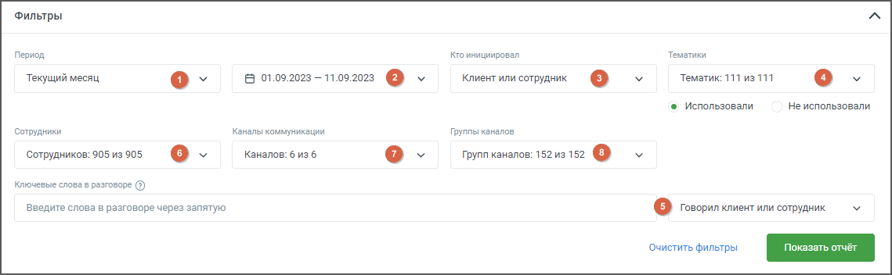
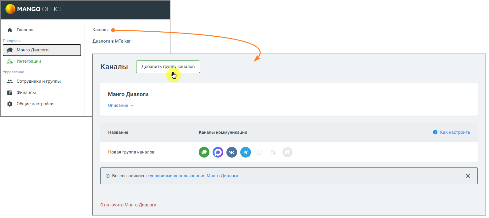
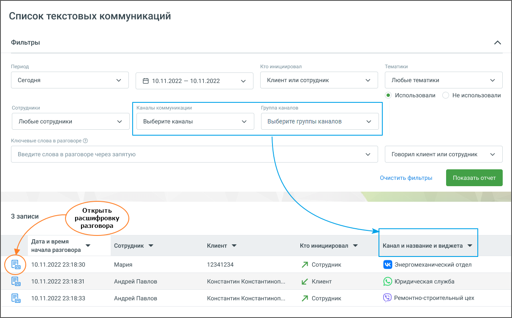

## 7.1. Список текстовых коммуникаций

> Трассировка: PDF §7.1 · сквозные стр. 59-61 · источники: ч.1 `kb/sources/speech-analytics/RECHEVAYA-ANALITIKA_1.26.42.pdf` с.59-61.

При переходе на страницу «Текстовые коммуникации» отображается панель фильтров. На панели присутствуют:

> **Описание иллюстрации SA-§7.1-1** · к разделу §7.1 «Список текстовых коммуникаций» · стр. 59 · снимок экрана / схема, 1139×352 px.
> Относится к тексту руководства: «При переходе на страницу «Текстовые коммуникации» отображается панель фильтров. На панели присутствуют:»
> Следующий за иллюстрацией текст: « Период – в какой период состоялись диалоги, которые должны войти в отчет. Выпадающее меню, с вариантами периода: произвольный, текущий день, текущая неделя, текущий месяц, с прошлого месяца, с позап…»
> Текст на изображении (OCR, требует сверки): Фильтры; Период; ro инициировал; Тематики; Текущий месяц; Клиент или сотрудник; `Тематик; 111 из 111; В 01.09.2023 - 11.09.2023 @ v; © Использовали; He использовали.; Сотрудники; Каналы коммучикации; Группы каналов; ‘Сотрудников: 905 из 905; Каналов: 6 из 6; roynn каналов 1529152 @; Ключевые слова в разговоре (©); Введите слова в разговоре через запятую; © перилами сотрудник; Очистить фильтры

• Период – в какой период состоялись диалоги, которые должны войти в отчет. Выпадающее меню, с вариантами периода: произвольный, текущий день, текущая неделя, текущий месяц, с прошлого месяца, с позапрошлого месяца, текущий год, весь период;

• Календарь – для указания временного промежутка, когда были осуществлены диалоги, которые должны войти в отчет. После выбора дат, нужно подтвердить выбор кнопкой «Выбрать»;

• Выпадающий список Кто инициировал диалог – канал поиска. Варианты: клиент, сотрудник, клиент или сотрудник.

• Тематики – поиск проводится как по всем распознанным текстовым сообщениям, так и по сообщениям определенной тематики. Для поиска по тематикам в выпадающем списке выберите необходимый вариант.

При вводе поискового запроса производится проверка на наличие каждого слова в словаре распознавания (с учетом словоформ).

Возможен выбор как включенных, так и исключенных из поиска тематик.

Если выбрано Использовали, то в списке выводятся диалоги, на которые проставилась хотя бы одна из выбранных тематик.

Если выбрано Не использовали, в списке будут только те диалоги, на которые не проставилась ни одна из выбранных тематик.

ИИ тематики – дополнительный фильтр для поиска чатов по тематикам, распознанным с помощью ИИ Тегирования. Выбранная в фильтре ИИ тематика передаётся в плеер вместе с открытой перепиской.

• Строка для ввода ключевых слов – терм. Подробнее о том, как формулировать поисковые запросы, узнайте здесь. В выпадающем списке доступен выбор канала, по которому будет вестись поиск. Варианты: Клиент, Сотрудник, Клиент или сотрудник.

• Сотрудники – выпадающий список всех сотрудников, сгруппированный по группам. Имеется строка поиска по ФИО сотрудника и кнопка Выбрать все/Сбросить все.

• Каналы коммуникации – выбор из выпадающего списка каналов коммуникации, доступных в разделе МангоДиалоги → Каналы. Варианты: Чат на сайте, ВКонтакте, Viber, Telegram, WhatsApp, Avito.

• Группы каналов – выбор из выпадающего списка групп каналов коммуникации, созданных в разделе МангоДиалоги → Каналы.

> **Описание иллюстрации SA-§7.1-2** · к разделу §7.1 «Список текстовых коммуникаций» · стр. 60 · снимок экрана / схема, 1555×696 px.
> Относится к тексту руководства: «• Группы каналов – выбор из выпадающего списка групп каналов коммуникации, созданных в разделе МангоДиалоги → Каналы.»
> Следующий за иллюстрацией текст: «После настройки необходимых фильтров и добавления ключевых слов нажмите кнопку Показать отчет. Отобразится список разговоров, удовлетворяющих заданным условиям поиска.»
> Текст на изображении (OCR, требует сверки): Главная; Каналы; Продукты; Диалоги в MTalker; \® Манго Диалоги; & Интеграции; Управление; Сотрудники и группы; Финансы; Манго Диалоги; 3 Общие настройки; Описание У; Название; Каналы коммуникации; © Какнастроить; Новая группа каналов; 00090; © Bel согласились с условиями использования Манго Диалоги.; ‘Отключить Манго Диалоги

После настройки необходимых фильтров и добавления ключевых слов нажмите кнопку Показать отчет. Отобразится список разговоров, удовлетворяющих заданным условиям поиска.

> **Описание иллюстрации SA-§7.1-3** · к разделу §7.1 «Список текстовых коммуникаций» · стр. 60 · снимок экрана / схема, 1212×755 px.
> Относится к тексту руководства: «После настройки необходимых фильтров и добавления ключевых слов нажмите кнопку Показать отчет. Отобразится список разговоров, удовлетворяющих заданным условиям поиска.»
> Следующий за иллюстрацией текст: «После нажатия на кнопку Открыть расшифровку разговора, отображается текст разговора с осциллограммой. Если пользователь имеет ограниченные права доступа на просмотр текстовых разговоров, то в результа…»
> Текст на изображении (OCR, требует сверки): Список текстовых коммуникаций; Фильтры; Период; kro инициировал; Тематики; Любые тематики; Сегодня; В 10.11.2022 - 10.11.2022; Клиент или сотрудник; ©) Использовали; Не использовали; Сотрудники; Каналы коммуникации; Группа каналов; Любые сотрудники; Выберите каналы; выберите группы каналов; Ключевые слова в разговоре @; Введите слова в разговоре через запятую; Говорил клиент или сотрудник; Открыть; 3 записи; расшифровку; разговора; Дата и время; Сотрудник У; Клиент У; Кто инициировал У; Канал и название и виджета У; начала разговора; 10.11.2022 23:18:30; Мария; 12341234; A\ сотрудник; (© энерг…

После нажатия на кнопку Открыть расшифровку разговора, отображается текст разговора с осциллограммой.

Если пользователь имеет ограниченные права доступа на просмотр текстовых разговоров, то в результатах поиска, по ключевым словам, будут только доступные ему разговоры.
