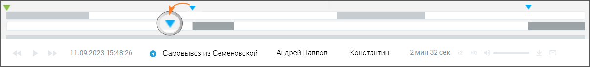
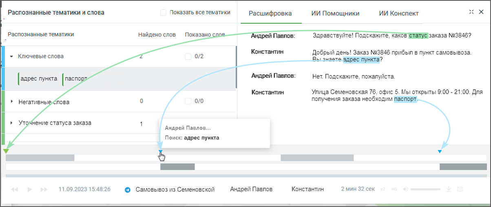
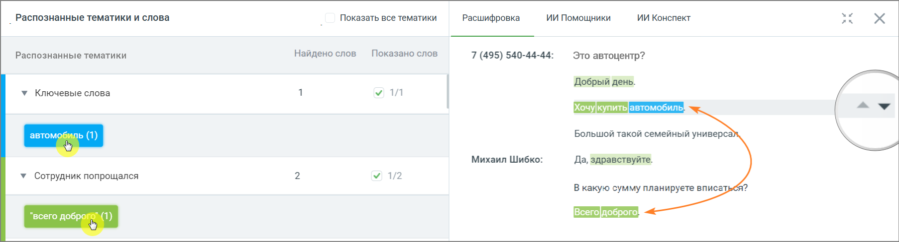

## 7.3. Метки на осциллограмме диалога

> Трассировка: PDF §7.3 · сквозные стр. 61-62 · источники: ч.1 `kb/sources/speech-analytics/RECHEVAYA-ANALITIKA_1.26.42.pdf` с.61-62.

Для отображения результатов поиска в текстовых сообщениях используется осциллограмма диалога, с выделенными фрагментами диалога.

> **Описание иллюстрации SA-§7.3-1** · к разделу §7.3 «Метки на осциллограмме диалога» · стр. 61 · снимок экрана / схема, 1207×138 px.
> Относится к тексту руководства: «Для отображения результатов поиска в текстовых сообщениях используется осциллограмма диалога, с выделенными фрагментами диалога.»
> Следующий за иллюстрацией текст: «При наведении курсора в область осциллограммы на тех участках диалога, где были вхождения терм, отображаются:»
> Текст на изображении (OCR, требует сверки): 11.09.2023 15:48:26; © Самовывоз из Семеновской; Андрей Павлов; Константин; 2мин 32 сек

При наведении курсора в область осциллограммы на тех участках диалога, где были вхождения терм, отображаются:

> **Описание иллюстрации SA-§7.3-2** · к разделу §7.3 «Метки на осциллограмме диалога» · стр. 61 · пиктограмма (значок элемента интерфейса), 24×24 px.
> Относится к тексту руководства: «При наведении курсора в область осциллограммы на тех участках диалога, где были вхождения терм, отображаются:»
> Следующий за иллюстрацией текст: « метка для терм, найденных из строки ввода ключевых слов;»
> Текста на изображении нет; назначение значка — см. текст, к которому он относится.

• метка для терм, найденных из строки ввода ключевых слов;

> **Описание иллюстрации SA-§7.3-3** · к разделу §7.3 «Метки на осциллограмме диалога» · стр. 61 · пиктограмма (значок элемента интерфейса), 24×24 px.
> Относится к тексту руководства: «• метка для терм, найденных из строки ввода ключевых слов;»
> Следующий за иллюстрацией текст: « метка для терм из тематик.»
> Текста на изображении нет; назначение значка — см. текст, к которому он относится.

• метка для терм из тематик.

> **Описание иллюстрации SA-§7.3-4** · к разделу §7.3 «Метки на осциллограмме диалога» · стр. 61 · пиктограмма (значок элемента интерфейса), 24×24 px.
> Относится к тексту руководства: «• метка для терм из тематик.»
> Следующий за иллюстрацией текст: «При наведении курсора на метки и осциллограммы отображается всплывающее окно с указанием канала, в рамках которого была распознана терма, а также сама терма. Поиск по текстовым сообщениям может осущес…»
> Текста на изображении нет; назначение значка — см. текст, к которому он относится.

> **Описание иллюстрации SA-§7.3-5** · к разделу §7.3 «Метки на осциллограмме диалога» · стр. 61 · пиктограмма (значок элемента интерфейса), 24×24 px.
> Относится к тексту руководства: «• метка для терм из тематик.»
> Следующий за иллюстрацией текст: «При наведении курсора на метки и осциллограммы отображается всплывающее окно с указанием канала, в рамках которого была распознана терма, а также сама терма. Поиск по текстовым сообщениям может осущес…»
> Текста на изображении нет; назначение значка — см. текст, к которому он относится.

При наведении курсора на метки и осциллограммы отображается всплывающее окно с указанием канала, в рамках которого была распознана терма, а также сама терма.

Поиск по текстовым сообщениям может осуществляться:

• по ключевым словам, в строке поиска;

• с учетом выбранных в фильтре тематик.

Соответственно будут различаться метки на осциллограмме диалога.

> **Описание иллюстрации SA-§7.3-6** · к разделу §7.3 «Метки на осциллограмме диалога» · стр. 62 · снимок экрана / схема, 1204×508 px.
> Относится к тексту руководства: «Соответственно будут различаться метки на осциллограмме диалога.»
> Следующий за иллюстрацией текст: « Если во всплывающем окне осциллограммы в списке тематик выбрать какую-либо тематику, то на осциллограмме будут отображены метки, принадлежащие только этой тематике, и не будут отображены метки, прин…»
> Текст на изображении (OCR, требует сверки): Распознанные тематики и слова; Показать все тематики; ИИ Конспект; Расшифровка; ИИ Помощники; найдено слов; Показано.; заказа №3846?; _ Распознанные тематики; Здравствуйте! Подскажите, како:; + Ключевые слова; 0/2; Константин; Добрый день! Заказ №3846 прибыл в пункт самовывоза; Андрей Павлов:; Her Подскажите, пожалуйста.; [soe [sin; Улица Семеновская 76, офис 5. Мы открыты 9:00 - 21:00. Для; Негативньк; ‘лова; o/0; получения заказа необходим; Андрей Павлов.; / > Уто4Нение статуса заказа; Поиск: адрес пункта; 11.09.2023 15:48:26; 2 мин 32 сек; © Самовывоз из Семеновской; Андрей Павлов

 Если во всплывающем окне осциллограммы в списке тематик выбрать какую-либо тематику, то на

осциллограмме будут отображены метки, принадлежащие только этой тематике, и не будут отображены метки, принадлежащие другим тематикам из списка.

 Если во всплывающем окне осциллограммы в списке ключевых слов выбрать какое-либо ключевое

слово, то на осциллограмме будут отображены метки, принадлежащие только этому ключевому слову, и не будут отображены метки, принадлежащие другим ключевым словам из списка.

Выбор термы или ключевого слова в блоке «Распознанные тематики и слова» выделяет фрагмент

> **Описание иллюстрации SA-§7.3-7** · к разделу §7.3 «Метки на осциллограмме диалога» · стр. 62 · пиктограмма (значок элемента интерфейса), 46×15 px.
> Относится к тексту руководства: «Выбор термы или ключевого слова в блоке «Распознанные тематики и слова» выделяет фрагмент»
> Следующий за иллюстрацией текст: «диалога, с этой термой/ключевым словом. Пиктограммы позволяют быстро переключаться между фрагментами, содержащими выбранные термы/ключевые слова.»
> Текста на изображении нет; назначение значка — см. текст, к которому он относится.

диалога, с этой термой/ключевым словом. Пиктограммы позволяют быстро переключаться между фрагментами, содержащими выбранные термы/ключевые слова.

> **Описание иллюстрации SA-§7.3-8** · к разделу §7.3 «Метки на осциллограмме диалога» · стр. 62 · снимок экрана / схема, 1806×488 px.
> Относится к тексту руководства: «диалога, с этой термой/ключевым словом. Пиктограммы позволяют быстро переключаться между фрагментами, содержащими выбранные термы/ключевые слова.»
> Следующий за иллюстрацией текст: «Клик по пиктограмме сворачивает окно диалога в компактный формат. Для отображения окна в»
> Текст на изображении (OCR, требует сверки): Распознанные тематики и слова; Показать все тематики; Расшифровка; ИИ Помощники; ИИ Конспект; хи; як; Показано слов; Распознанные тематики; Найдено слов; 7 (495) 540-44-44:; Это автоцентр?; Добрый день.; у Ключевые слова; у 1; aw; Большой такой семейный yHuBepca); Михаил Шибко:; Да, здравствуйте.; У Сотрудник попрощался; У 1/2; В какую сумму планируете вписат,

> **Описание иллюстрации SA-§7.3-9** · к разделу §7.3 «Метки на осциллограмме диалога» · стр. 62 · пиктограмма (значок элемента интерфейса), 22×22 px.
> Относится к тексту руководства: «диалога, с этой термой/ключевым словом. Пиктограммы позволяют быстро переключаться между фрагментами, содержащими выбранные термы/ключевые слова.»
> Следующий за иллюстрацией текст: «Клик по пиктограмме сворачивает окно диалога в компактный формат. Для отображения окна в»
> Текста на изображении нет; назначение значка — см. текст, к которому он относится.

Клик по пиктограмме сворачивает окно диалога в компактный формат. Для отображения окна в

> **Описание иллюстрации SA-§7.3-10** · к разделу §7.3 «Метки на осциллограмме диалога» · стр. 62 · пиктограмма (значок элемента интерфейса), 22×22 px.
> Относится к тексту руководства: «Клик по пиктограмме сворачивает окно диалога в компактный формат. Для отображения окна в»
> Следующий за иллюстрацией текст: «полной форме следует нажать на пиктограмму .»
> Текста на изображении нет; назначение значка — см. текст, к которому он относится.

полной форме следует нажать на пиктограмму .
