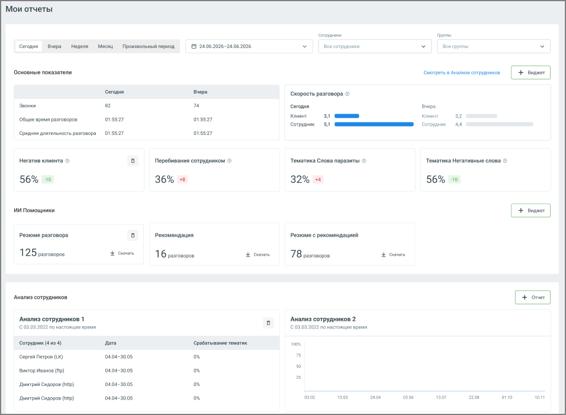

## 8.1. Мои отчеты

> Трассировка: PDF §8.1 · сквозные стр. 63-64 · источники: ч.1 `kb/sources/speech-analytics/RECHEVAYA-ANALITIKA_1.26.42.pdf` с.63-64.

Страница Мои отчеты – главный экран отчетов Речевой аналитики. На ней собраны ключевые показатели разговоров, сводка по ИИ Помощникам и сохраненные отчеты Анализ сотрудников.

> **Описание иллюстрации SA-§8.1-1** · к разделу §8.1 «Мои отчеты» · стр. 63 · снимок экрана / схема, 956×701 px.
> Относится к тексту руководства: «Страница Мои отчеты – главный экран отчетов Речевой аналитики. На ней собраны ключевые показатели разговоров, сводка по ИИ Помощникам и сохраненные отчеты Анализ сотрудников.»
> Следующий за иллюстрацией текст: «Фильтры. В верхней части страницы расположены фильтры: период (Сегодня, Вчера, Неделя, Месяц, Произвольный период), Сотрудники и Группы. По умолчанию выбраны период «Сегодня»,»
> Текст на изображении (OCR, требует сверки): Мои отчеты; expan; mt; cera; up; een; eons; pmsormsh namo; © 2406 2025-2405.2026; ee conprnnon; ce eye; основные показатели; орет ловли сятиииоя; сода; Pep; скорость разговора ©; eo; m4; coro; sepa; ‘use spew раиоверов; orssar; ovssa7; owe; ove; за; сотни; тва; ее; Coen ararensioen роовора; Horan кливнтя ©; Перобивания сотрудником ©; Тематика Слово паразиты ©; Томотика Негэтноные слова ©; 56% 5; ИИ помощники; резюме разговора; рекомендация; резюме с рекомендацией; 125 pascoaovee; она; 1 6 pascoaopoe; omar; 78 posxoa0p0e; нь; Аналио сотрудников; ‘Анализ сотрудников 1; Анализ сотрудников 2; (203…

Фильтры. В верхней части страницы расположены фильтры: период (Сегодня, Вчера, Неделя, Месяц, Произвольный период), Сотрудники и Группы. По умолчанию выбраны период «Сегодня»,

все сотрудники и все группы. Фильтры применяются к блокам Основные показатели и ИИ Помощники. Выбранные значения сохраняются и восстанавливаются при следующем входе на страницу.

Основные показатели. Блок отображает показатели разговоров за выбранный период и их изменение относительно предыдущего периода такой же длительности: сегодня – по сравнению со вчера, неделя – с прошлой неделей, месяц – с прошлым месяцем. По умолчанию отображаются: звонки, общее время и средняя длительность разговоров, скорость разговора сотрудника и клиента, негатив клиента, перебивания сотрудником, тематики «Слова паразиты» и «Негативные слова». Для показателей, рост которых нежелателен (негатив, перебивания, доля обоюдного молчания), рост выделяется красным цветом, снижение – зеленым; изменения остальных показателей отображаются серым. Кнопка Виджет добавляет в блок другие показатели разговора, тематики и ИИ тематики. Ссылка Смотреть в Анализе сотрудников открывает отчет Анализ сотрудников.

ИИ Помощники. Блок отображает виджеты ИИ Помощников: название помощника и количество разговоров, проанализированных за выбранный период. Кнопка Скачать выгружает данные в файл Excel (.xlsx) с полями: дата звонка, имя оператора, номер/имя клиента, время звонка, длительность, ответ помощника. Если данных за период нет, кнопка недоступна. Кнопка Виджет добавляет виджет ИИ Помощника, значок корзины удаляет виджет. Если ИИ Помощники не созданы, в блоке отображается предложение добавить помощника. Добавлять виджеты и скачивать данные могут пользователи с доступом к отчетам, в том числе без права «Просматривать и изменять настройки».

Анализ сотрудников. Блок отображает сохраненные отчеты Анализ сотрудников – не более 10, новые отображаются сверху. Чтобы добавить отчет, нажмите кнопку Отчет: откроется отчет Анализ сотрудников. Сформируйте отчет, нажмите Сохранить и выберите вариант отображения – миниатюра графиком, миниатюра таблицей (первые 5 строк) или график с таблицей. Содержание таблицы (сотрудники или группы) зависит от положения чекбокса «Показать группы». При открытии страницы данные отчетов обновляются на текущую дату с учетом фильтров, сохраненных в отчете; фильтры страницы на них не влияют. Клик по названию отчета открывает его с сохраненными параметрами. Сохраненные отчеты доступны только создавшему их пользователю на любом устройстве.
