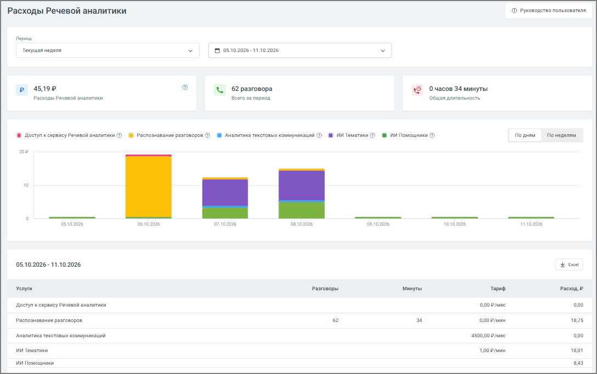

## 8.2. Расходы Речевой аналитики

> Трассировка: PDF §8.2 · сквозные стр. 64-67 · источники: ч.1 `kb/sources/speech-analytics/RECHEVAYA-ANALITIKA_1.26.42.pdf` с.64-67.

Страница расходов помогает быстро понять, сколько стоит использование сервиса за выбранный период и какие услуги вносят основной вклад в затраты.

Доступ к отчету регулируется в настройках ролей ЛК ВАТС. Доступ к отчету открыт, если у пользователя есть доступ к разделам Финансы и Баланс Лицевого счета: Просматривать информацию о расходах за текущий и предыдущий месяцы.

> **Описание иллюстрации SA-§8.2-1** · к разделу §8.2 «Расходы Речевой аналитики» · стр. 65 · снимок экрана / схема, 1089×683 px.
> Относится к тексту руководства: «Доступ к отчету регулируется в настройках ролей ЛК ВАТС. Доступ к отчету открыт, если у пользователя есть доступ к разделам Финансы и Баланс Лицевого счета: Просматривать информацию о расходах за текущий и предыдущий месяцы.»
> Следующий за иллюстрацией текст: «Период и выбор дат В верхней части страницы можно выбрать период, за который будут отображены расходы. Чаще всего пользователи выбирают:  текущий день или вчера — чтобы быстро оценить недавнюю активн…»
> Текст на изображении (OCR, требует сверки): Расходы Речевой аналитики; руководство пользователя,; период; Текущая неделя; 5 5102025110202; р 45192; <. 62 разговора; {© очасов 34 минуты:; расходы Речевой; tanec; сего за период; общая длительность; 18 Доступ к сервису Речевой аналитики © № Распознавание разговоров © № Аналитика текстовых коммуникаций ©) № ИИ Тематики № ИИ Помощники ©); Fo mae; понеделям; me; 10; DD; 6102006; 7302026; али; нае; asoame6; yam26; 05.10.2026 11.10.2026; РЕ; Yenyru; говоры; минуты; тори; Pacron, 2; Доступ к сервису Речевой вналитики; o00e/mec; ono; распознавание разговоров,; 000 Pm; 1875; ооо уме; `дналитика те…

**Период и выбор дат**

В верхней части страницы можно выбрать период, за который будут отображены расходы. Чаще всего пользователи выбирают:

• текущий день или вчера — чтобы быстро оценить недавнюю активность; • текущую неделю или месяц — для регулярного мониторинга; • произвольный период — когда нужно посмотреть данные за конкретные даты.

После выбора периода информация на странице сразу обновляется — ничего дополнительно подтверждать не нужно.

**Основные показатели за период**

Под блоком выбора дат отображаются три ключевых значения, которые дают быстрый обзор ситуации:

• сумма расходов за выбранный период; • количество обработанных разговоров; • общая длительность разговоров.

Эти показатели помогают сразу оценить нагрузку и стоимость работы сервиса.

**График расходов**

График визуально показывает динамику затрат по дням или неделям. Это полезно, если вы хотите:

• увидеть, когда были пики активности,

• понять, какие услуги формируют ключевые расходы, • быстро сравнить дни между собой.

Цветовая маркировка помогает сразу отличать:

• расход на доступ к сервису, • распознавание разговоров, • аналитику текстовых коммуникаций, • ИИ Тематики, • ИИ Помощники.

При наведении курсора на столбец появляется всплывающая подсказка с деталями по конкретному дню: сумма расходов по каждой услуге, количество разговоров и длительность.

Для ИИ Тематик и ИИ Помощников отображается сумма, фактически переданная на списание. Если на аккаунте есть приветственные символы для ИИ Тематик и/или ИИ Помощников, информация о них отображается в блоке над графиком.

**Таблица расходов**

Внизу страницы расположена таблица с подробной разбивкой по услугам. Для каждой услуги указано:

• сколько разговоров было обработано, • сколько минут распознано, • какой тариф использовался, • какая сумма начислена.

В конце таблицы отображается итоговый расход за период. Если данные нужно передать коллегам или приложить к отчёту — таблица легко выгружается в формате Excel.
