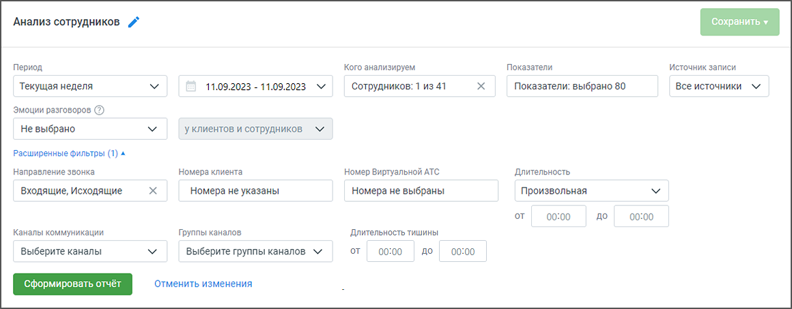
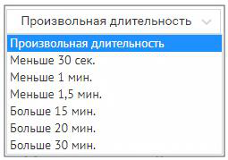
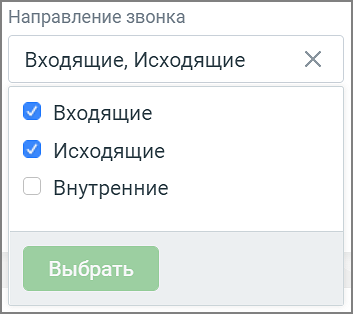
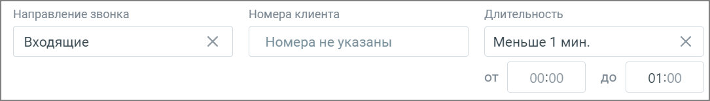
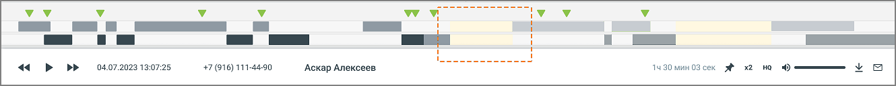

### 8.3.1. Блок фильтров

> Трассировка: PDF §8.3.1 · сквозные стр. 67-69 · источники: ч.1 `kb/sources/speech-analytics/RECHEVAYA-ANALITIKA_1.26.42.pdf` с.67-69.

Кнопка Сохранить – становится активной после формирования отчета. При нажатии отображается список вариантов сохранения виджета на странице «Мои отчеты»: миниатюра графиком – отображается только график; миниатюра таблицей – отображается только таблица с первыми 5 строками; график с таблицей – отображаются график и таблица, таблица содержит первые 5 строк. Состав таблицы виджета (сотрудники или группы) определяется положением чекбокса «Показать группы» на момент сохранения отчета. На виджете данные всегда отсортированы по убыванию показателя «Тематик сработало», независимо от сортировки, установленной в самом отчете. Сохраненный отчет отображается в блоке «Анализ сотрудников» на странице «Мои отчеты».

Кнопка Удалить – удаление отчета со страницы Мои отчеты;

Пиктограмма «карандаш» – переименование отчета.

> **Описание иллюстрации SA-§8.3.1-1** · к разделу §8.3.1 «Блок фильтров» · стр. 67 · снимок экрана / схема, 1160×453 px.
> Относится к тексту руководства: «Пиктограмма «карандаш» – переименование отчета.»
> Следующий за иллюстрацией текст: «При формировании отчета пользователям доступна фильтрация: Период – произвольный, текущий день, текущая неделя, текущий месяц, с прошлого месяца, с позапрошлого месяца, текущий год, весь период. Кого …»
> Текст на изображении (OCR, требует сверки): Анализ сотрудников /°; Период; Koro анализируем.; Показатели; Источник записи; Текущая неделя; 11.09.2023 - 11.09.2023 м; ‘Сотрудников: 1 из 41; Показатели: выбрано 80; Все источники м; Эмоции разговоров; He выбрано; уклиентов и сотрудников м; Расширенные фильтры (1) ^; Направление звонка; Homepa клиента; Номер Виртуальной АТС; Длительность,; Входящие, Исходящие; Номера He указаны; Номера не выбраны; Произвольнея; от; 00:00; до; Каналы коммуникации; Группы каналов; Длительность тишины; Выберите каналы; Выберите группы каналов м; мир!; Tb OT; Отменить изменения

При формировании отчета пользователям доступна фильтрация:

Период – произвольный, текущий день, текущая неделя, текущий месяц, с прошлого месяца, с позапрошлого месяца, текущий год, весь период.

Кого анализируем – в выпадающем списке фильтра есть два уровня: сначала отображаются группы, а внутри них — сотрудники. Пользователь может выбрать нужную группу, чтобы сразу увидеть всех её участников, или найти конкретного человека. Если ни один сотрудник не выбран, отчет формируется по всем сотрудникам.

Показатели – все тематики (в том числе неактивные), а также характеристики разговора. Подробнее здесь.

Источник записи – выбор типа записи разговора: телефонные разговоры/ текстовые коммуникации.

Эмоции разговоров (по клиентам, по сотрудникам, по клиентам и сотрудникам) – дополнительная настройка для фильтрации разговоров в зависимости от выбранной эмоции: негативно, позитивно, нейтрально. В таблице отчета отображаются соответствующими пиктограммами-смайликами.

Эмоции определяются на основании звуков (тембра, громкости). При выборе типа записи разговора «текстовые коммуникации» фильтр недоступен.

Направление – входящий, исходящий, внутренний звонок или текстовое сообщение.

Номер ВАТС – выбор номеров линии ВАТС (максимальное количество – 100). При выборе типа записи разговора «текстовые коммуникации» или «офлайн-записи» фильтр недоступен.

Номер клиента – выбор произвольного номера клиента. При выборе типа записи разговора «текстовые коммуникации» фильтр недоступен.

Длительность звонка – по умолчанию установлена произвольная длительность звонка. При выборе типа записи разговора «текстовые коммуникации» фильтр недоступен.

> **Описание иллюстрации SA-§8.3.1-2** · к разделу §8.3.1 «Блок фильтров» · стр. 68 · снимок экрана / схема, 255×179 px.
> Относится к тексту руководства: «Длительность звонка – по умолчанию установлена произвольная длительность звонка. При выборе типа записи разговора «текстовые коммуникации» фильтр недоступен.»
> Следующий за иллюстрацией текст: «Каналы коммуникации – выбор из выпадающего списка каналов коммуникации, доступных в разделе МангоДиалоги → Каналы. Варианты: Чат на сайте, ВКонтакте, Viber, Telegram, WhatsApp, Avito. При выборе типа …»
> Текст на изображении (OCR, требует сверки): Произвольная длительность; Меньше 30 сек.; Меньше 1 мин.; Меньше 1,5 мин.; Больше 15 мин.; Больше 20 мин.; Больше 30 мин.

Каналы коммуникации – выбор из выпадающего списка каналов коммуникации, доступных в разделе МангоДиалоги → Каналы. Варианты: Чат на сайте, ВКонтакте, Viber, Telegram, WhatsApp, Avito. При выборе типа записи разговора «офлайн-записи» или «телефонные разговоры» фильтр недоступен. Каналы коммуникации будут отображаться только в том случае, если соответствующая услуга была ранее подключена.

Группы каналов – выбор из выпадающего списка групп каналов коммуникации, созданных в разделе МангоДиалоги → Каналы. При выборе типа записи разговора «офлайн-записи» или «телефонные разговоры» фильтр недоступен.

Внутри фильтра действует принцип фильтрации – ИЛИ (когда одно из условий истинно). Между фильтрами действует принцип фильтрации – И (когда все условия истинны).

ПРИМЕР 1

> **Описание иллюстрации SA-§8.3.1-3** · к разделу §8.3.1 «Блок фильтров» · стр. 68 · снимок экрана / схема, 353×314 px.
> Относится к тексту руководства: «ПРИМЕР 1»
> Следующий за иллюстрацией текст: «В фильтре Направление (внутри фильтра) выбраны: Входящие, Исходящие. При поиске по заданным условиям в отчете будут представлены разговоры, когда хотя бы одно из условий истинно – т. е. или входящие, …»
> Текст на изображении (OCR, требует сверки): Направление звонка; Входящие, Исходящие; Входящие; Исходящие; Внутренние

В фильтре Направление (внутри фильтра) выбраны: Входящие, Исходящие. При поиске по заданным условиям в отчете будут представлены разговоры, когда хотя бы одно из условий истинно – т. е. или входящие, или исходящие вызовы или текстовые сообщения.

ПРИМЕР 2

В фильтре Источник записи выбраны: Телефонные разговоры. В фильтре Направление выбраны: Входящие. В фильтре Длительность выбрано «Меньше 1 мин.».

При поиске по заданным условиям в отчете будут представлены разговоры, когда все три условия истинны – т. е. входящие телефонные вызовы длительностью менее 1 минуты.

> **Описание иллюстрации SA-§8.3.1-4** · к разделу §8.3.1 «Блок фильтров» · стр. 69 · снимок экрана / схема, 1085×156 px.
> Относится к тексту руководства: «При поиске по заданным условиям в отчете будут представлены разговоры, когда все три условия истинны – т. е. входящие телефонные вызовы длительностью менее 1 минуты.»
> Следующий за иллюстрацией текст: «Длительность тишины – используя этот фильтр руководитель может контролировать сотрудников на предмет тишины в разговорах, для выявления слабых мест в работе операторов. Фильтр применим только к новым …»
> Текст на изображении (OCR, требует сверки): Направление звонка; Номера клиента; Длительность; Входящие; Номера не указаны; Меньше 1 мин.; от; 00:00; до; 01:00

Длительность тишины – используя этот фильтр руководитель может контролировать сотрудников на предмет тишины в разговорах, для выявления слабых мест в работе операторов. Фильтр применим только к новым записям.

o Если не выбрана величина "от" – отфильтруются все разговоры, где длительность тишины

была до указанного времени. o Если не выбрала величина "до" – отфильтруются разговоры, где длительность тишины была

более указанного времени.

Длительность тишины также отображается на плеере расшифровки разговора.

> **Описание иллюстрации SA-§8.3.1-5** · к разделу §8.3.1 «Блок фильтров» · стр. 69 · снимок экрана / схема, 1330×130 px.
> Относится к тексту руководства: «Длительность тишины также отображается на плеере расшифровки разговора.»
> Следующий за иллюстрацией текст: «Изменение какого-либо из дополнительных фильтров не приводит к автоматическому обновлению данных в отчете. Для обновления данных нажмите кнопку «Сформировать отчет».»
> Текст на изображении (OCR, требует сверки): iv У; п м; EE ПИ; ч«чьы; 04.07.2023 13:07:25; +7 (916) 111-44-90; Аскар Алексеев; 130mm 03 eK; x2 Ha 4); ув

Изменение какого-либо из дополнительных фильтров не приводит к автоматическому обновлению данных в отчете. Для обновления данных нажмите кнопку «Сформировать отчет».
