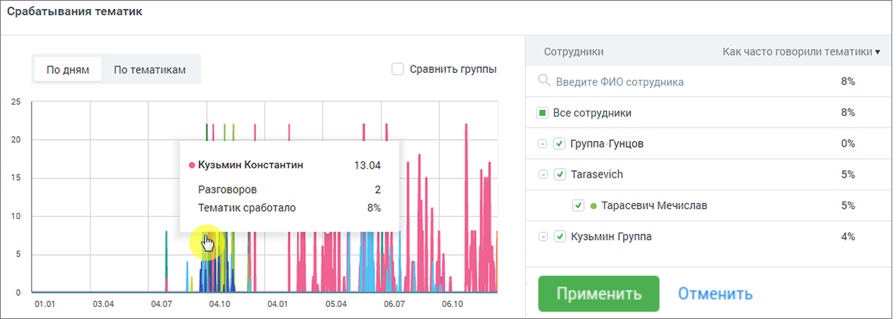
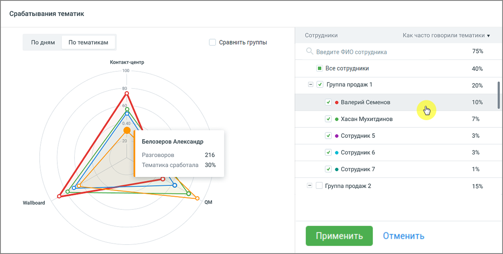

### 8.3.2. Блок визуализации срабатывания тематик

> Трассировка: PDF §8.3.2 · сквозные стр. 69-71 · источники: ч.1 `kb/sources/speech-analytics/RECHEVAYA-ANALITIKA_1.26.42.pdf` с.69-71.

Отчет предоставляет данные по количеству присвоенных звонкам тематик в разговорах сотрудников/групп, которым были присвоены выбранные тематики.

Отчет доступен в срезах По дням, По тематикам. Каждый цвет кривой на графике соответствует определенному сотруднику или группе.

> **Описание иллюстрации SA-§8.3.2-1** · к разделу §8.3.2 «Блок визуализации срабатывания тематик» · стр. 69 · снимок экрана / схема, 1186×424 px.
> Относится к тексту руководства: «Отчет доступен в срезах По дням, По тематикам. Каждый цвет кривой на графике соответствует определенному сотруднику или группе.»
> Следующий за иллюстрацией текст: «Рис.1. Срез «По дням»  По оси У графика «По дням» отображается сколько тематик сработало, то есть процентное значение срабатывания выбранных в "Показателях" тематик. Если чекбокс «Сравнить группы» вк…»
> Подпись в руководстве: «Рис.1. Срез «По дням»  По оси У графика «По дням» отображается сколько тематик сработало, то есть процентное значение срабатывания выбранных в "Показателях" тематик. Если чекбокс «Сравнить группы» включен, то график отображает данные по группам сотрудников. Иначе – по».
> Текст на изображении (OCR, требует сверки): 'Срабатывания тематик; ‘Сотрудники; Как часто говорили тематики ¥; По дням; По тематикам; сравнить группы; Введите ФИО сотрудника; и Все сотрудники; IL; У Группа Гунцов.; ® Кузьмин Константин; 13.04; 15; У Tarasevich; разговоров.; Тематик сработало; У © Тарасевич Мечислав,; 10; У Кузьмин Группа; o1.01; 03.04; 04.07; 04.10; 04.01; 05.04; 06.07; 06.10; Отменить

Рис.1. Срез «По дням»

• По оси У графика «По дням» отображается сколько тематик сработало, то есть процентное значение срабатывания выбранных в "Показателях" тематик. Если чекбокс «Сравнить группы» включен, то график отображает данные по группам сотрудников. Иначе – по отдельным сотрудникам. Максимальное количество выбранных сотрудников для построения графика – 20.

• По оси Х отображается временной период в разбивке по дням относительно выбранного периода в фильтре "Период".

ПРИМЕР 1:

В поле "Показатели" выбрано 3 тематики.

За указанную дату по сотруднику "Игорь Петров" было распознано 50 разговоров.

На 40 распознанных разговоров был присвоена каждая из выбранных тематик, а на оставшиеся 10 не присвоена ни одна тематика. Таким образом количество тематик, которые присвоены указанным разговорам = 120 (из возможных 150).

Значение параметра "Тематик сработало" будет равняться: 120 / 150 * 100% = 80%.

По клику на графике отображается всплывающее окно с информацией по сотруднику или клиенту на выбранную дату. Если чекбокс «Сравнить группы» включен, то всплывающее окно содержит данные по группе сотрудников на выбранную дату.

Если чекбокс «Сравнить группы» выключен, по наведению курсора на вершину любой из кривых графика отображаются данные по конкретному сотруднику. Всплывающее окно содержит данные по сотруднику на выбранную дату.

Столбец «Как часто говорили тематики» рассчитывается как среднее значение по всем значениям параметра «Тематик сработало» за установленный период.

> **Описание иллюстрации SA-§8.3.2-2** · к разделу §8.3.2 «Блок визуализации срабатывания тематик» · стр. 70 · снимок экрана / схема, 1204×610 px.
> Относится к тексту руководства: «Столбец «Как часто говорили тематики» рассчитывается как среднее значение по всем значениям параметра «Тематик сработало» за установленный период.»
> Следующий за иллюстрацией текст: «Рис.2. Срез «По тематикам» Внутри окружности графика «По тематикам» располагается графическое отображение вхождения сработавших тематик в разговоры выбранных сотрудников (сколько тематик сработало, ст…»
> Подпись в руководстве: «Рис.2. Срез «По тематикам» Внутри окружности графика «По тематикам» располагается графическое отображение вхождения сработавших тематик в разговоры выбранных сотрудников (сколько тематик сработало, столько».
> Текст на изображении (OCR, требует сверки): Срабатывания тематик; Как часто говорили тематики ¥; Сотрудники; По дням; По тематикам; сравнить группы; Введите ФИО сотрудника; 75%; Контакт-центр,; 100; Boe сотрудники; 40%; Y) Группа продаж 1; 20%; У @ Валерий Семенов; 10%; 0.40; У @ Хасан Мухитдинов; 20; У) ® Сотрудник 5; Белозеров Александр.; Разговоров; 216; У) ® Сотрудник 6; Тематика сработала 30%; У) ® Сотрудник7; Группа продаж 2; 15%; Wallboard; au; Отменить

Рис.2. Срез «По тематикам»

Внутри окружности графика «По тематикам» располагается графическое отображение вхождения сработавших тематик в разговоры выбранных сотрудников (сколько тематик сработало, столько цветных фигур отображается на графике). Максимальное количество выбранных сотрудников или сработавших тематик для построения графика – 20.

Если чекбокс «Сравнить группы» включен, то всплывающее окно содержит данные по группе сотрудников на выбранную дату.

Если чекбокс «Сравнить группы» выключен, по наведению курсора на вершину любой из кривых графика отображаются данные по конкретному сотруднику. Всплывающее окно содержит данные по сотруднику на выбранную дату.

Столбец «Как часто говорили тематики» рассчитывается как среднее значение по всем значениям параметра «Тематик сработало» для конкретного сотрудника.

ПРИМЕР 2:

Значение "Тематик сработало" по сотруднику "Игорь Петров" за 01.01 = 50%, а за 02.01 = 70%

Соответственно, значение "Как часто говорили тематики" по сотруднику "Игорь Петров" за выбранные 2 дня равняется [(50% + 70%) / 2)] = 60%
