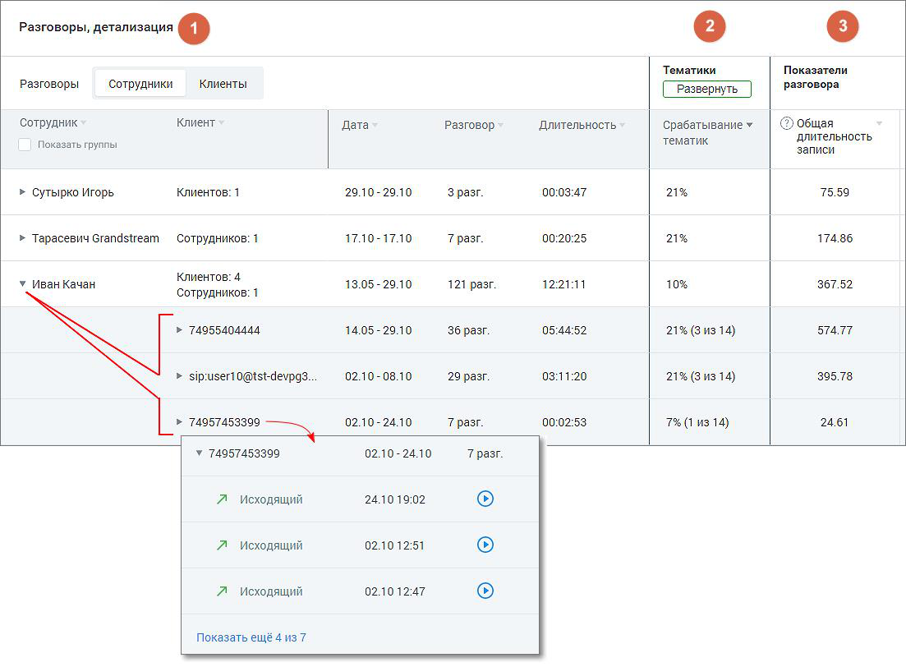
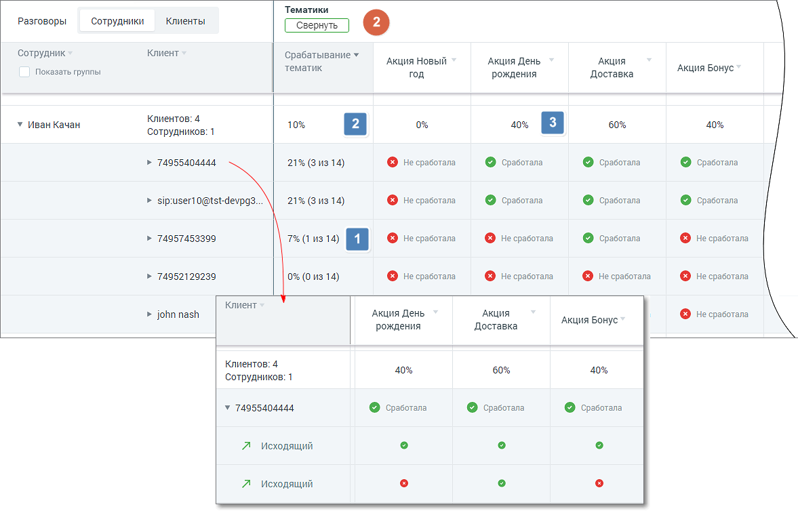
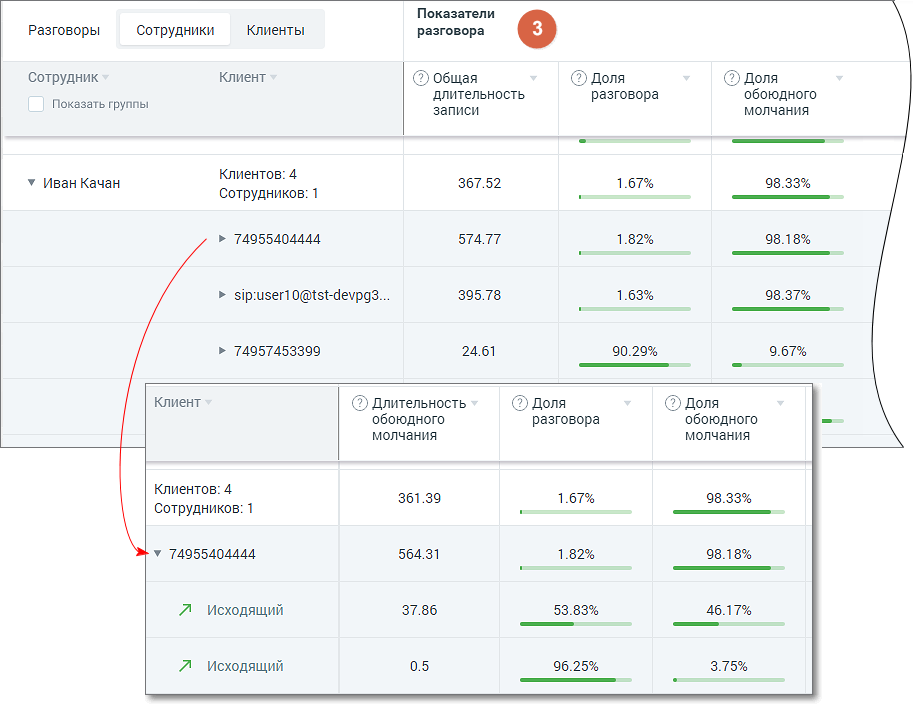

### 8.3.3. Блок таблицы Разговоры, детализация

> Трассировка: PDF §8.3.3 · сквозные стр. 71-74 · источники: ч.1 `kb/sources/speech-analytics/RECHEVAYA-ANALITIKA_1.26.42.pdf` с.71-74.

Табличная часть отчета состоит из трех разделов:

• Разговоры

• Тематики

• Показатели разговора

Для типа записи разговора «Текстовые коммуникации» в качестве показателей отображаются только данные разговоров по тематикам.

**1. Раздел «Разговоры, детализация»**

Детализация разговоров предоставляется в срезах Сотрудники/Клиенты. В таблице отчета данные выводятся с возможностью группировки согласно установленных фильтров.

Рассмотрим пример построения таблицы для типа записи разговора: «телефонные разговоры»:

> **Описание иллюстрации SA-§8.3.3-1** · к разделу §8.3.3 «Блок таблицы Разговоры, детализация» · стр. 71 · снимок экрана / схема, 1103×812 px.
> Относится к тексту руководства: «Рассмотрим пример построения таблицы для типа записи разговора: «телефонные разговоры»:»
> Следующий за иллюстрацией текст: «Таблица содержит следующие столбцы (рассмотрим пример для среза «Сотрудники»):»
> Текст на изображении (OCR, требует сверки): Разговоры, детализация @; Тематики; Показатели; Разговоры; Сотрудники; Клиенты; разговора; Сотрудник; Клиент; ‘Дата; Разговор; Длительность,; Срабатывание у; © общая; ‘длительность,; Показать группы:; тематик; записи; Клиентов: 1; 29.10-29.10; 00:03:47; 21%; 75.59; > Сутырко Игорь; 3 разг.; > Тарасевич Grandstream; Сотрудников: 1; 1710-1710; T pasr.; 00:20:25; 174.86; Клиентов: 4; у Иван Качан; 13.05-29.10; 121 разг.; 12:21:11; 10%; 367.52; > 74955404444; 14.05-29.10; 05:44:52; 57477; 36 разг.; > sipuserl 0@tst-devpgs.; 02.10-08.10; 29 разг.; 03:11:20; 395.78; 02.10-24.10; 7 разг.; 00:02:53; 2…

Таблица содержит следующие столбцы (рассмотрим пример для среза «Сотрудники»):

• Сотрудник – имя сотрудника ВАТС.

• Клиент – количество уникальных внешних номеров (не привязанных ни к одному из сотрудников ВАТС) с которыми у выбранного сотрудника за выбранный период состоялся разговор. Если в качестве источника записи выбран тип разговора «телефонные разговоры», то в списке содержится информация о наименовании группы каналов и канале коммуникации разговора.

По каждому пункту списка доступна детализация звонков с записями разговоров, а также текста диалога в канале коммуникации (если на ВАТС подключены соответствующие услуги).

• Дата – диапазон дат в которые у выбранного сотрудника имеются распознанные разговоры.

• Разговор – суммарное количество распознанных разговоров выбранного сотрудника за выбранный период.

• Длительность – суммарная длительность всех распознанных разговоров выбранного сотрудника за выбранный период в формате ЧЧ:ММ:СС.

• Эмоции клиента – среднее значение, отображается смайлом.

• Эмоции сотрудника – среднее значение, отображается смайлом.

> **Описание иллюстрации SA-§8.3.3-2** · к разделу §8.3.3 «Блок таблицы Разговоры, детализация» · стр. 72 · пиктограмма (значок элемента интерфейса), 20×22 px.
> Относится к тексту руководства: «• Эмоции сотрудника – среднее значение, отображается смайлом.»
> Следующий за иллюстрацией текст: «По клику на пиктограмму аудиозаписи или текстового канала коммуникации (например ) открывается детализация записи разговора или текстового диалога. Если чекбокс «Показать группы» проставлен, столбец С…»
> Текста на изображении нет; назначение значка — см. текст, к которому он относится.

> **Описание иллюстрации SA-§8.3.3-3** · к разделу §8.3.3 «Блок таблицы Разговоры, детализация» · стр. 72 · пиктограмма (значок элемента интерфейса), 20×20 px.
> Относится к тексту руководства: «• Эмоции сотрудника – среднее значение, отображается смайлом.»
> Следующий за иллюстрацией текст: «По клику на пиктограмму аудиозаписи или текстового канала коммуникации (например ) открывается детализация записи разговора или текстового диалога. Если чекбокс «Показать группы» проставлен, столбец С…»
> Текста на изображении нет; назначение значка — см. текст, к которому он относится.

По клику на пиктограмму аудиозаписи или текстового канала коммуникации (например ) открывается детализация записи разговора или текстового диалога.

Если чекбокс «Показать группы» проставлен, столбец Сотрудник содержит двухуровневый иерархический список (группа / сотрудник): т.е. сотрудники сгруппированы по группам. Данные в отчете в этом случае формируются и для группы в целом.

**2. Раздел «Тематики»**

Рассмотрим пример построения таблицы для типа записи разговора: «телефонные разговоры».

> **Описание иллюстрации SA-§8.3.3-4** · к разделу §8.3.3 «Блок таблицы Разговоры, детализация» · стр. 72 · снимок экрана / схема, 1177×754 px.
> Относится к тексту руководства: «Рассмотрим пример построения таблицы для типа записи разговора: «телефонные разговоры».»
> Следующий за иллюстрацией текст: «В развернутом виде раздел таблицы содержит следующие столбцы:»
> Текст на изображении (OCR, требует сверки): Тематики; Разговоры; Сотрудники; Клиенты; Сотрудник; Клиент; Срабатывание ¥; АКЦИЯ НОВЫЙ; Акция День; АКцИЯ; Показать группы,; тематик; год; рождения; Доставка; Акция Бонус; Клиентов: 4; У Иван Качан; 10%; 60%; 40%; ‘Сотрудников: 1; 40% а; > 74955404444.; © несработала; © соеботала; > sipuser 0@tst-devpg3.; > 74957453399; 7% (1 из 14) а © не сработала; > 74952129239; © He cpacorana; > john nash; у 74955404444.; Ло Исходящий

В развернутом виде раздел таблицы содержит следующие столбцы:

• Срабатывание тематик – показатель вида (N из M), где N – количество соответствующих данному разговору тематик, а M – общее количество тематик, выбранных в блоке фильтрации.

• Столбцы с наименованиями тематик – все тематики, выбранные в блоке фильтрации, с пометкой о срабатывании. В детализации звонков пометка о срабатывании отображается по каждому звонку.

При расчете данных в столбцах используются следующие величины:

N – количество соответствующих разговору тематик

M – общее количество тематик, выбранных в блоке фильтрации

> **Описание иллюстрации SA-§8.3.3-5** · к разделу §8.3.3 «Блок таблицы Разговоры, детализация» · стр. 73 · пиктограмма (значок элемента интерфейса), 34×34 px.
> Относится к тексту руководства: «M – общее количество тематик, выбранных в блоке фильтрации»
> Следующий за иллюстрацией текст: «– параметр, равный N/M*100%;»
> Текста на изображении нет; назначение значка — см. текст, к которому он относится.

– параметр, равный N/M*100%;

> **Описание иллюстрации SA-§8.3.3-6** · к разделу §8.3.3 «Блок таблицы Разговоры, детализация» · стр. 73 · пиктограмма (значок элемента интерфейса), 34×34 px.
> Относится к тексту руководства: «– параметр, равный N/M*100%;»
> Следующий за иллюстрацией текст: «– параметр, равный среднему арифметическому данных в строке по всем выбранным тематиким;»
> Текста на изображении нет; назначение значка — см. текст, к которому он относится.

– параметр, равный среднему арифметическому данных в строке по всем выбранным тематиким;

> **Описание иллюстрации SA-§8.3.3-7** · к разделу §8.3.3 «Блок таблицы Разговоры, детализация» · стр. 73 · пиктограмма (значок элемента интерфейса), 34×34 px.
> Относится к тексту руководства: «– параметр, равный среднему арифметическому данных в строке по всем выбранным тематиким;»
> Следующий за иллюстрацией текст: «– параметр, равный отношению количества меток "Сработал" (по вертикали) к общему количеству меток ("Сработал " + "Не сработал ") 3. Раздел «Показатели разговора» Рассмотрим пример построения таблицы д…»
> Текста на изображении нет; назначение значка — см. текст, к которому он относится.

– параметр, равный отношению количества меток "Сработал" (по вертикали) к общему количеству меток ("Сработал " + "Не сработал ")

**3. Раздел «Показатели разговора»**

Рассмотрим пример построения таблицы для типа записи разговора «телефонные разговоры»:

> **Описание иллюстрации SA-§8.3.3-8** · к разделу §8.3.3 «Блок таблицы Разговоры, детализация» · стр. 73 · снимок экрана / схема, 913×713 px.
> Относится к тексту руководства: «Рассмотрим пример построения таблицы для типа записи разговора «телефонные разговоры»:»
> Следующий за иллюстрацией текст: «Раздел таблицы содержит следующие столбцы:»
> Текст на изображении (OCR, требует сверки): Показатели; Клиенты; Разговоры; Сотрудники; разговора; Сотрудник; Клиент; @ общая; © доля; длительность,; обоюдного; Показать группы,; записи; молчания; Клиентов: 4; У Иван Качан; 367.52; 1.67%; 98.33%; Сотрудников: 1; > 74955404444.; 57477; 1.82%; 98.18%; > sipuser 0@tst-devpg3.; 395.78; 1.63%; 98.37%; > 74957453399; 24.61; 90.29%; 9.67%; @ Длительность; 361.39; у 74955404444.; 564.31; Ло Исходящий; 3786; 53.83%; 46.17%; 05; 96.25%; 3.75%

Раздел таблицы содержит следующие столбцы:

• Общая длительность аудиозаписи • Длительность разговора • Длительность обоюдного молчания • Доля разговора • Доля обоюдного молчания • Количество перебиваний сотрудником • Количество перебиваний клиентом • Доля обоюдного разговора • Доля разговора сотрудника • Доля разговора клиента • Скорость разговора сотрудника • Скорость разговора клиента

Чтобы узнать правило расчета каждого из показателей, наведите курсор на пиктограмму «?» возле наименования показателя. Подробнее о значениях показателей узнайте здесь.

Для фильтрации данных отчета по возрастанию/убыванию следует щелкнуть по наименованию столбца.

> **Описание иллюстрации SA-§8.3.3-9** · к разделу §8.3.3 «Блок таблицы Разговоры, детализация» · стр. 74 · пиктограмма (значок элемента интерфейса), 24×23 px.
> Относится к тексту руководства: «Для фильтрации данных отчета по возрастанию/убыванию следует щелкнуть по наименованию столбца.»
> Следующий за иллюстрацией текст: «Для выгрузки данных отчета в формате CSV кликните на пиктограмму в правом верхнем углу табличной части. Доступны выгрузка файла отчета по сотрудникам и по клиентам.»
> Текста на изображении нет; назначение значка — см. текст, к которому он относится.

Для выгрузки данных отчета в формате CSV кликните на пиктограмму в правом верхнем углу табличной части. Доступны выгрузка файла отчета по сотрудникам и по клиентам.
