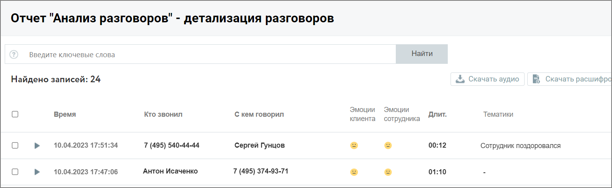
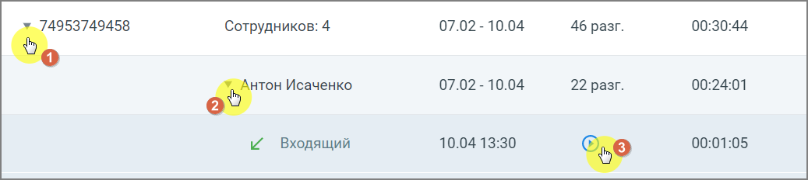
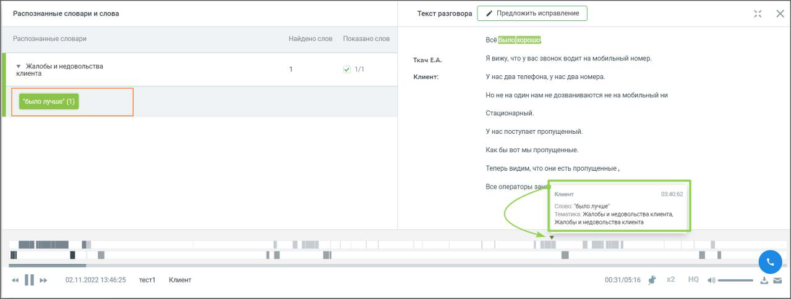

### 8.3.4. Детализация разговоров

> Трассировка: PDF §8.3.4 · сквозные стр. 74-76 · источники: ч.1 `kb/sources/speech-analytics/RECHEVAYA-ANALITIKA_1.26.42.pdf` с.74-76.

Рассмотрим пример детализации для типа записи разговора: «телефонные разговоры»:

> **Описание иллюстрации SA-§8.3.4-1** · к разделу §8.3.4 «Детализация разговоров» · стр. 74 · снимок экрана / схема, 1554×480 px.
> Относится к тексту руководства: «Рассмотрим пример детализации для типа записи разговора: «телефонные разговоры»:»
> Следующий за иллюстрацией текст: «Окно детализации разговоров содержит следующие данные о разговорах:  Дату и время разговора  Кто инициировал разговор  С кем говорил  Эмоции клиента  Эмоции сотрудника  Длительность разговора  …»
> Текст на изображении (OCR, требует сверки): Отчет "Анализ разговоров" - детализация разговоров; Введите ключевые слова; Найти; Найдено записей: 24; $ Скачать аудио; FB Скачать расшифр; Эмоции; Время; Кто звонил; С кем говорил; Длит.; Тематики; клиента сотрудника; 10.04.2023 17:51:34; 00:12; 7 (495) 540-44-44; ‘Сергей Гунцов; Сотрудник поздоровался; 10.04.2023 17:47:06; Антон Исаченко; 01:10; ia); 7 (495) 374-93-71

Окно детализации разговоров содержит следующие данные о разговорах:

• Дату и время разговора • Кто инициировал разговор • С кем говорил • Эмоции клиента • Эмоции сотрудника • Длительность разговора • Список тематик, которые присвоены разговору • Общая длительность записи • Длительность обоюдного молчания • Доля разговора/обоюдного молчания • Количество перебиваний сотрудником/клиентом • Доля обоюдного разговора/сотрудника/клиента

• Скорость разговора сотрудника/клиента

Если какие-то из показателей разговора не доступны для данного типа записи разговора или не выбраны в фильтрах, то в окне детализации они также не отражаются.

В окне детализации разговоров пользователю доступны следующие действия: поиск по записям, прослушивание, просмотр расшифровки разговора (при наличии), скачивание аудиозаписи и расшифровки разговора.

> **Описание иллюстрации SA-§8.3.4-2** · к разделу §8.3.4 «Детализация разговоров» · стр. 75 · снимок экрана / схема, 1037×232 px.
> Относится к тексту руководства: «В окне детализации разговоров пользователю доступны следующие действия: поиск по записям, прослушивание, просмотр расшифровки разговора (при наличии), скачивание аудиозаписи и расшифровки разговора.»
> Следующий за иллюстрацией текст: «Клик на пиктограмму разговора открывает окно со следующей информацией:»
> Текст на изображении (OCR, требует сверки): Сотрудников: 4; 07.02 - 10.04; 46 разг.; 00:30:44; 22 разг.; 00:24:01; eo Исаченко; 5 Входящий; 10.04 13:30; 00:01:05

Клик на пиктограмму разговора открывает окно со следующей информацией:

> **Описание иллюстрации SA-§8.3.4-3** · к разделу §8.3.4 «Детализация разговоров» · стр. 75 · пиктограмма (значок элемента интерфейса), 22×22 px.
> Относится к тексту руководства: «Клик на пиктограмму разговора открывает окно со следующей информацией:»
> Следующий за иллюстрацией текст: « Тематики и ключевые слова – список распознанных ключевых слов, сгруппированный по тематикам.  Расшифровка текста разговора – помимо текста разговора включает данные сотрудника и клиента, а также ме…»
> Текста на изображении нет; назначение значка — см. текст, к которому он относится.

• Тематики и ключевые слова – список распознанных ключевых слов, сгруппированный по тематикам.

• Расшифровка текста разговора – помимо текста разговора включает данные сотрудника и клиента, а также метки вхождений. Для внутренних разговоров – данные обоих сотрудников.

• Плеер с отметками фрагментов разговора и вхождений терм .

> **Описание иллюстрации SA-§8.3.4-4** · к разделу §8.3.4 «Детализация разговоров» · стр. 75 · пиктограмма (значок элемента интерфейса), 15×11 px.
> Относится к тексту руководства: «• Плеер с отметками фрагментов разговора и вхождений терм .»
> Текста на изображении нет; назначение значка — см. текст, к которому он относится.

> **Описание иллюстрации SA-§8.3.4-5** · к разделу §8.3.4 «Детализация разговоров» · стр. 75 · снимок экрана / схема, 1279×485 px.
> Относится к тексту руководства: «• Плеер с отметками фрагментов разговора и вхождений терм .»
> Текст на изображении (OCR, требует сверки): Распознанные словари и слова; Текст разговора / 7 Предложить исправление; Распознанные словари; Найдено слов; Показано слов,; было; каче,; Я вижу, что у вас звонок водит на мобильный номер.; У Жалобы инедовольства; клиента; Клиент:; Унас два телефона, y нас два номера.; Нонена один нам не дозваниваются не на мобильный ни; Ea); ‘стационарный.; У нас поступает пропущенный.; Kak 6.1 вот мы пропущенные.; Теперь видим, что они есть пропущенные,; ce операторы 3; Komen; оз; ‘слово: “было лудше"; Тематика. Жалобы недовольства клиента,; Жалобы инедовольства клиента; mmm; ит; 02.11.2022 13:46:25; тес; К…
