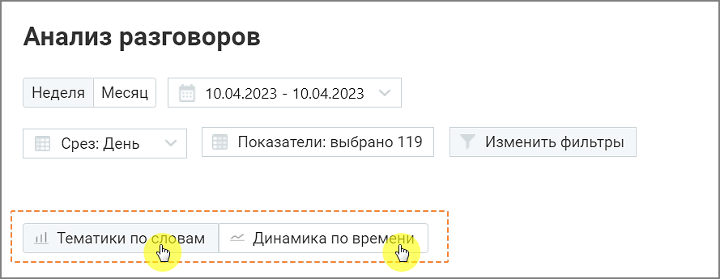

## 8.4. Анализ разговоров

> Трассировка: PDF §8.4 · сквозные стр. 76 · источники: ч.1 `kb/sources/speech-analytics/RECHEVAYA-ANALITIKA_1.26.42.pdf` с.76.

Отчет «Анализ разговоров» состоит из двух блоков: Блока таблицы и Блока визуализаций Тематики по словам и Динамика по времени.

Блоки визуализаций отображаются по щелчку на соответствующей вкладке:

> **Описание иллюстрации SA-§8.4-1** · к разделу §8.4 «Анализ разговоров» · стр. 76 · снимок экрана / схема, 889×345 px.
> Относится к тексту руководства: «Блоки визуализаций отображаются по щелчку на соответствующей вкладке:»
> Текст на изображении (OCR, требует сверки): Анализ разговоров; Неделя Месяц; 10.04.2023 - 10.04.2023; Показатели: выбрано 119; Изменить фильтры; Срез: День; =. www ewww meme eee wee eee ewe wee ee ee eee eee eeeeeen=; ам; ul Тематики “oe; = Динамика no ren
