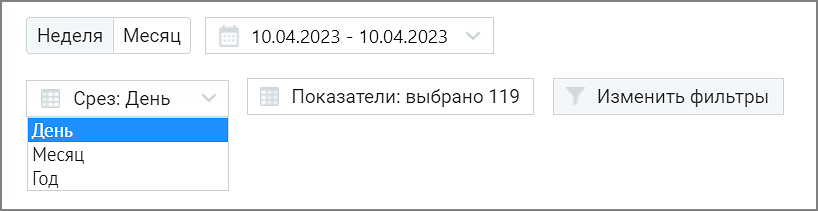
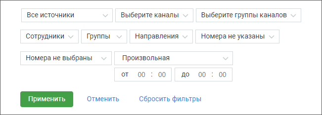
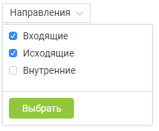
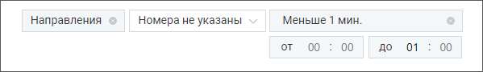

### 8.4.1. Блок фильтров

> Трассировка: PDF §8.4.1 · сквозные стр. 76-78 · источники: ч.1 `kb/sources/speech-analytics/RECHEVAYA-ANALITIKA_1.26.42.pdf` с.76-78.

Для построения отчета “Анализ разговоров” выберите временной период, срез (день/месяц/год) и показатели, по которым будет формироваться отчет.

> **Описание иллюстрации SA-§8.4.1-1** · к разделу §8.4.1 «Блок фильтров» · стр. 76 · снимок экрана / схема, 818×211 px.
> Относится к тексту руководства: «Для построения отчета “Анализ разговоров” выберите временной период, срез (день/месяц/год) и показатели, по которым будет формироваться отчет.»
> Следующий за иллюстрацией текст: «О показателях, по которым осуществляется формирование отчета, подробнее здесь.»
> Текст на изображении (OCR, требует сверки): Неделя Месяц; 10.04.2023 - 10.04.2023; Срез: День; Показатели: выбрано 119; Изменить фильтры; [День; Месяц; Год

О показателях, по которым осуществляется формирование отчета, подробнее здесь.

> **Описание иллюстрации SA-§8.4.1-2** · к разделу §8.4.1 «Блок фильтров» · стр. 76 · пиктограмма (значок элемента интерфейса), 38×32 px.
> Относится к тексту руководства: «О показателях, по которым осуществляется формирование отчета, подробнее здесь.»
> Следующий за иллюстрацией текст: «Если нажать кнопку «Отмена» или пиктограмму , изменения не будут внесены, а выборка показателей вернется к последней сохраненной версии. По завершению работы указанных выше фильтров отчет будет сформи…»
> Текста на изображении нет; назначение значка — см. текст, к которому он относится.

Если нажать кнопку «Отмена» или пиктограмму , изменения не будут внесены, а выборка показателей вернется к последней сохраненной версии.

По завершению работы указанных выше фильтров отчет будет сформирован автоматически.

Для дополнительной фильтрации данных в отчете откройте выпадающий список Изменить фильтры. Откроются поля дополнительных фильтров.

> **Описание иллюстрации SA-§8.4.1-3** · к разделу §8.4.1 «Блок фильтров» · стр. 77 · снимок экрана / схема, 651×233 px.
> Относится к тексту руководства: «Для дополнительной фильтрации данных в отчете откройте выпадающий список Изменить фильтры. Откроются поля дополнительных фильтров.»
> Следующий за иллюстрацией текст: «Источник записи – выбор типа записи разговора: телефонные разговоры/ текстовые коммуникации. Каналы коммуникации – выбор из выпадающего списка каналов коммуникации, доступных в разделе МангоДиалоги → …»
> Текст на изображении (OCR, требует сверки): Все источники; Выберите каналы; Выберите группы каналов; Сотрудники; Группы; Направления; Номера не указаны; Номера не выбраны; Произвольная; от; 00; до 00; Сбросить фильтры; Отменить

Источник записи – выбор типа записи разговора: телефонные разговоры/ текстовые коммуникации.

Каналы коммуникации – выбор из выпадающего списка каналов коммуникации, доступных в разделе МангоДиалоги → Каналы. Варианты: Чат на сайте, ВКонтакте, Viber, Telegram, WhatsApp, Avito. При выборе типа записи разговора «телефонные разговоры» фильтр недоступен.

Группы каналов – выбор из выпадающего списка групп каналов коммуникации, созданных в разделе МангоДиалоги → Каналы. При выборе типа записи разговора «телефонные разговоры» фильтр недоступен. Каналы коммуникации будут отображаться только в том случае, если соответствующая услуга была ранее подключена.

Сотрудники – список всех сотрудников, сгруппированный по группам. При выборе типа записи разговора «текстовые коммуникации» в списке доступны только выбранные в разделе Настройки/Аналитика текстовых коммуникаций сотрудники. Если ни один сотрудник не выбран, отчет формируется по всем сотрудникам.

Группы – при установке флага напротив наименования группы сформированный отчет будет включать только выбранные группы. Для быстрого выбора всех групп предусмотрен общий флаг.

Направление – входящий, исходящий, внутренний звонок или текстовое сообщение.

Номера клиента – фильтрация только по любым добавленным номерам. При выборе типа записи разговора «текстовые коммуникации» фильтр недоступен.

Номер ВАТС – фильтрация только выбранным номерам ВАТС. При выборе типа записи разговора «текстовые коммуникации» или «офлайн-записи» фильтр недоступен.

Длительность – продолжительность разговора. По умолчанию установлен параметр «произвольная длительность». При выборе типа записи разговора «текстовые коммуникации» фильтр недоступен.

> **Описание иллюстрации SA-§8.4.1-4** · к разделу §8.4.1 «Блок фильтров» · стр. 77 · снимок экрана / схема, 255×179 px.
> Относится к тексту руководства: «Длительность – продолжительность разговора. По умолчанию установлен параметр «произвольная длительность». При выборе типа записи разговора «текстовые коммуникации» фильтр недоступен.»
> Следующий за иллюстрацией текст: «Внутри фильтра действует принцип фильтрации – ИЛИ (когда одно из условий истинно). Между фильтрами действует принцип фильтрации – И (когда все условия истинны).»
> Текст на изображении (OCR, требует сверки): Произвольная длительность; Меньше 30 сек.; Меньше 1 мин.; Меньше 1,5 мин.; Больше 15 мин.; Больше 20 мин.; Больше 30 мин.

Внутри фильтра действует принцип фильтрации – ИЛИ (когда одно из условий истинно). Между фильтрами действует принцип фильтрации – И (когда все условия истинны).

ПРИМЕР 1

> **Описание иллюстрации SA-§8.4.1-5** · к разделу §8.4.1 «Блок фильтров» · стр. 78 · снимок экрана / схема, 232×190 px.
> Относится к тексту руководства: «ПРИМЕР 1»
> Следующий за иллюстрацией текст: «В фильтре Направление (внутри фильтра) выбраны: Входящие, Исходящие. При поиске по заданным условиям в отчете будут представлены вызовы, когда хотя бы одно из условий истинно – т. е. или входящие, или…»
> Текст на изображении (OCR, требует сверки): Направления ~; Входящие; Исходящие; (/ Внутренние

В фильтре Направление (внутри фильтра) выбраны: Входящие, Исходящие. При поиске по заданным условиям в отчете будут представлены вызовы, когда хотя бы одно из условий истинно – т. е. или входящие, или исходящие вызовы или текстовые сообщения.

ПРИМЕР 2

В фильтре Направление выбраны: Входящие. В фильтре Длительность выбрано «Меньше 1 мин.».

При поиске по заданным условиям в отчете будут представлены вызовы, когда оба условия истинны – т. е. входящие вызовы длительностью менее 1 минуты.

> **Описание иллюстрации SA-§8.4.1-6** · к разделу §8.4.1 «Блок фильтров» · стр. 78 · снимок экрана / схема, 599×90 px.
> Относится к тексту руководства: «При поиске по заданным условиям в отчете будут представлены вызовы, когда оба условия истинны – т. е. входящие вызовы длительностью менее 1 минуты.»
> Следующий за иллюстрацией текст: «Кнопкой «Выбрать» сохраните внесенные изменения.»
> Текст на изображении (OCR, требует сверки): Направления; Номера не указаны; Меньше 1 мин.; от; 00; до 01

Кнопкой «Выбрать» сохраните внесенные изменения.
