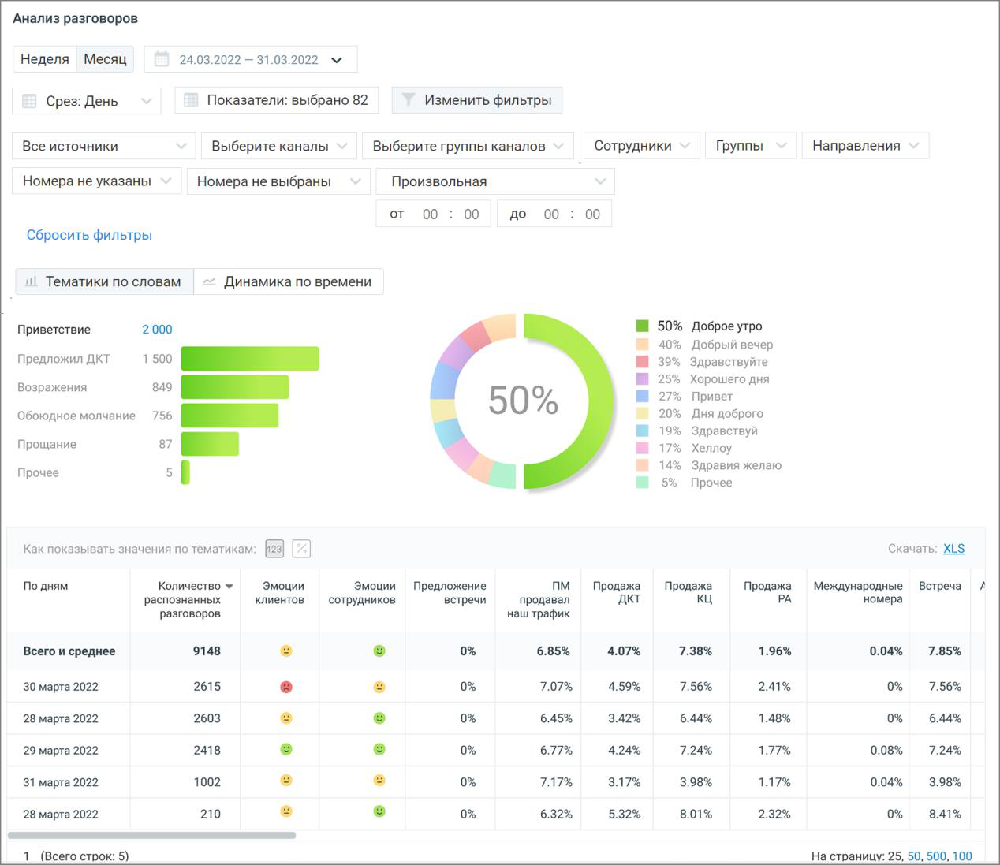
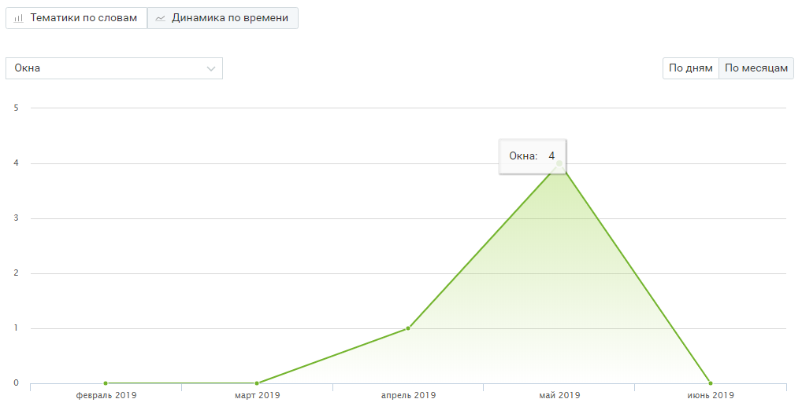

### 8.4.2. Блок визуализаций

> Трассировка: PDF §8.4.2 · сквозные стр. 78-80 · источники: ч.1 `kb/sources/speech-analytics/RECHEVAYA-ANALITIKA_1.26.42.pdf` с.78-80.

**Визуализация “Тематики по словам”**

В поле визуализации “Тематики по словам” отображается:

Топ 5 выбранных тематик – наиболее популярные тематики (не более 5-ти) из тематик, выбранных пользователем во всплывающем окне “Показатели”, подраздел Количество разговоров по тематикам.

Позволяет определить – какие из установленных тематик содержат наибольшее количество разговоров. Таким образом руководитель может видеть, к примеру, вектор заинтересованности клиентов в тех или иных товарах.

Клик по любой из предложенных тематик позволяет увидеть подробную детализацию по этой тематике.

Что говорят в тематике – для тематики, выбранной в “ТОП-5 популярных тематик”, показывает процентное соотношение распознанных терм по отношению к общему количеству терм тематики. В гистограмме отображается не более 10 строк. Если тематика содержит более 10 терм, наименее популярные из них помечаются, как Прочие.

> **Описание иллюстрации SA-§8.4.2-1** · к разделу §8.4.2 «Блок визуализаций» · стр. 79 · снимок экрана / схема, 1268×1097 px.
> Относится к тексту руководства: «…тик”, показывает процентное соотношение распознанных терм по отношению к общему количеству терм тематики. В гистограмме отображается не более 10 строк. Если тематика содержит более 10 терм, наименее популярные из них помечаются, как Прочие.»
> Следующий за иллюстрацией текст: «Визуализация “Динамика по времени” Визуализация “Динамика по времени” представляет собой график изменений выбранного показателя в заданный период времени. Выпадающий список в левом верхнем углу график…»
> Текст на изображении (OCR, требует сверки): Анализ разговоров.; Неделя Месяц; 24.03.2022 — 31.03.2022 м; Показатели: выбрано 82; Изменить фильтры; Срез: День; Все источники; Выберите каналы; Выберите группы каналов; Сотрудники; Группы; Направления; Номера не указаны; Номера не выбраны; Произвольная; от; 00; до 00; Сбросить фильтры; ul Тематики по словам; ~ Динамика по времени; М 50%; Доброе утро; Приветствие; 2000; 40%; Добрый вечер; Предложил ДКТ; 39%; Здравствуйте; Хорошего дня; Возражения; 27%; Привет; 50%; 20%; Дня доброго; Обоюдное молчание 756 ИИ; 19%; Здравствуй; Прощание; 17%; Хеллоу; 14%; Здравия желаю; Прочее; sf; Как показыва…

**Визуализация “Динамика по времени”**

Визуализация “Динамика по времени” представляет собой график изменений выбранного показателя в заданный период времени.

Выпадающий список в левом верхнем углу графика содержит доступные для выбора показатели.

При наведении курсора на элементы графика отображается всплывающая подсказка с информацией по соответствующему дню/месяцу.

> **Описание иллюстрации SA-§8.4.2-2** · к разделу §8.4.2 «Блок визуализаций» · стр. 80 · снимок экрана / схема, 1018×522 px.
> Относится к тексту руководства: «При наведении курсора на элементы графика отображается всплывающая подсказка с информацией по соответствующему дню/месяцу.»
> Текст на изображении (OCR, требует сверки): ull Тематики по словам.; = Динамика по времени; Окна; To Ham По месяцам; кн:; февраль 2019; март 2019; апрель 2019; май 2019; ‘июнь 2019
