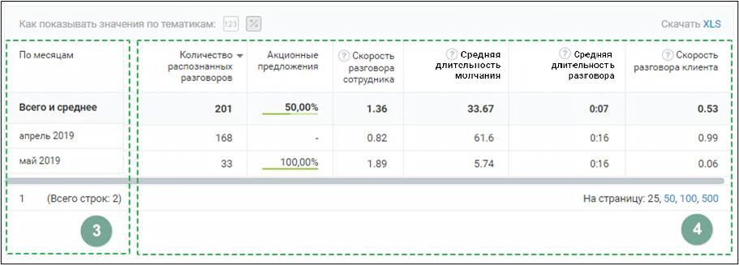

### 8.4.3. Блок таблицы

> Трассировка: PDF §8.4.3 · сквозные стр. 80-81 · источники: ч.1 `kb/sources/speech-analytics/RECHEVAYA-ANALITIKA_1.26.42.pdf` с.80-81.

> **Описание иллюстрации SA-§8.4.3-1** · к разделу §8.4.3 «Блок таблицы» · стр. 80 · снимок экрана / схема, 911×327 px.
> Относится к тексту руководства: начало раздела «Блок таблицы».
> Следующий за иллюстрацией текст: «Таблица формируется по срезу День/Месяц/Год и заданным пользователем в окне “Показатели” параметрам. Для типа записи разговора «Текстовые коммуникации» в качестве показателей отображаются только данны…»
> Текст на изображении (OCR, требует сверки): Как; казывать значения по тем; тика; Скачать XLS; не; По месяцам; Количество +; Акциочные; Средняя; Скорость; длительность; распознанных; предложения; разговора; "молчания; разговора клиента; разговоров; ‘сотрудника; Всего и среднее.; 201; 50,00%; 1.36; 33.67; 0:07; 0.53; апрель 2019; 168; 0.82; 61.6; 016; 0.99; май2019; 33; 100,00%; 1.89; 574; 0.06; (Всего строк: 2); На страницу: 25, 50, 100, 500

Таблица формируется по срезу День/Месяц/Год и заданным пользователем в окне “Показатели” параметрам.

Для типа записи разговора «Текстовые коммуникации» в качестве показателей отображаются только данные разговоров по тематикам.

Таблица может включать следующие данные:

> **Описание иллюстрации SA-§8.4.3-2** · к разделу §8.4.3 «Блок таблицы» · стр. 80 · пиктограмма (значок элемента интерфейса), 42×41 px.
> Относится к тексту руководства: «Таблица может включать следующие данные:»
> Следующий за иллюстрацией текст: «Срез: день, месяц или год. Этот показатель присутствует в таблице всегда.»
> Текста на изображении нет; назначение значка — см. текст, к которому он относится.

Срез: день, месяц или год. Этот показатель присутствует в таблице всегда.

> **Описание иллюстрации SA-§8.4.3-3** · к разделу §8.4.3 «Блок таблицы» · стр. 80 · пиктограмма (значок элемента интерфейса), 47×42 px.
> Относится к тексту руководства: «Срез: день, месяц или год. Этот показатель присутствует в таблице всегда.»
> Следующий за иллюстрацией текст: «Показатели:  название тематики – в примере на скриншоте выбрана тематика «Акционные предложения».»
> Текста на изображении нет; назначение значка — см. текст, к которому он относится.

Показатели:

• название тематики – в примере на скриншоте выбрана тематика «Акционные предложения».

При выборе для отчета большего количества тематик, данные по каждой из них будут отображаться в отдельном столбце. Где заголовок – название выбранной тематики. ВАЖНО: Данные столбца могут отображаться в двух вариантах: - в виде процентного соотношения разговоров в срезе, отнесенных к данной тематике, к общему числу разговоров в срезе; - в числовом виде – количество разговоров в срезе, отнесенных к данной тематике;

• Количество распознанных разговоров. Этот показатель присутствует в таблице всегда • Средняя длительность записи • Средняя длительность разговора • Средняя длительность молчания • Доля разговора • Доля обоюдного молчания • Количество перебиваний сотрудником • Количество перебиваний клиентом • Доля обоюдного разговора • Доля разговора сотрудника • Доля разговора клиента • Скорость разговора сотрудника • Скорость разговора клиента

> **Описание иллюстрации SA-§8.4.3-4** · к разделу §8.4.3 «Блок таблицы» · стр. 81 · пиктограмма (значок элемента интерфейса), 25×26 px.
> Относится к тексту руководства: «…ра • Доля обоюдного молчания • Количество перебиваний сотрудником • Количество перебиваний клиентом • Доля обоюдного разговора • Доля разговора сотрудника • Доля разговора клиента • Скорость разговора сотрудника • Скорость разговора клиента»
> Следующий за иллюстрацией текст: «Чтобы узнать правило расчета каждого из показателей, наведите курсор на пиктограмму возле наименования показателя. Для фильтрации данных отчета по возрастанию/убыванию следует щелкнуть по наименованию…»
> Текста на изображении нет; назначение значка — см. текст, к которому он относится.

Чтобы узнать правило расчета каждого из показателей, наведите курсор на пиктограмму возле наименования показателя.

Для фильтрации данных отчета по возрастанию/убыванию следует щелкнуть по наименованию столбца.
