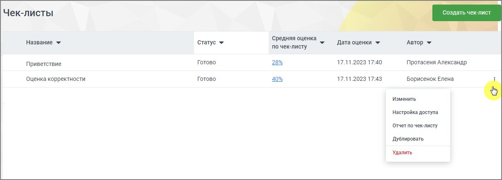
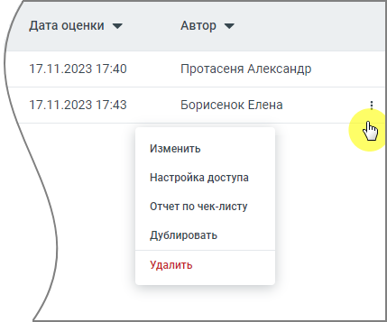

## 8.5. Анализ по чек-листам

> Трассировка: PDF §8.5 · сквозные стр. 82-84 · источники: ч.1 `kb/sources/speech-analytics/RECHEVAYA-ANALITIKA_1.26.42.pdf` с.82-84.

Отчет предназначен для автоматической оценки разговора сотрудника с клиентом на соответствие стандартам компании.

Клик по строке меню «Анализ по чек-листам» открывает перечень всех созданных пользователем чек-листов для оценки разговоров операторов. В окне списка доступен просмотр средней оценки по созданным чек-листам и создание нового чек-листа в Конструкторе.

> **Описание иллюстрации SA-§8.5-1** · к разделу §8.5 «Анализ по чек-листам» · стр. 83 · снимок экрана / схема, 1211×434 px.
> Относится к тексту руководства: «…роке меню «Анализ по чек-листам» открывает перечень всех созданных пользователем чек-листов для оценки разговоров операторов. В окне списка доступен просмотр средней оценки по созданным чек-листам и создание нового чек-листа в Конструкторе.»
> Следующий за иллюстрацией текст: «Заголовки столбцов (доступна сортировка): Название – задается автором на странице Конструктора Средняя оценка по чек-листу – отображается если чек-лист был просчитан. Может отображаться как цифрами, т…»
> Текст на изображении (OCR, требует сверки): Чек-листы; дат; ек-лист; Название *; ‘Средняя оценка; Дата оценки w; Статус +; по чек-листу; Автор ¥; Готово; 28%; 17.11.2023 17:40; Протасеня Александр.; Приветствие; Оценка корректности; 40%; 17.11.2023 17:43; Борисенок Елена; Изменить; 'Настройка доступа; ‘Отчет по чек-листу; `Дублировать; 'УДалить

Заголовки столбцов (доступна сортировка):

Название – задается автором на странице Конструктора

Средняя оценка по чек-листу – отображается если чек-лист был просчитан. Может отображаться как цифрами, так и в процентах. Если чек лист не был просчитан – ставится прочерк

Дата оценки – дата и время, когда была выставлена оценка (задается автоматически). Если чек- лист не был просчитан – ставится прочерк

Автор – автор чек-листа. Изменение чек-листа доступно только автору и тем сотрудникам, которым предоставлен доступ к чек-листу.

Статус – чек-лист может находиться в одном из следующих статусов, задаваемых автоматически:

• Черновик – анализ по чек-листу не проводился, статистики нет;

• В процессе – чек-лист находится на этапе просчета;

• Ошибка просчета – любая из ошибок. При появлении ошибки рекомендуется запустить оценку по чек-листу повторно;

• Готово – чек-лист оценен и есть цифровое значение. Ячейка с цифровыми данными является кнопкой, которая переводит на страницу Статистики.

> **Описание иллюстрации SA-§8.5-2** · к разделу §8.5 «Анализ по чек-листам» · стр. 83 · снимок экрана / схема, 429×357 px.
> Относится к тексту руководства: «• Готово – чек-лист оценен и есть цифровое значение. Ячейка с цифровыми данными является кнопкой, которая переводит на страницу Статистики.»
> Следующий за иллюстрацией текст: «Пиктограмма доступна только авторам чек-листа и сотрудникам, которым автор предоставил»
> Текст на изображении (OCR, требует сверки): Дата оценки w; Автор v; 17.11.2023 17:40; Протасеня Александр; 17.11.2023 17:43; Борисенок Елена; Изменить; Настройка доступа; Отчет по чек-листу; Дублировать; Удалить

> **Описание иллюстрации SA-§8.5-3** · к разделу §8.5 «Анализ по чек-листам» · стр. 84 · пиктограмма (значок элемента интерфейса), 10×20 px.
> Относится к тексту руководства: «• Готово – чек-лист оценен и есть цифровое значение. Ячейка с цифровыми данными является кнопкой, которая переводит на страницу Статистики.»
> Следующий за иллюстрацией текст: «Пиктограмма доступна только авторам чек-листа и сотрудникам, которым автор предоставил»
> Текста на изображении нет; назначение значка — см. текст, к которому он относится.

Пиктограмма доступна только авторам чек-листа и сотрудникам, которым автор предоставил

> **Описание иллюстрации SA-§8.5-4** · к разделу §8.5 «Анализ по чек-листам» · стр. 84 · пиктограмма (значок элемента интерфейса), 10×20 px.
> Относится к тексту руководства: «Пиктограмма доступна только авторам чек-листа и сотрудникам, которым автор предоставил»
> Следующий за иллюстрацией текст: «доступ к чек-листу. Клик по пиктограмме в строке выделенного чек-листа открывает выпадающее меню:  Удалить – после подтверждения согласия на удаление чек-лист удаляется;  Дублировать – создание дубл…»
> Текста на изображении нет; назначение значка — см. текст, к которому он относится.

доступ к чек-листу. Клик по пиктограмме в строке выделенного чек-листа открывает выпадающее меню:

• Удалить – после подтверждения согласия на удаление чек-лист удаляется;

• Дублировать – создание дубля чек-листа, в котором все поля кроме Названия и Описания заполнены так же, как и в оригинале. Если в списке уже создано 10 чек-листов кнопка не работает;

• Отчет по чек-листу – переход на страницу Статистики по данному чек-листу;

• Настройка доступа – при нажатии на строку открывается окно, в котором автор может выбрать сотрудников, получающих доступ к чек-листу. Список доступных сотрудников не ограничивается подконтрольными группами — доступны все пользователи, имеющие права доступа к Речевой аналитике.

• Изменить – переход на страницу Конструктора, с возможностью редактировать чек-лист.
