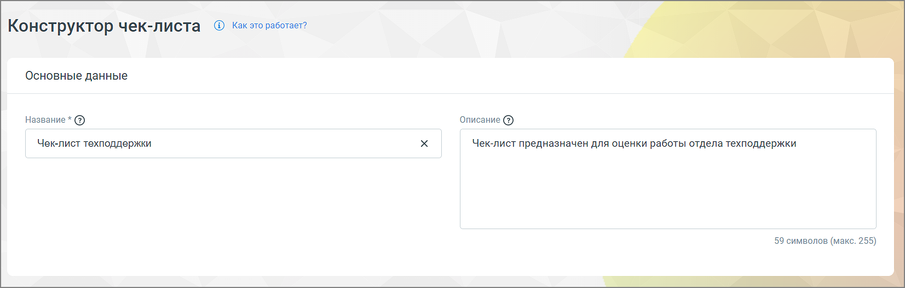
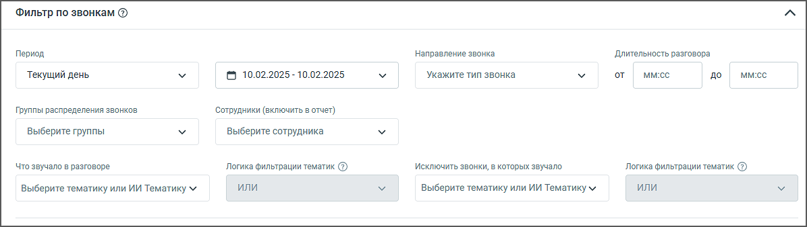
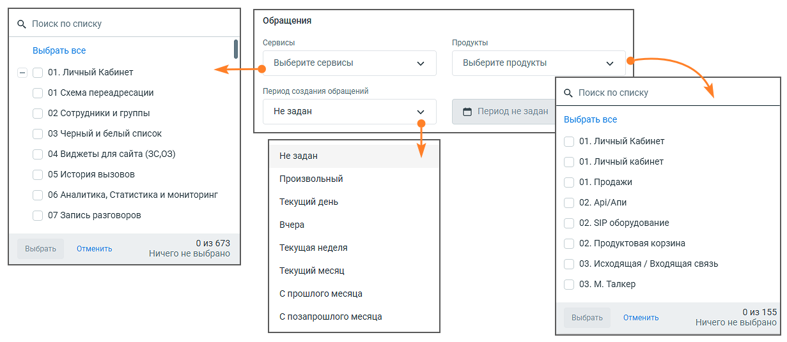
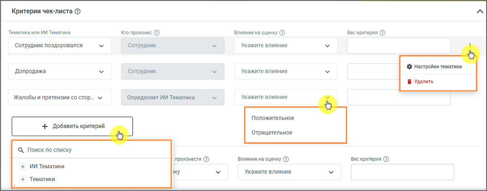
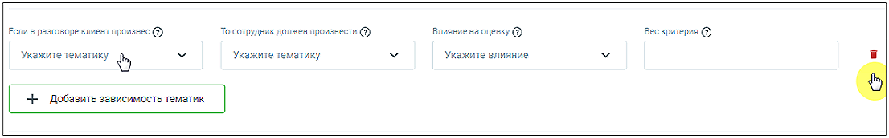
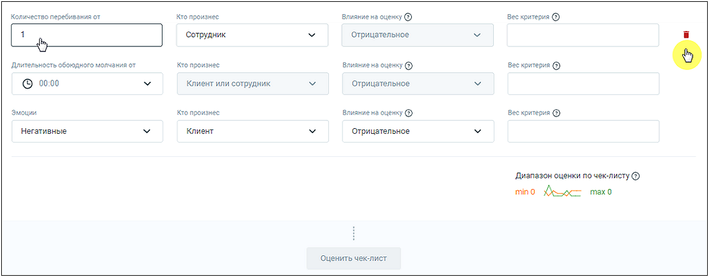
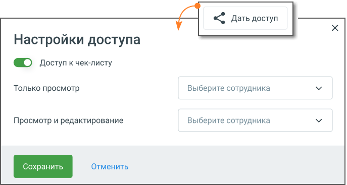

### 8.5.1. Конструктор чек-листов

> Трассировка: PDF §8.5.1 · сквозные стр. 84-90 · источники: ч.1 `kb/sources/speech-analytics/RECHEVAYA-ANALITIKA_1.26.42.pdf` с.84-90.

Возможно создание не более 20-ти чек-листов.

Для создания нового чек-листа необходимо нажать на кнопку Создать чек-лист. Вы можете выбрать один из трёх вариантов: «Чек-лист для отдела продаж», «Чек-лист для отдела поддержки» или «Пустой чек-лист».

Готовые шаблоны уже содержат ключевые критерии для оценки качества работы менеджеров, что помогает сразу выявлять типовые ошибки и точки роста. Выбранный шаблон можно сразу использовать для анализа или адаптировать под свои задачи, изменив, добавив или удалив пункты.

«Пустой чек-лист» позволяет создать список с нуля, если требуется полностью индивидуальный подход.

> **Описание иллюстрации SA-§8.5.1-1** · к разделу §8.5.1 «Конструктор чек-листов» · стр. 84 · снимок экрана / схема, 1653×528 px.
> Относится к тексту руководства: ««Пустой чек-лист» позволяет создать список с нуля, если требуется полностью индивидуальный подход.»
> Следующий за иллюстрацией текст: «Основные данные:  Название – название, под которым чек-лист будет отображаться в списке чек-листов, не более 65 символов. Название должно быть уникальным в рамках списка чек-листов ЛК ВАТС. Поле обяз…»
> Текст на изображении (OCR, требует сверки): Конструктор чек-листа © както работает?; Основные данные; Название * @; Описание @; Чек-лист техподдержки; Чек-лист предназначен для оценки работы отдела техподдержки; 59 символов (макс. 255)

Основные данные:

• Название – название, под которым чек-лист будет отображаться в списке чек-листов, не более 65 символов. Название должно быть уникальным в рамках списка чек-листов ЛК ВАТС. Поле обязательно для заполнения;

• Описание – описание чек-листа, не более 255 символов;

> **Описание иллюстрации SA-§8.5.1-2** · к разделу §8.5.1 «Конструктор чек-листов» · стр. 85 · снимок экрана / схема, 1196×338 px.
> Относится к тексту руководства: «• Описание – описание чек-листа, не более 255 символов;»
> Следующий за иллюстрацией текст: «Фильтр по звонкам и чатам:  Период – в какой период были осуществлены звонки и чаты, которые должны войти в отчет. Выпадающее меню, с вариантами периода: произвольный, текущий день, вчера, текущая не…»
> Текст на изображении (OCR, требует сверки): Фильтр по звонкам ©; Период; Направление звонка; Длительность разговора; Текущий день; © 10.02.2025 - 10.02.2025; `Укажите тип звонка; от; ммс; до; Группы распределения звонков; ‘сотрудники (включить в отчет); выберите группы; выберите сотрудника; ‘Что звучало в разговоре; исключить звонки, в которых звучало; Логика фильтрации тематик @; Выберите тематику или ИИ Тематику ¥; win; Выберите тематику или ИИ Тематику м

Фильтр по звонкам и чатам:

• Период – в какой период были осуществлены звонки и чаты, которые должны войти в отчет. Выпадающее меню, с вариантами периода: произвольный, текущий день, вчера, текущая неделя, текущий месяц, с прошлого месяца, с позапрошлого месяца;

• Календарь – для указания временного промежутка, когда были осуществлены разговоры и переписки, которые должны войти в отчет. После выбора дат, нужно подтвердить выбор кнопкой «Выбрать»;

• Длительность разговора – какой длительности должны быть звонки, которые должны войти в отчет (фильтр применяется только к звонкам);

o Если в ячейке не указана цифра «от», то будут анализироваться все разговоры без учета

нижней границы;

o Если в ячейке не указана цифра «до», то будут анализироваться все разговоры без

учета верхней границы;

o Если в ячейке не указаны цифра «от» и «до», то будут анализироваться все разговоры,

без учета этого фильтра;

• Тип коммуникации – какие коммуникации должны войти в отчет: звонок, чат.

• Тип звонка – какого типа звонки должны войти в отчет. Выпадающее меню с вариантами: исходящий, входящий, внутренний. После выбора показателей нужно подтвердить выбор кнопкой «Выбрать»;

• Сотрудники – выпадающий список, в котором можно выбрать одного, нескольких или всех сотрудников, по разговорам и чатам которых будет строиться отчет. В списке фильтра есть два уровня: сначала отображаются группы, а внутри них — сотрудники. Пользователь может выбрать нужную группу, чтобы сразу увидеть всех её участников, или найти конкретного человека.

• Группы распределения звонков – при выборе каких-либо групп в отчетах будут отображаться только разговоры сотрудников, принадлежащих к выбранным группам. Если ни одно группа не выбрана, отчет формируется по всем группам;

• Что звучало в разговоре – выбор одной или нескольких тематик (в том числе ИИ тематик) для оценки по чек-листу;

• Исключить звонки и чаты, в которых звучало – звонки и чаты, которым проставились выбранные тематики, не будут участвовать в оценке по чек-листу;

• Логика фильтрации – для включающего и исключающего тематики фильтра необходимо задать один из вариантов логики, по которой будут фильтроваться звонки и чаты:

o «И» – ищет диалоги, где встречается тематика 1 И тематика 2 И остальные выбранные

тематики;

o «ИЛИ» – ищет диалоги, где встречается хотя бы одна из выбранных тематик.

> **Описание иллюстрации SA-§8.5.1-3** · к разделу §8.5.1 «Конструктор чек-листов» · стр. 86 · снимок экрана / схема, 1231×536 px.
> Относится к тексту руководства: «o «ИЛИ» – ищет диалоги, где встречается хотя бы одна из выбранных тематик.»
> Следующий за иллюстрацией текст: «Фильтр по обращениям:  Сервисы – поле выбора категорий сервисов. Выпадающий список включает все сервисы ЛК ВАТС. Содержит элементы для поиска и массового выбора.  Продукты – поле выбора категорий пр…»
> Текст на изображении (OCR, требует сверки): ‘Обращения; Q Поиск по списку; ‘Сервисы; Продукты; выбрать все; выберите сервисы; выберите продукты; 01. Личный Кабинет; Период создания обращений; 01 Схема переадресации; 02 Сотрудники и группы; Не задан; (© Период не задан; 03 Черный и белый список; 04 Виджеты для сайта (36,03); 05 История вызовов; Произвольный; 01. Продажи; 06 Аналитика, Статистика и мониторинг; Текущий день; 02. Ар/АПИ; 07 Запись разговоров; Вчера; 02. ЯР оборудование; из 673; 02. Продуктовая корзина; выбрать,; Отменить; Текущая неделя; ничего не выбрано,; 03. Исходящая / Входящая связь; Текущий месяц.; 03. М. Талкер; ‘С п…

Фильтр по обращениям:

• Сервисы – поле выбора категорий сервисов. Выпадающий список включает все сервисы ЛК ВАТС. Содержит элементы для поиска и массового выбора. • Продукты – поле выбора категорий продуктов. Выпадающий список включает все продукты ЛК ВАТС. Содержит элементы для поиска и массового выбора. • Период создания обращений – выпадающий список с вариантами периода. Доступные варианты:

o Не задан, o Произвольный, o Текущий день, o Вчера, o Текущая неделя, o Текущий месяц, o С прошлого месяца, o С позапрошлого месяца. • Текущий результат – значение результата обращения, получаемое из CRM. Позволяет отфильтровать и оценить разговоры и чаты по итоговому статусу связанного обращения. • Дата закрытия обращения – период, в который было закрыто обращение, полученный из CRM. Фильтр по CRM

Инструмент фильтрации звонков по этапам сделок позволяет оценивать эффективность работы сотрудников не только по содержанию разговора, но и в контексте хода сделки.

> **Описание иллюстрации SA-§8.5.1-4** · к разделу §8.5.1 «Конструктор чек-листов» · стр. 86 · снимок экрана / схема, 436×117 px.
> Относится к тексту руководства: «Инструмент фильтрации звонков по этапам сделок позволяет оценивать эффективность работы сотрудников не только по содержанию разговора, но и в контексте хода сделки.»
> Следующий за иллюстрацией текст: «внимание Функция доступна при подключённой в ЛК ВАТС интеграции «Расширенный пакет Битрикс24». В настройках интеграции должен быть отмечен чекбокс «Передавать данные в Речевую аналитику». В выпадающем…»
> Текст на изображении (OCR, требует сверки): Фильтры CRM; Воронки Битрикс24; Воронки и этапы; Выбрано: 1 изб

**Внимание:**

Функция доступна при подключённой в ЛК ВАТС интеграции «Расширенный пакет Битрикс24». В настройках интеграции должен быть отмечен чекбокс «Передавать данные в Речевую аналитику».

В выпадающем списке блока фильтров вы можете выбрать:

• Тип воронки (например, «Продажи», «Поддержка»);

• Этап сделки (например, «Первичный контакт», «Закрыто успешно»).

После выбора параметров в таблице результатов отображается колонка «CRM», где для каждого разговора указываются статус сделки и её текущий этап в Битрикс24. Благодаря этим данным можно сразу увидеть, как конкретные звонки влияют на продвижение сделок и оценить эффективность работы менеджеров на разных стадиях продаж.

Отфильтрованные результаты можно просматривать прямо в интерфейсе или выгружать в таблицу. Это удобно для последующего анализа или подготовки отчётов.

Критерии чек-листа:

> **Описание иллюстрации SA-§8.5.1-5** · к разделу §8.5.1 «Конструктор чек-листов» · стр. 87 · снимок экрана / схема, 1215×477 px.
> Относится к тексту руководства: «Критерии чек-листа:»
> Следующий за иллюстрацией текст: «Доступные критерии: 1) Тематики или ИИ Тематики При создание нового чек-листа в блоке Критериев по умолчанию отображаются три тематики-»
> Текст на изображении (OCR, требует сверки): Критерии чек-листа ®; "Тематика или ИИ Тематика; Кто произнес @; Влияние на оценку ©; Вескритерия ©; Сотрудник поздоровался; сотрудник; Укажите влияние; 3$ Настройки тематики; Допродажа; @ Удалить; Жалобы и претензии со стор. м; Определяет ИИ Тематика; Положительное; + добавить критерий; ‘Отрицательное; Q Поиск no списку; произнести @; Bec критерия @; + WW Тематики; ky; + Тематики

Доступные критерии:

1) Тематики или ИИ Тематики

При создание нового чек-листа в блоке Критериев по умолчанию отображаются три тематики-

> **Описание иллюстрации SA-§8.5.1-6** · к разделу §8.5.1 «Конструктор чек-листов» · стр. 87 · пиктограмма (значок элемента интерфейса), 10×20 px.
> Относится к тексту руководства: «При создание нового чек-листа в блоке Критериев по умолчанию отображаются три тематики-»
> Следующий за иллюстрацией текст: «критерия. Клик по пиктограмме в строке выделенного чек-листа открывает выпадающее меню:  Настройки тематики – переход в раздел Настройки тематик;  Удалить – удаление тематики или запроса к ИИ из чек…»
> Текста на изображении нет; назначение значка — см. текст, к которому он относится.

критерия. Клик по пиктограмме в строке выделенного чек-листа открывает выпадающее меню:

• Настройки тематики – переход в раздел Настройки тематик;

• Удалить – удаление тематики или запроса к ИИ из чек-листа.

Клик по кнопке «Добавить критерий» открывает список всех доступных тематик и запросов к ИИ с возможностью выбора одного из них. В список критериев добавляется строка с выбранной тематикой или запросом и полями для ввода и выбора данных:

o Кто произнес – в каком канале звучала тематика или запрос: сотрудник, клиент, клиент

или сотрудник;

o Влияние на оценку – задается влияние тематики или запроса на общую оценку

(положительное или отрицательное);

o Вес критерия – оценка в баллах, как повлияет срабатывание критерия, на общую оценку,

максимум можно вводить 4 цифры;

Отображение поля «Кто произнес» для выбранных тематик и запросов:

• Если в расширенных настройках Тематики пользователь указал вариант «клиент или сотрудник», то в чек-листе есть возможность выбрать или клиента, или сотрудника или оставить обоих.

• Если тематика или запрос настроены на «клиент» или «сотрудник», то у пользователя в чек- листах не будет возможности выбрать – в ячейке будет указан или «клиент», или «сотрудник» по умолчанию.

• Если у пользователя не было расширенных настроек, то данную ячейку пользователь заполняет в интерфейсе конструктора чек-листов самостоятельно.

2) Зависимость тематик

> **Описание иллюстрации SA-§8.5.1-7** · к разделу §8.5.1 «Конструктор чек-листов» · стр. 88 · снимок экрана / схема, 1106×173 px.
> Относится к тексту руководства: «2) Зависимость тематик»
> Следующий за иллюстрацией текст: «Эта настройка устанавливает зависимость ответа сотрудника от запроса клиента. У пользователя есть возможность выбрать тематики запроса и ответа, а также влияние критерия на оценку и вес критерия. Клик…»
> Текст на изображении (OCR, требует сверки): Eons разговоре клиент произнес @; To сотрудник должен произчести (©); Bows; наценку ©; 'Вескритерия ©); Укажите тем; Укажите влияние; пику; Укажите тематику %

Эта настройка устанавливает зависимость ответа сотрудника от запроса клиента. У пользователя есть возможность выбрать тематики запроса и ответа, а также влияние критерия на оценку и вес критерия. Клик по кнопке "Добавить зависимость тематик" добавляет строку с полями для ввода/выбора данных.

3) Характеристики разговора

> **Описание иллюстрации SA-§8.5.1-8** · к разделу §8.5.1 «Конструктор чек-листов» · стр. 88 · снимок экрана / схема, 1143×447 px.
> Относится к тексту руководства: «3) Характеристики разговора»
> Следующий за иллюстрацией текст: «Также при создании чек-листа в блоке по умолчанию отображаются критерии – характеристики разговора:  Количество перебиваний – влияние на оценку автоматически проставлено как «отрицательное», вес не у…»
> Текст на изображении (OCR, требует сверки): "Количество перебивания от; то произнес:; Элияниена оценку ©; Вес критерия @; ‘Сотрудник; Отрицательное; Длительность обоюдного молчания от; Kro произнес; Влияние не оценку @; Bee критерия @; Клиент или сотрудник; Эмоции; произнес; Влилниенг оценку ©); 'Негативные; Клиент; Диапазон оценки по чек-листу ©; mind Фо тако; Оценить чеклист

Также при создании чек-листа в блоке по умолчанию отображаются критерии – характеристики разговора:

• Количество перебиваний – влияние на оценку автоматически проставлено как «отрицательное», вес не указан

o Количество перебиваний от __ – количество перебиваний в разговоре сотрудником или

клиентом (выбирается в следующем поле);

o Кто произнес – для кого считается количество перебиваний. Варианты: сотрудник,

клиент, клиент или сотрудник;

o Влияние на оценку – по умолчанию проставлено как «отрицательное», изменение

невозможно;

o Вес критерия – оценка в баллах, как повлияет срабатывание критерия, на общую оценку,

максимум можно вводить 4 цифры;

• Длительность обоюдного молчания – по умолчанию проставлено как «отрицательное», изменение невозможно;

o Длительность обоюдного молчания от__ вводится в формате ММ:СС. Пользователь

может ввести цифру самостоятельно, либо выбрать из выпадающего меню, с шагом 10 секунд.

o Кто произнес – имеется в виду «для кого считается длительность молчания». Вариант:

сотрудник или клиент, изменение невозможно;

o Влияние на оценку – по умолчанию проставлено как «отрицательное», изменение

невозможно;

o Вес критерия – оценка в баллах, как повлияет срабатывание критерия, на общую оценку,

максимум можно вводить 4 цифры.

После ввода веса каждого критерия, под таблицей автоматически считается и отображается диапазон оценок по чек-листу – максимальная и минимальная возможные оценки сотрудников.

Для подсчета статистики по чек-листу нажмите кнопку «Оценить чек-лист». После нажатия кнопки все поля критериев будут недоступны для редактирования.

Чтобы отредактировать критерии после подсчета статистки, прокрутите страницу чек-листа вверх и нажмите кнопку «Изменить чек-лист». Статистика по данному чек-листу будет сброшена, чек-лист перейдет в статус «черновик» до момента следующей оценки.

**Как поделиться чек-листом**

Руководитель направления может создать чек-лист с заранее определёнными критериями. Такой чек-лист можно передать другим пользователям — например, руководителям подразделений или супервайзерам.

• Кнопка Дать доступ размещена в нижней части страницы чек-листа. • Возможность поделиться чек-листом доступна с любым сотрудником компании, у которого есть доступ к модулю речевой аналитики — не обязательно из одной группы или подразделения. • При сохранении чек-листа пользователем с правами «только просмотр», сохраняется только его версия отчета с индивидуальными фильтрами — базовый (корневой) отчет не изменяется.

> **Описание иллюстрации SA-§8.5.1-9** · к разделу §8.5.1 «Конструктор чек-листов» · стр. 89 · снимок экрана / схема, 687×367 px.
> Относится к тексту руководства: «…й аналитики — не обязательно из одной группы или подразделения. • При сохранении чек-листа пользователем с правами «только просмотр», сохраняется только его версия отчета с индивидуальными фильтрами — базовый (корневой) отчет не изменяется.»
> Следующий за иллюстрацией текст: «Сотрудники, которые получат доступ к чек-листу, могут использовать его для построения отчетов по нужным параметрам: выбрать конкретного сотрудника, задать нужный период, отфильтровать по другим параме…»
> Текст на изображении (OCR, требует сверки): lI < Дать доступ; Настройки доступа; @) Доступ к чек-листу; Только просмотр; Выберите сотрудника; Просмотр и редактирование

Сотрудники, которые получат доступ к чек-листу, могут использовать его для построения отчетов по нужным параметрам: выбрать конкретного сотрудника, задать нужный период, отфильтровать по другим параметрам. При этом сам чек-лист остается неизменным — редактированию подлежат только фильтры.

После применения фильтров создаётся персональная версия отчета, доступная только тому сотруднику, кто её сформировал. Другие пользователи, имеющие доступ к чек-листу, не увидят чужие изменения в фильтрах и результатах отчета.
