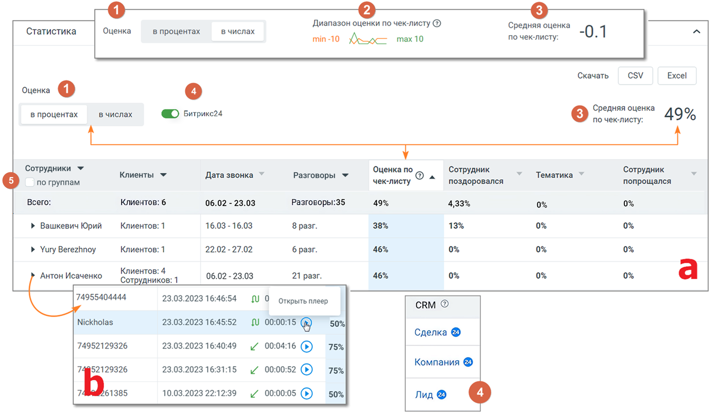
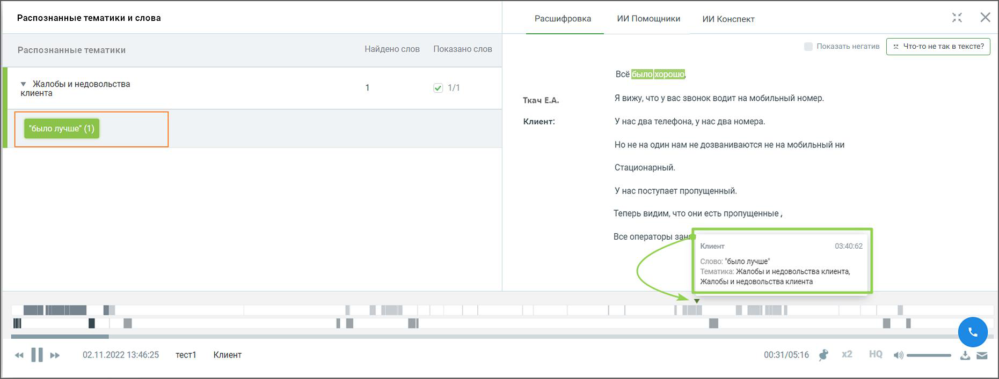
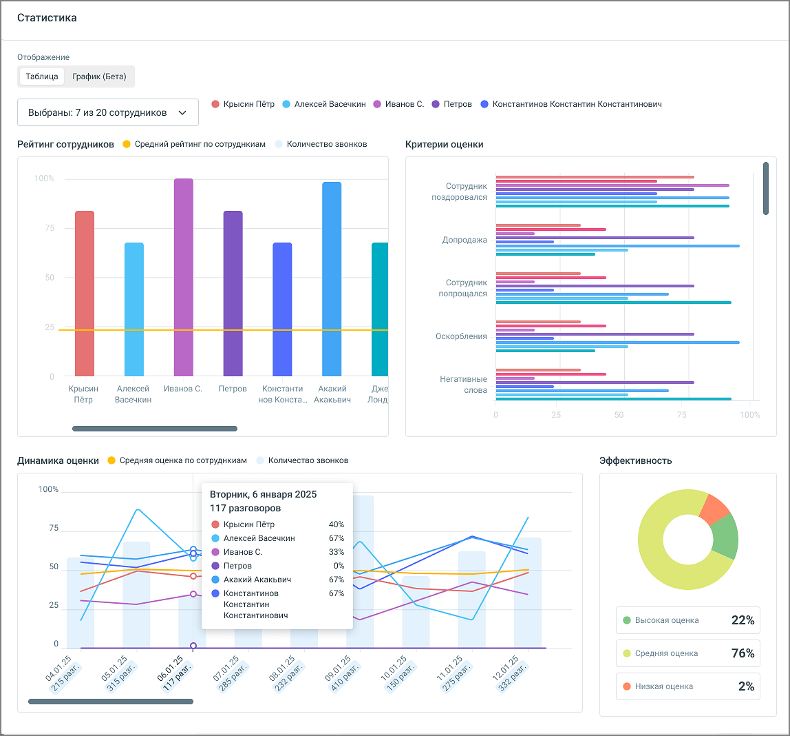

### 8.5.2. Статистика

> Трассировка: PDF §8.5.2 · сквозные стр. 90-93 · источники: ч.1 `kb/sources/speech-analytics/RECHEVAYA-ANALITIKA_1.26.42.pdf` с.90-93.

Статистика отчета по Чек-листам содержит вкладки «Таблица» и «График», которые позволяют комплексно анализировать результаты оценок в отчете.

Вкладка «Таблица»

Статистика по чек-листу отображается в процентах и числах и показывает результаты просчета чек-листа (по звонкам и чатам) по заданным в блоке «Критерии» чек-листа критериям и фильтрам.

> **Описание иллюстрации SA-§8.5.2-1** · к разделу §8.5.2 «Статистика» · стр. 90 · снимок экрана / схема, 1649×973 px.
> Относится к тексту руководства: «Статистика по чек-листу отображается в процентах и числах и показывает результаты просчета чек-листа (по звонкам и чатам) по заданным в блоке «Критерии» чек-листа критериям и фильтрам.»
> Следующий за иллюстрацией текст: «Элементы окна статистики: Заголовок окна 1) Выбор отображения данных: Оценка в процентах или числах. По умолчанию установлен вариант «в процентах». Если в окне статистики пользователь выбирает вариант…»
> Текст на изображении (OCR, требует сверки): в числах; Диапазон оценки по чек-листу @; Статистика; Оценка; в процентах; по чек-листу:; Средняя оценка -0. 1; min -10 doce max 10; Скачать; csv; Excel; Оценка (1); Средняя оценка; ©) Битрикс24; 49%; Сотрудники v; Клиенты *; Дата звонка ©; Разговоры ~; Оценка по; Oa; Сотрудник; Тематика ©; по группам; чек-листу; поздоровался; попрощался; Всего:; Клиентов: 6; 06.02 - 23.03; Разговоры:35; 4,33%; > Вашкевич Юрий; Клиентов: 1; 16.03 - 16.03; 8 разг.; 38%; 13%; > Yury Berezhnoy; 22.02 - 27.02; 6 разг.; 46%; ‘Антон Исаченко; Клиентов: 4; ‘Сотрудников: 1; 21 разг.; 74955404444; 23.03.2023 16:46:54; …

Элементы окна статистики:

Заголовок окна

1) Выбор отображения данных: Оценка в процентах или числах. По умолчанию установлен вариант «в процентах». Если в окне статистики пользователь выбирает вариант «в числах», то в списке чек-листов средняя оценка по чек-листу также будет отображаться в числах.

2) Виджет "Диапазон оценки по чек-листу" – максимальные и минимальные оценки, которые можно получить по данному чек-листу. В отчете отображается если выбрана оценка «в числах».

3) Средняя оценка по чек-листу – отображается в процентах или в числах, в зависимости от выбора отображения данных.

4) Переключатель "Битрикс24" – в таблице статистики звонков переключатель добавляет возможность быстрого перехода к данным CRM из соответствующей строки записи. Для каждого звонка, связанного с CRM, отображается название сущности (лид, сделка или компания) которое служит активной ссылкой. При клике на ссылку открывается страница сущности в Битрикс24.

5) Чекбокс группировки сотрудников по группам – в таблице статистики имеется возможность группировки сотрудников по заранее определённым группам. Если чекбокс отмечен:

• Статистика отображается для групп, а не для отдельных сотрудников. • На уровне каждой группы отображаются агрегированные данные — средние значения или суммы, в зависимости от показателя (например, средняя оценка, общее количество разговоров и т.п.).

**Внимание:**

Включение функции возможно только если подключена интеграция с Bitrix24 (расширенный пакет), а также настроена передача данных в Речевую аналитику. Подробнее о подключении узнайте здесь.

Таблица (a) с блоком детализации (b)

1) Сотрудники (с чекбоксом "по группам") .– имя сотрудника или название группы, которых анализируем,

2) Клиенты – количество клиентов. В детализации номер телефона или имя клиента;

3) Дата звонка и чата – диапазон дат, в которые совершались звонки и чаты. В детализации – дата и время конкретного звонка или чата;

4) Разговоры – количество разговоров и чатов. В детализации – длительность и тип разговора (пиктограмма со стрелкой: входящий, исходящий, внутренний) либо отметка о чате;

5) Оценка по чек-листу – усредненная оценка по чек-листу по всем разговорам. В детализации – точная оценка по чек-листу каждого разговора. Отображается в зависимости от выбора отображения в процентах или числах;

6) Настраиваемые показатели – соответствуют названиям критериев, которые выбраны в Конструкторе при создании чек-листа. Отображаются в зависимости от выбора отображения в процентах или числах;

> **Описание иллюстрации SA-§8.5.2-2** · к разделу §8.5.2 «Статистика» · стр. 91 · пиктограмма (значок элемента интерфейса), 28×28 px.
> Относится к тексту руководства: «6) Настраиваемые показатели – соответствуют названиям критериев, которые выбраны в Конструкторе при создании чек-листа. Отображаются в зависимости от выбора отображения в процентах или числах;»
> Следующий за иллюстрацией текст: «Клик по пиктограмме открывает окно встроенного плеера для прослушивания разговора со следующей информацией:  Тематики и ключевые слова – список распознанных ключевых слов, сгруппированный по тематика…»
> Текста на изображении нет; назначение значка — см. текст, к которому он относится.

Клик по пиктограмме открывает окно встроенного плеера для прослушивания разговора со следующей информацией:

• Тематики и ключевые слова – список распознанных ключевых слов, сгруппированный по тематикам.

• Расшифровка текста разговора – помимо текста разговора включает данные сотрудника и клиента, а также метки вхождений. Для внутренних разговоров – данные обоих сотрудников.

• Плеер с отметками фрагментов разговора и вхождений терм .

> **Описание иллюстрации SA-§8.5.2-3** · к разделу §8.5.2 «Статистика» · стр. 91 · пиктограмма (значок элемента интерфейса), 15×11 px.
> Относится к тексту руководства: «• Плеер с отметками фрагментов разговора и вхождений терм .»
> Следующий за иллюстрацией текст: «3) Кнопки «Сохранить», «Вернуться к списку»  Клик по кнопке «Вернуться к списку» открывает страницу списка чек-листов.  Клик по кнопке «Сохранить» сохраняет внесенные в чек-лист изменения. Если изме…»
> Текста на изображении нет; назначение значка — см. текст, к которому он относится.

> **Описание иллюстрации SA-§8.5.2-4** · к разделу §8.5.2 «Статистика» · стр. 92 · снимок экрана / схема, 1861×707 px.
> Относится к тексту руководства: «• Плеер с отметками фрагментов разговора и вхождений терм .»
> Следующий за иллюстрацией текст: «3) Кнопки «Сохранить», «Вернуться к списку»  Клик по кнопке «Вернуться к списку» открывает страницу списка чек-листов.  Клик по кнопке «Сохранить» сохраняет внесенные в чек-лист изменения. Если изме…»
> Текст на изображении (OCR, требует сверки): Me; Распознанные тематики и слова; Расшифровка; ИИ Помощники; ИИ Конспект; ях; Распознанные тематики; Найдено слов; Показано слов; Всё; у Жалобы и недовольства; клиента; Ткач Е.А.; Я вижу, что у вас звонок водит на мобильный номер.; Клиент:; У нас два телефона, у Hac два номера.; 'былол; Но не на один нам не дозваниваются не на мобильный ни; Стационарный.; У нас поступает пропущенный.; Теперь видим, что они есть пропущенные,; Все операторы зан; Клиент; 03:40:62; ‘Слово: "было лучше"; Тематика: Жалобы и недовольства клиента,; Жалобы и недовольства клиента; if; ии; 02.11.2022 13:46:25; тест1; х2…

3) Кнопки «Сохранить», «Вернуться к списку»

• Клик по кнопке «Вернуться к списку» открывает страницу списка чек-листов.

• Клик по кнопке «Сохранить» сохраняет внесенные в чек-лист изменения. Если изменения не вносились, кнопка не активна.

4) Кнопки экспорта

• Файл статистики может быть экспортирован в форматах Csv, Excel. Для экспорта нажмите кнопку соответствующего формата рядом с подсказкой «Скачать».

• Если по разговору сформированы ответы ИИ Помощников и/или ИИ Конспект, в выгрузку (вкладка «Детализация») можно включить чекбокс «ИИ Помощники» — тогда в файл добавляются ответы всех активных помощников (по одному столбцу на каждого, заголовок столбца — название помощника) и данные ИИ Конспекта.

Вкладка «График»

> **Описание иллюстрации SA-§8.5.2-5** · к разделу §8.5.2 «Статистика» · стр. 93 · снимок экрана / схема, 1148×1068 px.
> Относится к тексту руководства: «Вкладка «График»»
> Следующий за иллюстрацией текст: «Вкладка "График" содержит следующие элементы: 1) Рейтинг сотрудников: Бары отображают сравнительный рейтинг выбранных в чек-листе сотрудников. 2) Критерии оценки: Горизонтальные линейные графики показ…»
> Текст на изображении (OCR, требует сверки): Статистика; Отображение; таблица; график (Бета); ® Крысин Пётр ® Алексей Васечкин @ Иванов С. @ Петров @ Константинов Константин Константинович; Выбраны: 7 из 20 сотрудников; Рейтинг сотрудников @ Средний рейтинг по сотруднкиам; Количество звонков; Критерии оценки; Сотрудник; поздороваля; 'Допродажа; попрощался; Оскорбления; Негативные; Крысин; ‘Алексей; Иванов С.; Петров; Константи; Акакий; xe; слова; Васечкин; нов Конста.; `Акакьвич; Петр; Лонд,; ный; Динамика оценки ® Средняя оценка по сотруднкиам; Эффективность; 100%; Вторник, 6 января 2025; 117 разговоров; 75; @ Крысин Пётр.; 40%; @ Алекс…

Вкладка "График" содержит следующие элементы:

1) Рейтинг сотрудников: Бары отображают сравнительный рейтинг выбранных в чек-листе сотрудников.

2) Критерии оценки: Горизонтальные линейные графики показывают распределение различных оценочных критериев применительно к сотруднику.

3) Динамика оценки: Линейные графики для анализа изменений оценок каждого из сотрудников во времени.

4) Эффективность: Круговая диаграмма для визуализации процентного распределения оценок по сотрудникам.
