### 8.5.3. Правила подсчета статистики

> Трассировка: PDF §8.5.3 · сквозные стр. 93-100 · источники: ч.1 `kb/sources/speech-analytics/RECHEVAYA-ANALITIKA_1.26.42.pdf` с.93-100.

Рассмотрим правила подсчета статистики на примере скриншотов ниже (в числах и процентах):

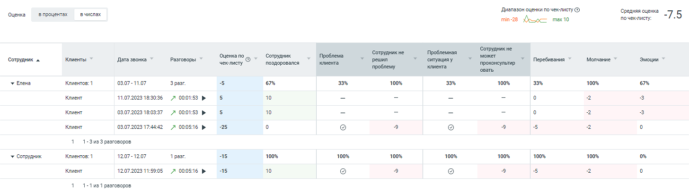

> **Описание иллюстрации SA-§8.5.3-1** · к разделу §8.5.3 «Правила подсчета статистики» · стр. 94 · снимок экрана / схема, 1456×409 px.
> Относится к тексту руководства: «Рассмотрим правила подсчета статистики на примере скриншотов ниже (в числах и процентах):»
> Следующий за иллюстрацией текст: «Рис. 1. Пример в числах»
> Подпись в руководстве: «Рис. 1. Пример в числах».
> Текст на изображении (OCR, требует сверки): числах.; _Дивпазон оценки почекслисту ©; ‘Оценка; впроцентах; почеклисту:; Cosas cuore 7 Б; min-28 Дос mae 10; Сотрудникне; ‘Сотрудникне; Проблемная; может; ‘Сотрудник 4.; Dara звонка; Разговоры; Оценка по; ‘Сотрудник; Проблема; решил; ситуацияу; Перебивания; Молчание; Эмоции; чеклисту; поздоровался; клиента; проконсультир; проблему; вать; Enena; Клиентов:1; 0307-1107; разг.; 100%; 33%; or; Клиент; 11.07.2023 18:30:36; 10; 7 000153 >; 03.07.2028 18:08:37; 03.07.2028 17:48:42; 7 00.0516 >; 25; 1-Зиз 3 разговоров; У Сотрудник; 1207-1207; 1 pesr.; a5; 12.07.2023 11:59:05; ic}; 1-1из1 разговоров

Рис. 1. Пример в числах

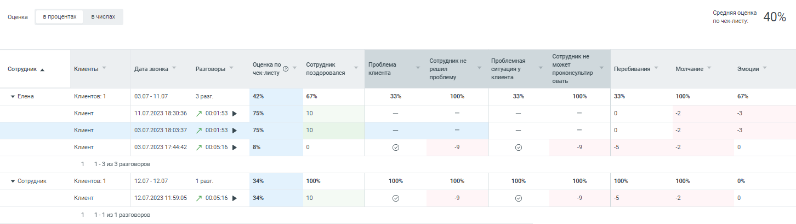

> **Описание иллюстрации SA-§8.5.3-2** · к разделу §8.5.3 «Правила подсчета статистики» · стр. 94 · снимок экрана / схема, 1452×410 px.
> Относится к тексту руководства: «Рис. 1. Пример в числах»
> Следующий за иллюстрацией текст: «Рис. 2. Пример в процентах»
> Подпись в руководстве: «Рис. 2. Пример в процентах».
> Текст на изображении (OCR, требует сверки): впроцентах; вчислах.; Оценка; почеклисту:; я 40%; Сотрудникне; Оценка по; Сотрудник; Проблема.; Проблемная; может; ‘Сотрудник a.; Дата звонка; Разговоры; ‘ситуацияу; Перебивания; Молчание; Эмоции; чеклисту; поздоровался; проконсультир,; у вена; Клиентов: 1; 0307-1107; разг; 100%; orm; 11.07.2028 18:30:36; 75%; 10; 03.07.2023 18:08:37; Клиент; (03.07.2028 17:48:42; 7 000816 >; 1-Зиз 3 разговоров; У Сотрудник; 1207-1207; 1 pasr.; 12.07.2023 11:59:05; 34%; 1-1из1 pasrosopos

Рис. 2. Пример в процентах

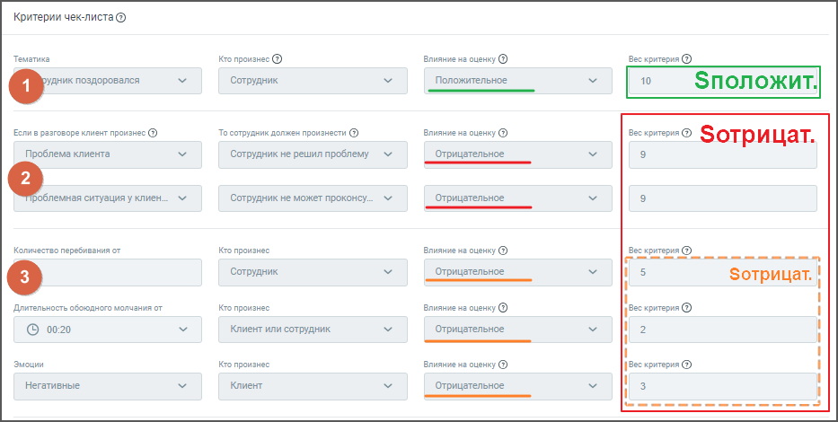

> **Описание иллюстрации SA-§8.5.3-3** · к разделу §8.5.3 «Правила подсчета статистики» · стр. 94 · снимок экрана / схема, 933×470 px.
> Относится к тексту руководства: «Рис. 2. Пример в процентах»
> Следующий за иллюстрацией текст: «Рис. 3. Критерии чек-листа 1) Подсчет средней оценки по чек-листу в процентах, производится по формуле: (P + |Sотриц|) / (|Sотриц| + Sполож) Где:»
> Подпись в руководстве: «Рис. 3. Критерии чек-листа 1) Подсчет средней оценки по чек-листу в процентах, производится по формуле: (P + |Sотриц|) / (|Sотриц| + Sполож) Где:».
> Текст на изображении (OCR, требует сверки): Критерии чек-листа ©; Тематика; ro произнес ®; rns на ошенку @; ec критерия ©; Сотрудник; Положительное; 10; Зположит.; oe nosnoposanca; разговоре клиент произнес ©); "Тосотридник должен произнести @); Brn на ошенку ©; Bec критерия © Зотр ицат.; Проблема клиента; Сотрудник не решил проблему; Отрицательное; ‘Сотрудник не может проконсу..; Колишество перебивания от; ro произнее; ве; аа; Зотрицат. /; Длительность обоюдного молчания oF; 12=екоитерия ©; © 0020; Клиент или сотрудник:; fl; wou; верите ©; Негативные; Клиент

Рис. 3. Критерии чек-листа

1) Подсчет средней оценки по чек-листу в процентах, производится по формуле:

**(P + |Sотриц|) / (|Sотриц| + Sполож)**

Где:

• Р=P1+P2+…PN – сумма баллов критериев, которые сработали во всех N разговорах; • Sотриц= Sотриц1+Sотриц2+…+SотрицN – общая возможная сумма баллов отрицательных критериев

для всех N разговоров. Если условие сложного критерия в отдельном разговоре не сработало, то этот разговор не учитывается в общей сумме баллов;

На примере рис.3 выше Sотриц составляет либо -28 либо -10 баллов, в зависимости от выполнения условия критерия в разговоре.

• Sполож= Sполож1+Sполож2+…+SположN – общая возможная сумма баллов положительных

критериев для всех N разговоров. Если условие сложного критерия в отдельном разговоре не сработало, то этот разговор не учитывается в общей сумме баллов;

На примере рис.3 выше Sполож равно 10 баллам.

Таким образом для примера рис.2 выше средняя оценка по чек-листу в процентах рассчитывается следующим образом:

Всего состоялось 4 разговора. Для первого и второго разговора условие сложного критерия в отдельном разговоре не сработало. Значит эти разговоры не учитываются в общей сумме баллов и для этих разговоров Sотриц = -10, а Sполож =10.

Для третьего и четвертого разговора условие сложного критерия в отдельном разговоре сработало. Значит эти разговоры учитываются в общей сумме баллов и для этих разговоров Sотриц = -28, а Sполож =10.

Считаем итоговую среднюю оценку по чек-листу в процентах:

((10-2-3)+(10-2-3)+(0-9-9-5-2)+(10-9-9-5-2)+(|-10|+|-10|+|-28|+|-28|)) / ((|-10|+10)+(|-10|+10)+(|-28|+10) +(|-28|+10)) = 0.396

Итого 40%.

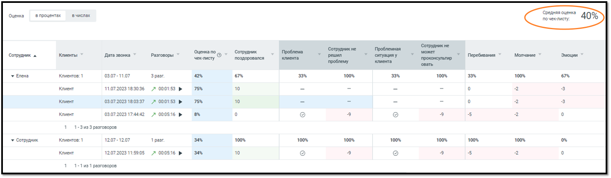

> **Описание иллюстрации SA-§8.5.3-4** · к разделу §8.5.3 «Правила подсчета статистики» · стр. 95 · снимок экрана / схема, 1482×433 px.
> Относится к тексту руководства: «Итого 40%.»
> Следующий за иллюстрацией текст: «2) Подсчет средней оценки по чек-листу в числах, производится по формуле: P/С Где:  Р – сумма баллов критериев, которые сработали во всех разговорах;  С – количество всех разговоров.»
> Текст на изображении (OCR, требует сверки): Оценка; впроцентах; вчислах; Samay" 40%; ‘Сотрудник не; Проблемная; Сотрудник не; Оценка по; Сотрудник; Проблема; может; ‘Сотрудник ^; Клиенты; Дата звонка; Разговоры; чекслисту; поздоровался; клиента; решил; ситуация у; проконсультир,; Перебивания; Молчание.; Эмоции; овать; у Enena; Клиентов:1; 030; 107; pa; 42%; 67%; 100%; 33%; Клиент; 11.07.2023 18:30:36; 00:01:53,; 75%; 10; 03.07.2023 18:03:37,; 03.07.2023 17:44:42; 00056; as; Клиентов:; 1207; 2.07; 34%; У Сотрудник; 11:89:08; 7 00:05:16; ти

2) Подсчет средней оценки по чек-листу в числах, производится по формуле:

**P/С**

Где:

• Р – сумма баллов критериев, которые сработали во всех разговорах; • С – количество всех разговоров.

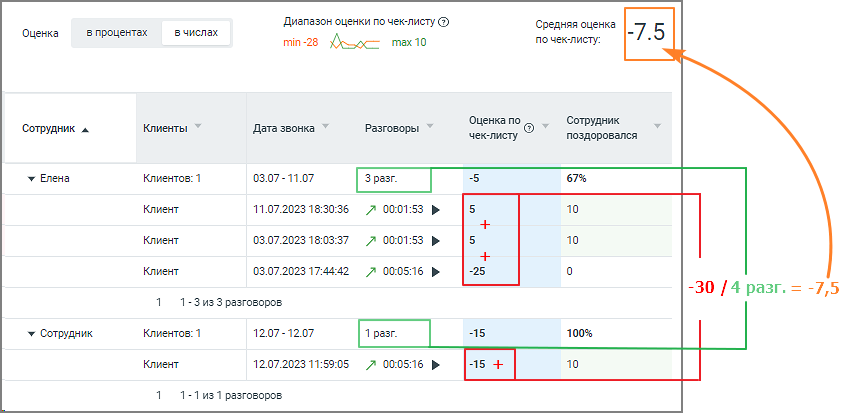

> **Описание иллюстрации SA-§8.5.3-5** · к разделу §8.5.3 «Правила подсчета статистики» · стр. 96 · снимок экрана / схема, 857×413 px.
> Относится к тексту руководства: «• Р – сумма баллов критериев, которые сработали во всех разговорах; • С – количество всех разговоров.»
> Следующий за иллюстрацией текст: «3) Подсчет общей оценки (в процентах) отдельного сотрудника для табличной части статистики, производится аналогично п.1. При этом рассматриваются разговоры только этого сотрудника. Таким образом для п…»
> Текст на изображении (OCR, требует сверки): Диапазон оценки по чек-листу @); Средняя оценка; Оценка; в процентах; в числах; min-28 Хо тах10; по чек-листу:; Оценка по; Сотрудник; Сотрудник ^; Дата звонка ”; Разговоры; чек-листу; поздоровался; у Елена; Клиентов: 1; 03.07 - 11.07; 67%; Клиент; 11.07.2023 18:30:36; 10; 03.07.2023 18:03:37; 03.07.2023 17:44:42; -25; 1-3 из 3 разговоров; у Сотрудник; 12.07 - 12.07; -15; 100%; 12.07.2023 11:59:05; 1-1 из 1 разговоров

3) Подсчет общей оценки (в процентах) отдельного сотрудника для табличной части статистики, производится аналогично п.1. При этом рассматриваются разговоры только этого сотрудника.

Таким образом для примера рис.2 выше средняя оценка по чек-листу в процентах для сотрудника «Елена» рассчитывается следующим образом:

Всего состоялось 3 разговора. Для первого и второго разговора условие сложного критерия в отдельном разговоре не сработало. Значит эти разговоры не учитываются в общей сумме баллов и для этих разговоров Sотриц = -10, а Sполож =10.

Для третьего разговора условие сложного критерия в отдельном разговоре сработало. Таким образом этот разговор учитывается в общей сумме баллов и для этого разговора Sотриц = -28, а Sполож =10.

Считаем итоговую среднюю оценку по чек-листу для сотрудника «Елена» в процентах:

((10-2-3)+(10-2-3)+(0-9-9-5-2)+(|-10|+|-10|+|-28|)) / ((|-10|+10)+(|-10|+10)+(|-28|+10)) = 0.42

Итого 42%

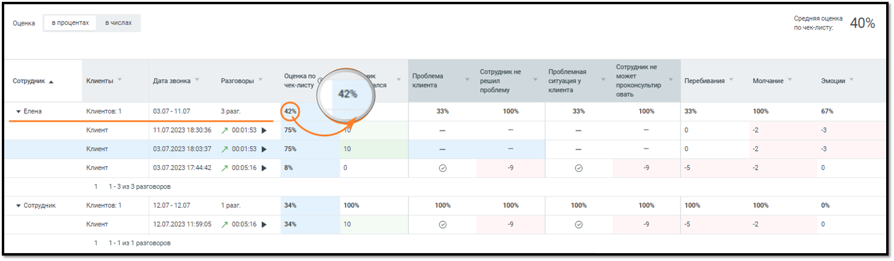

> **Описание иллюстрации SA-§8.5.3-6** · к разделу §8.5.3 «Правила подсчета статистики» · стр. 96 · снимок экрана / схема, 1482×433 px.
> Относится к тексту руководства: «Итого 42%»
> Следующий за иллюстрацией текст: «4) Подсчет общей оценки по чек-листу (в числах) отдельного сотрудника для табличной части статистики, производится аналогично п.2. При этом рассматриваются все разговоры только этого сотрудника.»
> Текст на изображении (OCR, требует сверки): Оценка; впроцентах; вчислах; ВЕТ” 40%; ‘Сотрудник не; Проблемная; Сотрудник не; Оценка по; Проблема; может; ‘Сотрудник ^; Клиенты; Дата звонка; Разговоры; ия; клиента; решил; ситуация у; проконсультир,; Перебивания; Молчание.; Эмоции; чеклисту 7; 42%; овать; у Enena; Клиентов:1; 030; 107; 3 par; 100%; 33%; 67%; Клиент; 11.07.2023 18:30:36; 00:01:53,; 75%; 03.07.2023 18:03:37,; 10; 03.07.2023 17:44:42; 00056; as; Клиентов:; 1207; 2.07; pa; 34%; У Сотрудник; 23 11:59:05; 000516; ти

4) Подсчет общей оценки по чек-листу (в числах) отдельного сотрудника для табличной части статистики, производится аналогично п.2. При этом рассматриваются все разговоры только этого сотрудника.

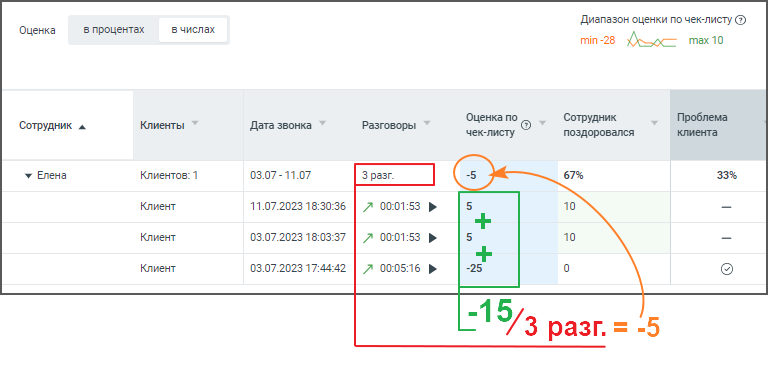

> **Описание иллюстрации SA-§8.5.3-7** · к разделу §8.5.3 «Правила подсчета статистики» · стр. 97 · снимок экрана / схема, 768×378 px.
> Относится к тексту руководства: «4) Подсчет общей оценки по чек-листу (в числах) отдельного сотрудника для табличной части статистики, производится аналогично п.2. При этом рассматриваются все разговоры только этого сотрудника.»
> Следующий за иллюстрацией текст: «5) Подсчет оценки звонка (в процентах) для табличной части статистики, производится аналогично п.1. (P + |Sотриц|) / (|Sотриц| + Sполож) Где:  P – сумма баллов критериев, которые сработали в исследуе…»
> Текст на изображении (OCR, требует сверки): Диапазон оценки по чек-листу (3); ‘Оценка; в процентах; в числах; min-28 Хо тах10; Оценка по; Сотрудник; Сотрудник ^; Дата звонка; Разговоры; чек-листу; поздоровался; у Елена; Клиентов: 1; 03.07 - 11.07; 67%; Клиент; 11.07.2023 18:30:36 / A 00:01:53 №»; 03.07.2023 18:03:37 / A 00:01:53 >»; -25; 03.07.2023 17:44:42 / A 00:05:16 +

5) Подсчет оценки звонка (в процентах) для табличной части статистики, производится аналогично п.1.

**(P + |Sотриц|) / (|Sотриц| + Sполож)**

Где:

• P – сумма баллов критериев, которые сработали в исследуемом разговоре; • Sотриц – сумма баллов отрицательных критериев, сработавших в исследуемом разговоре. Если условие сложного критерия в исследуемом разговоре не сработало, критерий не учитывается в сумме; • Sполож – сумма баллов положительных критериев. Если условие сложного критерия в исследуемом разговоре не сработало, критерий не учитывается в сумме. Таким образом для примера рис.2 выше средняя оценка по чек-листу в процентах рассчитывается следующим образом: Для первого и второго разговора условие сложного критерия в отдельном разговоре не сработало. Значит эти разговоры не учитываются в общей сумме баллов и для этих разговоров Sотриц = -10, а SположN =10. Для третьего разговора условие сложного критерия в отдельном разговоре сработало. Значит этот разговор учитывается в общей сумме баллов и для него Sотриц = -28, а Sполож =10.

Подсчитаем оценку отдельных звонков (в процентах): • 1 разговор: ((10 -2 -3) + |-10|) / (|-10| + 10) = 0,75; что составляет 75% • 2 разговор: ((10 -2 -3) + |-10|) / (|-10| + 10) = 0,75; что составляет 75% • 3 разговор: ((0 -9 -9 -5 -2) + |-28|) / (|-28| + 10) = 0,08; что составляет 8%

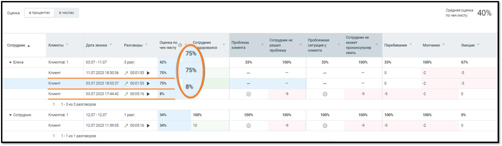

> **Описание иллюстрации SA-§8.5.3-8** · к разделу §8.5.3 «Правила подсчета статистики» · стр. 98 · снимок экрана / схема, 1482×433 px.
> Относится к тексту руководства: «…тах): • 1 разговор: ((10 -2 -3) + |-10|) / (|-10| + 10) = 0,75; что составляет 75% • 2 разговор: ((10 -2 -3) + |-10|) / (|-10| + 10) = 0,75; что составляет 75% • 3 разговор: ((0 -9 -9 -5 -2) + |-28|) / (|-28| + 10) = 0,08; что составляет 8%»
> Следующий за иллюстрацией текст: «6) Подсчет оценки звонка (в числах) для табличной части статистики, принимается равным:  сумме критериев, которые сработали в исследуемом звонке. Если критерии отрицательные – показатель отнимается.»
> Текст на изображении (OCR, требует сверки): Оценка; в процентах; вчислах; Семя 10%; ry; ‘Сотрудник He; Проблемная.; Сотрудник не; Оценка по <); Сотрудник; Проблема.; может; Сотрудник ^; Клиенты; Дата звонка; Разговоры; чекслисту; доровался; клиента; решил; ‘ситуацияу; проконсультир; Перебивания; Молчание; Эмоции; проблему; 75%; овать; у Бена; вто; 03,; iii; разг; 42%; 33%; 100%; 67%; Клиент; 11072; 303; 7 000153 >; 03.07,; 2023 18:03:37; 0307; 7:44:42; 000516 »; as; У сотрудник; ентов:; 1207; 34%; ow; 53.0; ob; ти

6) Подсчет оценки звонка (в числах) для табличной части статистики, принимается равным:

• сумме критериев, которые сработали в исследуемом звонке. Если критерии отрицательные – показатель отнимается.

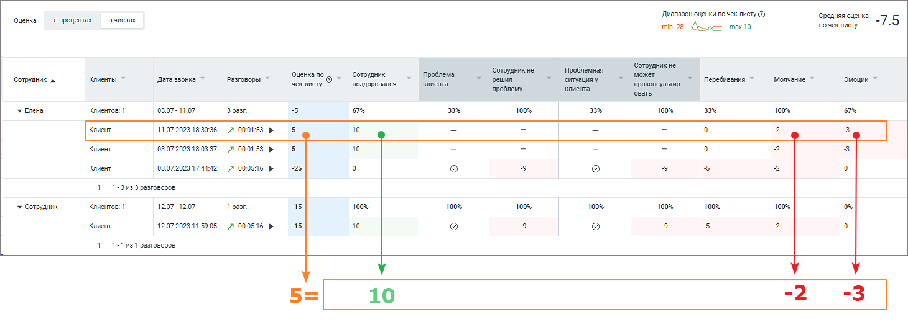

> **Описание иллюстрации SA-§8.5.3-9** · к разделу §8.5.3 «Правила подсчета статистики» · стр. 98 · снимок экрана / схема, 1460×527 px.
> Относится к тексту руководства: «• сумме критериев, которые сработали в исследуемом звонке. Если критерии отрицательные – показатель отнимается.»
> Следующий за иллюстрацией текст: «7) Подсчет средней оценки обычного критерия (в процентах) для табличной части статистики, производится по формуле:  Соотношение числа разговоров Сотрудника со сработавшим обычным критерием к общему к…»
> Текст на изображении (OCR, требует сверки): _Дивпазон оценки почекслисту ©; ‘Оценка; впроцентах; числах.; Cosas cuore 7 Б; min-28 Дос mae 10; почеклисту:; ‘Сотрудникне; Проблемная; Сотрудникне; Оценка по; ‘Сотрудник; Проблема; может; ‘Сотрудник 4.; Dara звонка; Разговоры; чеклисту; поздоровался; решил; ‘ситуацияу; проконсультир; Перебивания; Молчание; Эмоции; проблему; вать; Enena; Клиентов:1; 0307-1107; разг.; ors; 100%; or; Клиент; 11.07.2023 18:30:36; ‚000153 >; 10; 03.07.2028 18:08:37; 7 000153 >; 03.07.2028 17:48:42; 7 000816 >; 1-Зиз 3 разговоров; У Сотрудник; 1207-1207; 1 pesr.; a5; 12.07.2023 11:59:05; 1-1из1 разговоров

7) Подсчет средней оценки обычного критерия (в процентах) для табличной части статистики, производится по формуле:

• Соотношение числа разговоров Сотрудника со сработавшим обычным критерием к общему количеству звонков Сотрудника.

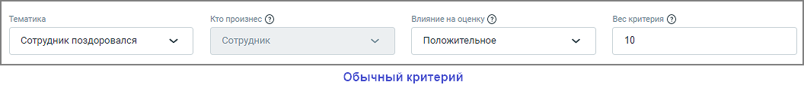

> **Описание иллюстрации SA-§8.5.3-10** · к разделу §8.5.3 «Правила подсчета статистики» · стр. 98 · снимок экрана / схема, 1056×121 px.
> Относится к тексту руководства: «• Соотношение числа разговоров Сотрудника со сработавшим обычным критерием к общему количеству звонков Сотрудника.»
> Следующий за иллюстрацией текст: «8) Подсчет средней оценки критерия с зависимостью (в процентах) для табличной части статистики, производится по формуле:  Соотношение общего количества звонков со сработавшими условием и критерием к …»
> Текст на изображении (OCR, требует сверки): Тематика; Кто произнес @; Annee na оценку ©; Bec критерия @); ‘Сотрудник поздоровался; Сотрудник; Положительное; 10; Обычный критерий

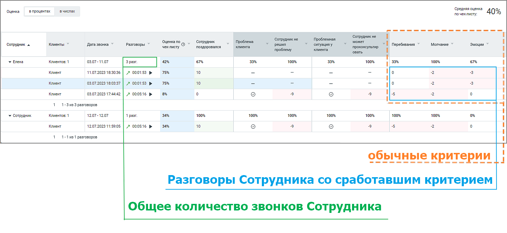

> **Описание иллюстрации SA-§8.5.3-11** · к разделу §8.5.3 «Правила подсчета статистики» · стр. 99 · снимок экрана / схема, 1456×672 px.
> Относится к тексту руководства: «• Соотношение числа разговоров Сотрудника со сработавшим обычным критерием к общему количеству звонков Сотрудника.»
> Следующий за иллюстрацией текст: «8) Подсчет средней оценки критерия с зависимостью (в процентах) для табличной части статистики, производится по формуле:  Соотношение общего количества звонков со сработавшими условием и критерием к …»
> Текст на изображении (OCR, требует сверки): Оценка; впроцентах; вчислах.; почеклисту:; я 40%; анна; ‘Сотрудникне; Проблемная; ‘Сотрудник a.; Клиенты ©; Дата sora; разговоры; чеклисту; Оценка по; OY; ‘Сотрудник; поздоровался; клиента; Проблема; т решил; т omaunay; может; проконсультир; Молчание; Эмоции; проблему; вать; 4 Перебивания ~; y Enea; Клиентов:1; 03.07-11.07; разг.; 42%; 67%; 100%; ore; Клиент; 11.07.2028 18:30:36; 7 000153 >; 75%; 10; Ho; 03.07.2028 18:08:37; ie; 03.07.2028 17:48:42; 7 000516 >; Is; 11-3133 разговоров,; У сотрудник; 1207-1207; 1 pesr.; 34%; 12.07.2023 11:59:05; 11-191 разговоров,; обычные критерии; еее; Разгово…

8) Подсчет средней оценки критерия с зависимостью (в процентах) для табличной части статистики, производится по формуле: • Соотношение общего количества звонков со сработавшими условием и критерием к общему числу звонков со сработавшим условием.

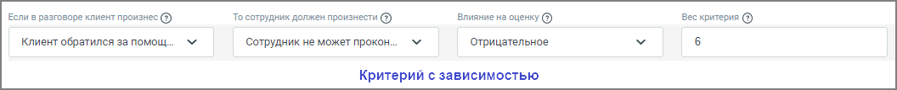

> **Описание иллюстрации SA-§8.5.3-12** · к разделу §8.5.3 «Правила подсчета статистики» · стр. 99 · снимок экрана / схема, 1056×107 px.
> Относится к тексту руководства: «…дсчет средней оценки критерия с зависимостью (в процентах) для табличной части статистики, производится по формуле: • Соотношение общего количества звонков со сработавшими условием и критерием к общему числу звонков со сработавшим условием.»
> Следующий за иллюстрацией текст: «9) Подсчет средней оценки условия к критерию с зависимостью (в процентах) для табличной части статистики, производится по формуле:  Соотношение общего числа разговоров со сработавшим условием к общем…»
> Текст на изображении (OCR, требует сверки): Если в разговоре клиент произнес @; То сотрудник должен произнести @); влияние на оценку @; Bec критерия @); Клиент обратился за помощ.; Сотрудник не может прокон..; Отрицательное; Критерий с зависимостью

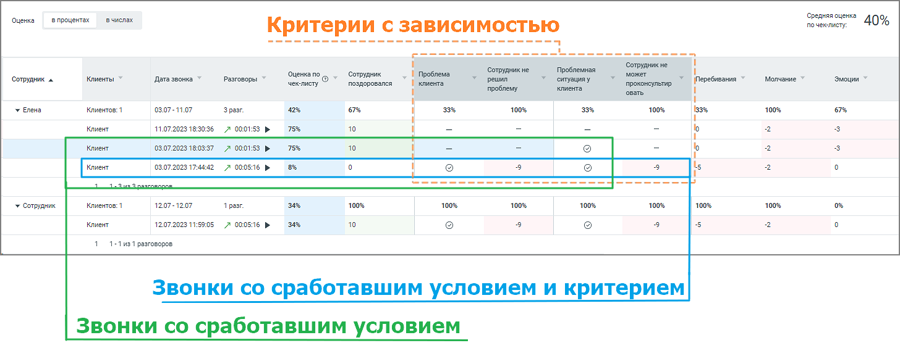

> **Описание иллюстрации SA-§8.5.3-13** · к разделу §8.5.3 «Правила подсчета статистики» · стр. 99 · снимок экрана / схема, 1456×577 px.
> Относится к тексту руководства: «…дсчет средней оценки критерия с зависимостью (в процентах) для табличной части статистики, производится по формуле: • Соотношение общего количества звонков со сработавшими условием и критерием к общему числу звонков со сработавшим условием.»
> Следующий за иллюстрацией текст: «9) Подсчет средней оценки условия к критерию с зависимостью (в процентах) для табличной части статистики, производится по формуле:  Соотношение общего числа разговоров со сработавшим условием к общем…»
> Текст на изображении (OCR, требует сверки): ‘Оценка; впроцентах; вчислах.; пак 40%; Критерии с зависимостью; BR ny; ee Sey; Сотрудникне; Оценка по; ‘Сотрудник; > // Проблема; ‘Сотрудникне; Проблемная; ‘Сотрудник 4.; Клиенты ~; Дата звонка *; Разговоры; чеклисту; Oy; поздоровался; ситуацияу; проконсультир,; "Перебивания ~; Молчание ©; Эмоции; проблему; Enena; Клиентов:1; 0307-1107; разг.; 42%; 100%; or; 11.07.2023 18:30:36 7 000153 >; 75%; 10; 03.07.2023 180837 7 000153 >; ССЗ a ПЕН; bs; Ss; es; 1207-1207; 34%; У Сотрудник; 1 pesr.; Клиент; 1207202311:5905 7 000516 >; 1-1из1 разговоров; Звонки со сработавшим условием и критерием; звонки …

9) Подсчет средней оценки условия к критерию с зависимостью (в процентах) для табличной части статистики, производится по формуле:

• Соотношение общего числа разговоров со сработавшим условием к общему количеству звонков.

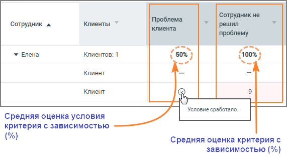

> **Описание иллюстрации SA-§8.5.3-14** · к разделу §8.5.3 «Правила подсчета статистики» · стр. 100 · снимок экрана / схема, 571×313 px.
> Относится к тексту руководства: «• Соотношение общего числа разговоров со сработавшим условием к общему количеству звонков.»
> Текст на изображении (OCR, требует сверки): Проблема; Сотрудник не; Сотрудник ^; Клиенты; решил; клиента; проблему; omy; ony; у Елена; Клиентов: 1; у 50%; (100%; Клиент; Средняя оценка условия; критерия с зависимостью; Средняя оценка критерия с; зависимостью (%)
