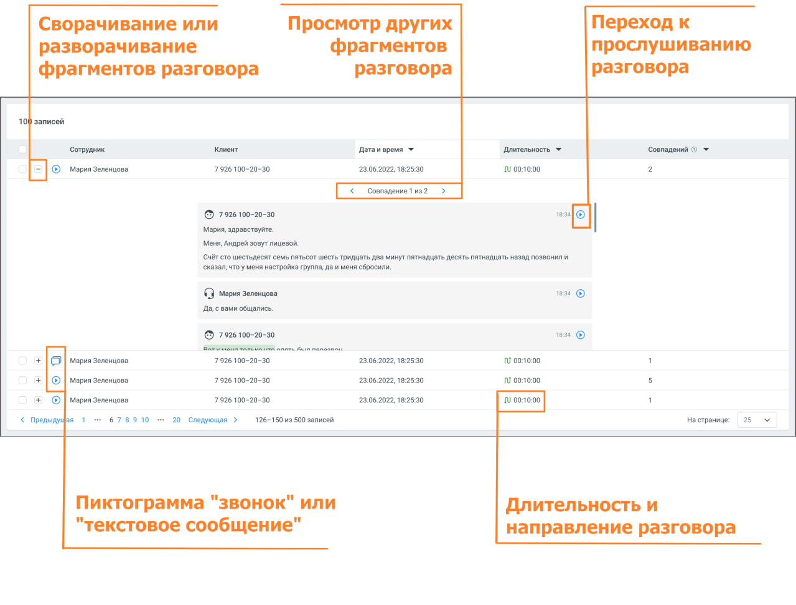

### 8.6.2. Блок результатов

> Трассировка: PDF §8.6.2 · сквозные стр. 101-103 · источники: ч.1 `kb/sources/speech-analytics/RECHEVAYA-ANALITIKA_1.26.42.pdf` с.101-103.

Блок содержит подробную информацию о срабатывание триггера, с отображением причины и результата срабатывания.

> **Описание иллюстрации SA-§8.6.2-1** · к разделу §8.6.2 «Блок результатов» · стр. 102 · снимок экрана / схема, 1279×973 px.
> Относится к тексту руководства: «Блок содержит подробную информацию о срабатывание триггера, с отображением причины и результата срабатывания.»
> Следующий за иллюстрацией текст: «Блок результатов содержит следующие данные: o Клиент и сотрудник, участники разговора o Источник записи o Длительность и направление разговора o Дата и время разговора o Количество совпадений с тригге…»
> Текст на изображении (OCR, требует сверки): Сворачивание или; Просмотр других; Переход к; разворачивание; фрагментов; прослушиванию; фрагментов разговора; разговора; 10) записей; Сотрудник; Клиент; Датаивремя +; "Длительность У; совпадений © +; © мария Зеленцова; 7926 100-20-30; 23.06.2022, 18:25:30; 0 00:10:00; © 7926 100-20-30; Mapua, здравствуйте.; Mens, Андрей зовут лицевой.; (Счёт сто шестьдесят семь пятьсот шесть тридцать два минут пятнадцать десять пятнадцать назад позвонил и; ‘сказал, что y меня настройка группа, да и меня сбросили; О Mapua зеленцова; тем ©; Да, свами общались,; © 7926100-20-з0; 124 ©; es; oo; ns; © / мерия Зеле…

Блок результатов содержит следующие данные:

o Клиент и сотрудник, участники разговора

o Источник записи

o Длительность и направление разговора

o Дата и время разговора

o Количество совпадений с триггером в разговоре. Если в разговоре триггер сработал

несколько раз, то для навигации по срабатываниям используйте пиктограммы влево <, и вправо >

o Фрагменты разговора, в которых сработал триггер. В каждом фрагменте есть пиктограмма,

которая открывает плеер или осциллограмму разговора:

• с первой фразы причины триггера (для настроек отображения - Причина и Реакция) • с фразы, где имеется триггер (для настроек отображения - Реакция)
