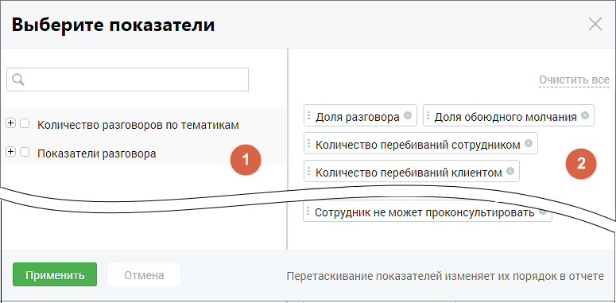

## 8.7. Показатели отчетов

> Трассировка: PDF §8.7 · сквозные стр. 103-105 · источники: ч.1 `kb/sources/speech-analytics/RECHEVAYA-ANALITIKA_1.26.42.pdf` с.103-105.

Для построения отчетов устанавливаются показатели, по которым будет формироваться отчет.

> **Описание иллюстрации SA-§8.7-1** · к разделу §8.7 «Показатели отчетов» · стр. 103 · снимок экрана / схема, 775×381 px.
> Относится к тексту руководства: «Для построения отчетов устанавливаются показатели, по которым будет формироваться отчет.»
> Следующий за иллюстрацией текст: «Окно выбора показателей содержит две группы: 1. В группе «Количество разговоров по тематикам» отображаются все тематики продукта: предустановленные и созданные пользователем, включая неактивные, а так…»
> Текст на изображении (OCR, требует сверки): Выберите показатели; Очистить все; Доля разговора; Доля обоюдного молчания; Количество разговоров по тематикам; Количество перебиваний сотрудником; Показатели разговора; Количество перебиваний клиентом; OTMeHa; Перетаскивание показателей изменяет их порядок в отчете

Окно выбора показателей содержит две группы:

1. В группе «Количество разговоров по тематикам» отображаются все тематики продукта: предустановленные и созданные пользователем, включая неактивные, а также ИИ тематики, распознанные с помощью ИИ Тегирования — в том числе по чатам, если подключена аналитика текстовых коммуникаций. По показателям можно проанализировать корректность речи сотрудника и речь клиента.

Для типа записи разговора «Текстовые коммуникации» в качестве показателей в отчетах отображаются только данные разговоров по тематикам.

2. Группа «Показатели разговора» включает в себя следующие характеристики звонка:

Общая длительность записи – показывает общую длительности записи с момента подъема трубки до окончания разговора;

Длительность разговора – показывает суммарное количество времени, когда хотя бы один из участников разговора говорил;

Длительность обоюдного молчания – показывает, сколько времени сотрудник тратит на поиск информации, требующейся клиенту, а также насколько быстро сотрудник может ответить на вопросы клиента.

Доля разговора – отношение длительности разговора к общей длительности записи. Позволяет понять, какую долю от общего времени записи собеседники были заняты разговором;

Доля обоюдного молчания – отношение длительности обоюдного молчанию к длительности записи. Позволяет понять, какую долю от общего времени записи клиент ожидает ответа сотрудника;

Количество перебиваний сотрудником – позволяет понять, сколько раз сотрудник перебил клиента;

Количество перебиваний клиентом – позволяет понять, сколько раз клиент перебил сотрудника. Если у какого-то сотрудника этот показатель сильно отличается от остальных, то, вероятно, способ донесения сотрудником информации не соответствует ожиданиям клиента;

Доля обоюдного разговора – доля разговора, когда клиент и сотрудник говорили одновременно. Позволяет понять стиль общения сотрудника с клиентом;

Доля разговора сотрудника – доля разговора, когда говорил только сотрудник. Позволяет понять, ведет ли сотрудник беседу, или её ведет клиент;

Доля разговора клиента – доля разговора, когда говорил только клиент. Позволяет понять, ведет ли сотрудник беседу, или её ведет клиент;

Скорость разговора клиента (количество слов в секунду);

Скорость разговора сотрудника (количество слов в секунду) – позволяет анализировать, как сотрудник подстраивается под скорость речи клиента. Сравнив этот показатель среди всех сотрудников, можно понять, кто слишком быстро говорит, а кто говорит чересчур медленно.

Данные выбранных чекбоксов в таблице «Показатели разговора» отчета «Анализ сотрудников» отображаются, как столбцы.

Выбранные показатели отображаются на правой стороне окна показателей (блок 2). Для удаления

> **Описание иллюстрации SA-§8.7-2** · к разделу §8.7 «Показатели отчетов» · стр. 104 · пиктограмма (значок элемента интерфейса), 23×26 px.
> Относится к тексту руководства: «Выбранные показатели отображаются на правой стороне окна показателей (блок 2). Для удаления»
> Следующий за иллюстрацией текст: «показателя из списка выбранных нажмите пиктограмму удаления в строке показателя. Для сохранения внесенных изменений нажмите на кнопку «Применить».»
> Текста на изображении нет; назначение значка — см. текст, к которому он относится.

показателя из списка выбранных нажмите пиктограмму удаления в строке показателя.

Для сохранения внесенных изменений нажмите на кнопку «Применить».

> **Описание иллюстрации SA-§8.7-3** · к разделу §8.7 «Показатели отчетов» · стр. 104 · пиктограмма (значок элемента интерфейса), 38×32 px.
> Относится к тексту руководства: «Для сохранения внесенных изменений нажмите на кнопку «Применить».»
> Следующий за иллюстрацией текст: «Если нажать кнопку «Отменить» или пиктограмму , изменения не будут внесены, а выборка показателей вернется к последней сохраненной версии.»
> Текста на изображении нет; назначение значка — см. текст, к которому он относится.

Если нажать кнопку «Отменить» или пиктограмму , изменения не будут внесены, а выборка показателей вернется к последней сохраненной версии.
