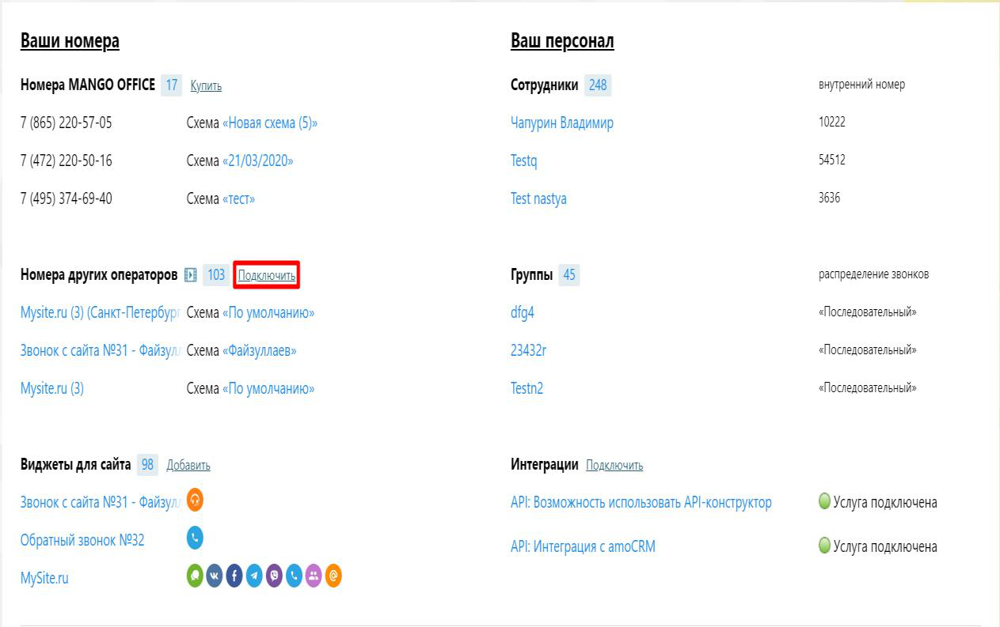
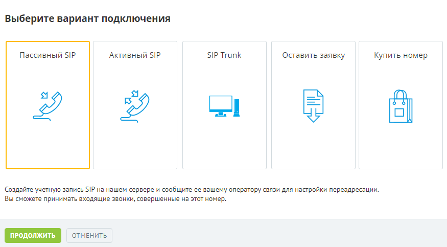
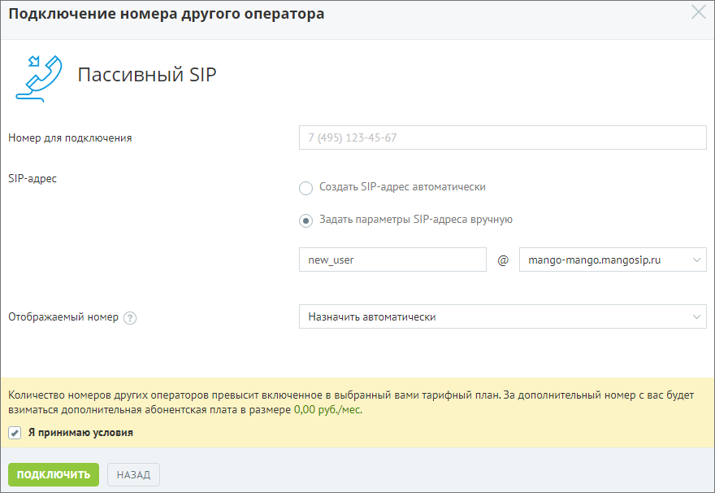
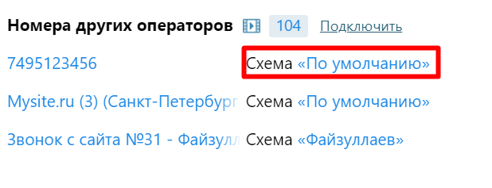
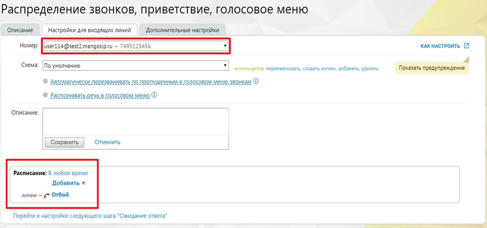
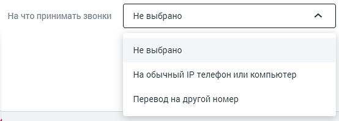

## 10.1. Точка входа «Пассивный SIP»

> Трассировка: PDF §10.1 · сквозные стр. 110-114 · источники: ч.1 `kb/sources/speech-analytics/RECHEVAYA-ANALITIKA_1.26.42.pdf` с.110-114.

1) Подключение услуги Речевая аналитика 2) Подключение Пассивного SIP 3) Создание сотрудника

Подключите услугу Речевая аналитика, как указано выше. Далее переходите к подключению Пассивного SIP.

**Подключение пассивного SIP**

Шаг 1. Включаем услугу

На обзорной панели Личного кабинета в блоке "Номера других операторов" нажимаем кнопку "Подключить".

> **Описание иллюстрации SA-§10.1-1** · к разделу §10.1 «Точка входа «Пассивный SIP»» · стр. 111 · снимок экрана / схема, 1263×793 px.
> Относится к тексту руководства: «На обзорной панели Личного кабинета в блоке "Номера других операторов" нажимаем кнопку "Подключить".»
> Следующий за иллюстрацией текст: «Шаг 2. Продолжаем настройку В открывшемся меню выбираем пункт "Пассивный SIP" и нажимаем кнопку "Продолжить".»
> Текст на изображении (OCR, требует сверки): Ваши номера; Ваш персонал; Номера MANGO OFFICE 17 Купить; Сотрудники 248; внутренний номер; (865) 220-57-05; ‘Схема «Новая схема (5)»; 10222; Чапурин Владимир; (472) 220-50-16; Cxema «21/03/2020»; Testq; 54512; (495) 374-69-40; ‘Схема «тест»; 3636; Test nastya; распределение звонков; Номера других операторов [1 103; Группы 45; Mysite.ru (3) (Санкт-Петербур: Схема «По умолчанию»; dfg4; «Последовательный»; 23432r; Звонок с сайта №31 - Файзул/ Схема «Файзуллаев»; Mysite.ru (3); Схема «По умолчанию»; Testn2; Виджеты для сайта 98 Добавить; Интеграции Подключить; Звонок с сайта №31 - Файзул 0; API: …

Шаг 2. Продолжаем настройку

В открывшемся меню выбираем пункт "Пассивный SIP" и нажимаем кнопку "Продолжить".

> **Описание иллюстрации SA-§10.1-2** · к разделу §10.1 «Точка входа «Пассивный SIP»» · стр. 111 · снимок экрана / схема, 875×483 px.
> Относится к тексту руководства: «В открывшемся меню выбираем пункт "Пассивный SIP" и нажимаем кнопку "Продолжить".»
> Следующий за иллюстрацией текст: «Шаг 3. Вносим данные для настройки Номер для подключения – номер телефона стороннего оператора, который требуется подключить; SIP-адрес – ручной режим необходим в тех случаях, когда Ваш системный адми…»
> Текст на изображении (OCR, требует сверки): Выберите вариант подключения; Пассивный SIP; Активный SIP; SIP Trunk; Оставить заявку; Купить номер; LS; lel; Создайте учетную запись SIP на нашем сервере и сообщите ее вашему оператору связи для настройки перездресации.; Вы сможете принимать входящие звонки, совершенные на этот номер.; ОТМЕНИТЬ

Шаг 3. Вносим данные для настройки

Номер для подключения – номер телефона стороннего оператора, который требуется подключить;

SIP-адрес – ручной режим необходим в тех случаях, когда Ваш системный администратор хочет видеть в трафике «читабельный» SIP-адрес. В автоматическом режиме SIP-адрес выглядит как набор символов;

Отображаемый номер – линия ВАТС MANGO OFFICE, которая будет использоваться в качестве переадресации. При входящем звонке на телефоне отобразится этот номер. Транслировать номер звонящего в данном варианте нельзя.

Шаг 4. Прописываем SIP-адрес для Пассивного SIP

В поле "SIP-адрес" появилось еще одно окно для заполнения SIP-адреса. Адрес можно прописывать согласно данным провайдера, либо придумать самостоятельно.

> **Описание иллюстрации SA-§10.1-3** · к разделу §10.1 «Точка входа «Пассивный SIP»» · стр. 112 · снимок экрана / схема, 880×606 px.
> Относится к тексту руководства: «В поле "SIP-адрес" появилось еще одно окно для заполнения SIP-адреса. Адрес можно прописывать согласно данным провайдера, либо придумать самостоятельно.»
> Следующий за иллюстрацией текст: «Далее следует принять условия и нажать кнопку "Подключить". Шаг 5. Передача информации стороннему оператору Поздравляем! Вы создали SIP-адрес. Его необходимо сообщить оператору вашей ВАТС, чтобы все з…»
> Текст на изображении (OCR, требует сверки): Подключение номера другого оператора; Пассивный SIP; Номер для подключения; 7 (495) 125-45-67; $Р-адрес; las; ) Создать S/P-agpec автоматически; (®) Задать параметры SIP-agpeca вручную; new_user; mango-mango.mangosip.ru; Отображаемый номер (?); Назначить автоматически; waa

Далее следует принять условия и нажать кнопку "Подключить".

Шаг 5. Передача информации стороннему оператору

Поздравляем! Вы создали SIP-адрес. Его необходимо сообщить оператору вашей ВАТС, чтобы все звонки с вашего номера направлялись на этот SIP-адрес. Или установить подключение самостоятельно, если в Личном кабинете ВАТС вашего оператора имеется соответствующая функция.

Шаг 6. Настройка схемы переадресации.

После успешной настройки Пассивного SIP необходимо задать переадресацию на ваших сотрудников. Для этого на обзорной панели Личного кабинета в блоке "Номера других операторов" находим номер, который мы указали в Шаге 3, и кликаем на схему.

> **Описание иллюстрации SA-§10.1-4** · к разделу §10.1 «Точка входа «Пассивный SIP»» · стр. 113 · снимок экрана / схема, 618×237 px.
> Относится к тексту руководства: «После успешной настройки Пассивного SIP необходимо задать переадресацию на ваших сотрудников. Для этого на обзорной панели Личного кабинета в блоке "Номера других операторов" находим номер, который мы указали в Шаге 3, и кликаем на схему.»
> Следующий за иллюстрацией текст: «Шаг 7. Продолжаем настраивать схему переадресации с Пассивного SIP В поле "Номер" Вы увидите SIP-адрес, который мы прописали в шаге 5. Настраиваем схему переадресации. Теперь все звонки, которые посту…»
> Текст на изображении (OCR, требует сверки): Номера других операторов №} 104 Подключить; 7495123456; Mysite.ru (3) (Санкт-Петербург Схема «По умолчанию»; Звонок с сайта №31 - Файзул/ Схема «Файзуллаев»

Шаг 7. Продолжаем настраивать схему переадресации с Пассивного SIP

В поле "Номер" Вы увидите SIP-адрес, который мы прописали в шаге 5. Настраиваем схему переадресации.

Теперь все звонки, которые поступают на номер стороннего оператора, будут распределяться на Ваших сотрудников.

> **Описание иллюстрации SA-§10.1-5** · к разделу §10.1 «Точка входа «Пассивный SIP»» · стр. 113 · снимок экрана / схема, 974×457 px.
> Относится к тексту руководства: «Теперь все звонки, которые поступают на номер стороннего оператора, будут распределяться на Ваших сотрудников.»
> Следующий за иллюстрацией текст: «Создание сотрудника Откройте личный кабинет по ссылке lk.mango-office.ru. На обзорной панели Личного кабинета ВАТС выберите блок Сотрудники и группы. Кликните по ссылке Добавить пользователя и заполни…»
> Текст на изображении (OCR, требует сверки): Распределение звонков, приветствие, голосовое меню; Описание; Настройки для входящих линий; Дополнительные настройки; Номер:; кАКНАСТРОИТЬ; Crewa: [Поумолчанию; ] нстолункя переиченовать conan xno, добыть удалить; _ Показать:; Поать предупрондения; ne; © Автоматически перезванивать по пропушенным влэлосором меню звонкам ©; Описание:; Отменить; [сохранить; Расписание: 8 любое эремя; Добавить ¥; samen ~ (> Отбой; Перейти x настройке следующего шага “Ожидание ответа"

**Создание сотрудника**

Откройте личный кабинет по ссылке lk.mango-office.ru. На обзорной панели Личного кабинета ВАТС выберите блок Сотрудники и группы. Кликните по ссылке Добавить пользователя и заполните карточку сотрудника.

При выборе вариантов На что принимать звонки: «На обычный IP-телефон» или компьютер» учетная запись SIP создается в автоматическом режиме или задается позднее при редактировании карточки сотрудника.

> **Описание иллюстрации SA-§10.1-6** · к разделу §10.1 «Точка входа «Пассивный SIP»» · стр. 114 · снимок экрана / схема, 554×198 px.
> Относится к тексту руководства: «При выборе вариантов На что принимать звонки: «На обычный IP-телефон» или компьютер» учетная запись SIP создается в автоматическом режиме или задается позднее при редактировании карточки сотрудника.»
> Следующий за иллюстрацией текст: «Далее нужно добавить SIP-адрес для приема звонков. Так как пассивный SIP работает только на входящие звонки, необходимо на сторонней АТС создать свою SIP-линию. Лучше создавать пассивную линию, так ка…»
> Текст на изображении (OCR, требует сверки): На что принимать звонки; Не выбрано; На обычный IP телефон или компьютер; Перевод на другой номер

Далее нужно добавить SIP-адрес для приема звонков.

Так как пассивный SIP работает только на входящие звонки, необходимо на сторонней АТС создать свою SIP-линию. Лучше создавать пассивную линию, так как в основном даже при исходящих звонках от сотрудника будет осуществляться входящий звонок на стороннюю АТС.

Так же можно создать SIP-аккаунт автоматически, и указать его на сторонней АТС как пассивную SIP-линию.
