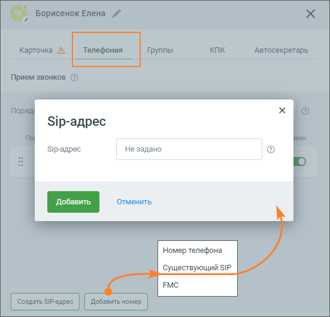
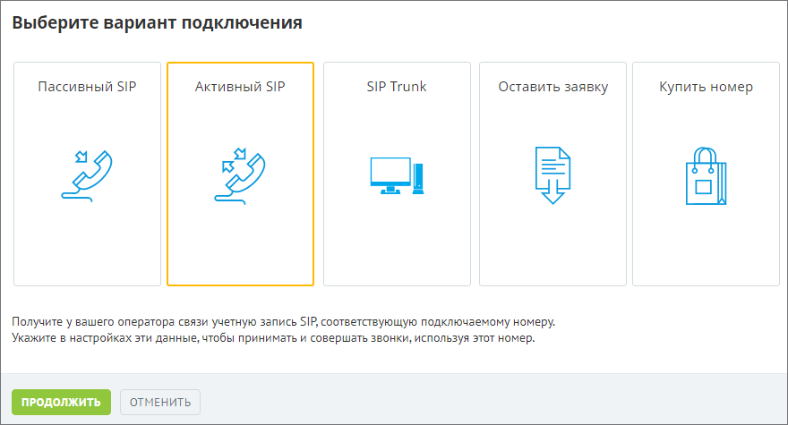
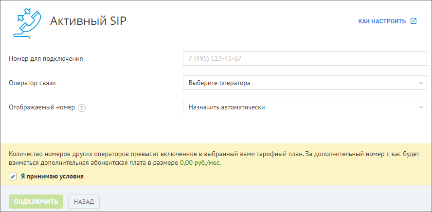
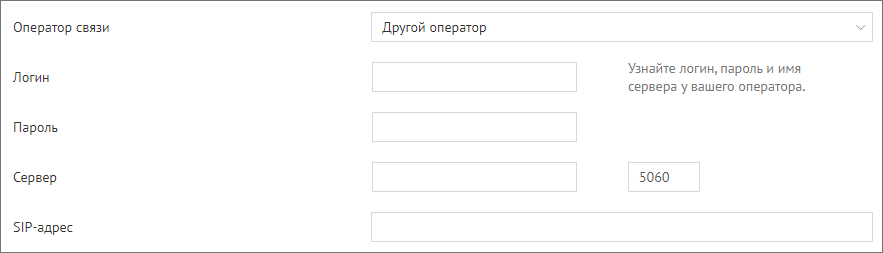
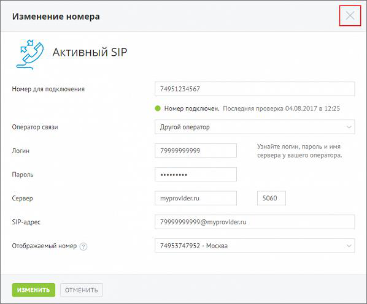
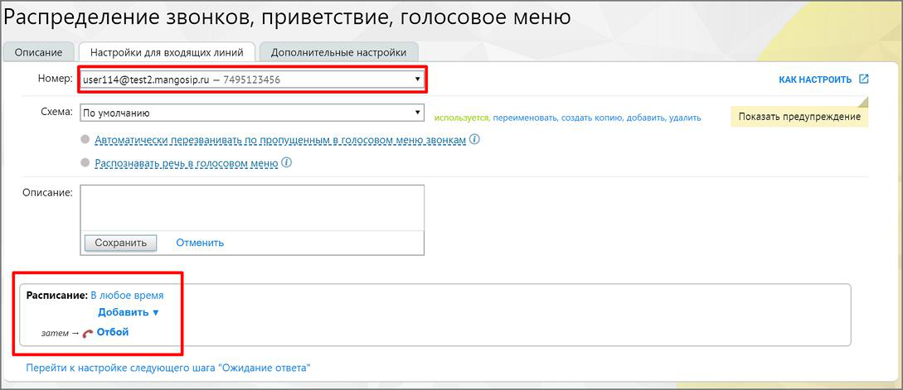
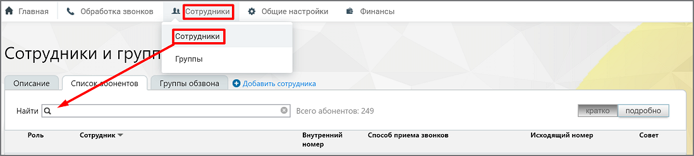
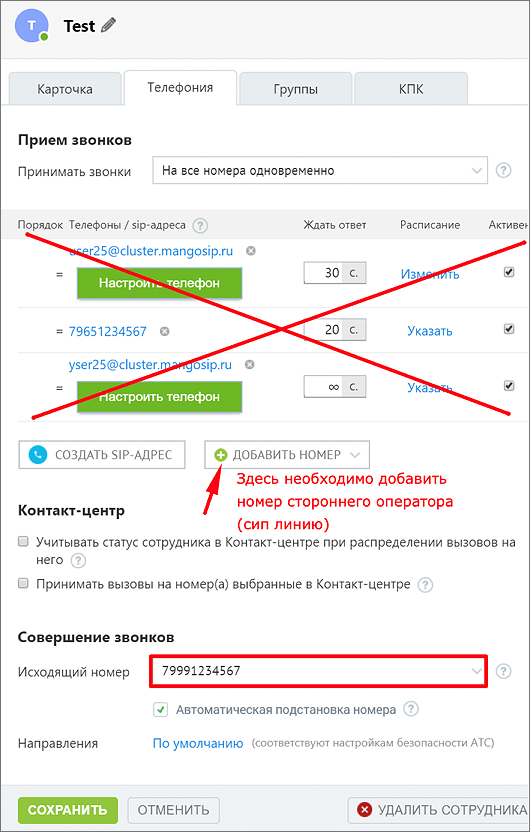

## 10.2. Точка входа «Активный SIP»

> Трассировка: PDF §10.2 · сквозные стр. 114-121 · источники: ч.1 `kb/sources/speech-analytics/RECHEVAYA-ANALITIKA_1.26.42.pdf` с.114-121.

1) Подключение услуги Речевая аналитика 2) Создание сотрудника 3) Подключение Активного SIP

Подключите услугу Речевая аналитика, как указано выше. Далее переходите к созданию сотрудника

**Создание сотрудника**

Откройте личный кабинет по ссылке lk.mango-office.ru. На обзорной панели Личного кабинета ВАТС выберите блок Сотрудники и группы. Кликните по ссылке Добавить пользователя и заполните карточку сотрудника. Перейдите на вкладку «Телефония».

> **Описание иллюстрации SA-§10.2-1** · к разделу §10.2 «Точка входа «Активный SIP»» · стр. 115 · снимок экрана / схема, 551×529 px.
> Относится к тексту руководства: «Откройте личный кабинет по ссылке lk.mango-office.ru. На обзорной панели Личного кабинета ВАТС выберите блок Сотрудники и группы. Кликните по ссылке Добавить пользователя и заполните карточку сотрудника. Перейдите на вкладку «Телефония».»
> Следующий за иллюстрацией текст: «Далее нужно добавить SIP-адрес для приема звонков. Так как пассивный SIP работает только на входящие звонки, необходимо на сторонней АТС создать свою SIP-линию. Лучше создавать пассивную линию, так ка…»
> Текст на изображении (OCR, требует сверки): Э!р-адрес; Sip-agpec; He 3agaHo

Далее нужно добавить SIP-адрес для приема звонков.

Так как пассивный SIP работает только на входящие звонки, необходимо на сторонней АТС создать свою SIP-линию. Лучше создавать пассивную линию, так как в основном даже при исходящих звонках от сотрудника будет осуществляться входящий звонок на стороннюю АТС.

Так же можно создать SIP-аккаунт автоматически, и указать его на сторонней АТС как пассивную SIP-линию.

**Подключение активного SIP**

Шаг 1. Включаем услугу Активного SIP – на обзорной панели Личного кабинета в блоке "Номера других операторов" нажимаем кнопку "Подключить". В открывшемся меню выбираем пункт "Активный SIP" и нажимаем кнопку "Продолжить".

> **Описание иллюстрации SA-§10.2-2** · к разделу §10.2 «Точка входа «Активный SIP»» · стр. 116 · снимок экрана / схема, 880×475 px.
> Относится к тексту руководства: «Шаг 1. Включаем услугу Активного SIP – на обзорной панели Личного кабинета в блоке "Номера других операторов" нажимаем кнопку "Подключить". В открывшемся меню выбираем пункт "Активный SIP" и нажимаем кнопку "Продолжить".»
> Следующий за иллюстрацией текст: «Шаг 2. Вносим данные для настройки Номер для подключения – номер телефона стороннего оператора, который требуется подключить; Оператор связи – если Вы не нашли своего оператора, выберите «Другой опера…»
> Текст на изображении (OCR, требует сверки): Выберите вариант подключения; Пассивный SIP; Активный SIP; SIP Trunk; Оставить заявку; Купить номер; lel; Получите у вашего оператора связи учетную запись SIP, соответствующую подключаемому номеру.; Укажите в настройках эти данные, чтобы принимать и совершать звонки, используя этот номер.; ОТМЕНИТЬ

Шаг 2. Вносим данные для настройки

Номер для подключения – номер телефона стороннего оператора, который требуется подключить;

Оператор связи – если Вы не нашли своего оператора, выберите «Другой оператор». (далее в примере рассматривается настройка «другого оператора», как более сложная).

Отображаемый номер – линия ВАТС MANGO OFFICE, которая будет использоваться в качестве переадресации на мобильные телефоны.

> **Описание иллюстрации SA-§10.2-3** · к разделу §10.2 «Точка входа «Активный SIP»» · стр. 116 · снимок экрана / схема, 888×436 px.
> Относится к тексту руководства: «Отображаемый номер – линия ВАТС MANGO OFFICE, которая будет использоваться в качестве переадресации на мобильные телефоны.»
> Следующий за иллюстрацией текст: «Шаг 3. Прописываем авторизационные данные для Активного SIP»
> Текст на изображении (OCR, требует сверки): is}; Активный SIP; КАК НАСТРОИТЬ (7; Номер для подключения; 7 (495) 123-45-67; Оператор связи; Выберите оператора; Отображаемый номер (?); Назначить автоматически; нам

Шаг 3. Прописываем авторизационные данные для Активного SIP

> **Описание иллюстрации SA-§10.2-4** · к разделу §10.2 «Точка входа «Активный SIP»» · стр. 117 · снимок экрана / схема, 883×253 px.
> Относится к тексту руководства: «Шаг 3. Прописываем авторизационные данные для Активного SIP»
> Следующий за иллюстрацией текст: «Логин – логин, который выдает сторонний оператор; Пароль – логин, который выдает сторонний оператор; Сервер – сервер, который выдает сторонний оператор. По умолчанию порт сервера – 5060, но у сторонне…»
> Текст на изображении (OCR, требует сверки): Оператор связи; Другой оператор; Узнайте логин, пароль и имя; Логин; сервера у вашего оператора; Пароль; Сервер; 5060; SIP-agpec

Логин – логин, который выдает сторонний оператор;

Пароль – логин, который выдает сторонний оператор;

Сервер – сервер, который выдает сторонний оператор. По умолчанию порт сервера – 5060, но у стороннего оператора может быть другой порт. В этом случае следует запросить у своего оператора данные порта.

Нажмите Подключить.

Шаг 4. Проверяем статус подключения (Регистрация не успешная)

Если вы видите красный индикатор и надпись "Номер не подключен", значит регистрация на сервере стороннего оператора не прошла. В таком случае нажмите кнопку Изменить. После чего статус обновится.

Если индикатор остается красным, вероятные ошибки:

• введены неверные авторизационные данные; • ip-адрес, с которого идут запросы на регистрацию, заблокирован.

Чтобы исправить данную ситуацию, обратитесь к Вашему стороннему оператору. Убедитесь, что у оператора не заблокирован IP MANGO OFFICE – 81.88.86.0/24, а также проверьте корректность авторизационных данных, которые Вы ввели в шаге 3.

Шаг 5. Проверяем статус подключения (Регистрация успешная)

После успешной настройки Активного SIP Вы увидите зеленый статус и надпись "Номер подключен". Это значит, что регистрация прошла успешно. Далее требуется настроить схему переадресации.

> **Описание иллюстрации SA-§10.2-5** · к разделу §10.2 «Точка входа «Активный SIP»» · стр. 118 · снимок экрана / схема, 598×496 px.
> Относится к тексту руководства: «После успешной настройки Активного SIP Вы увидите зеленый статус и надпись "Номер подключен". Это значит, что регистрация прошла успешно. Далее требуется настроить схему переадресации.»
> Следующий за иллюстрацией текст: «Шаг 6. Настраиваем схему переадресации с Активного SIP Вам необходимо задать переадресацию на ваших сотрудников. Для этого возвращаемся на главную страницу личного кабинета. В разделе "Номера других о…»
> Текст на изображении (OCR, требует сверки): Изменение номера; Ea; Активный SIP; Номер для подключения; 74951234567; @ Номер подключен. Последняя проверка 04.08.2017 в 12:25; Оператор связи; Другой оператор; Узнайте логин, пароль и имя; Логин; 79999999999; сервера у вашего оператора.; Пароль; Сервер; myprovider.ru; 5060; SIP-anpec; 79999999999 @myprovider.ru; 74953747952 - Москва; Отображаемый номер {?; ОТМЕНИТЬ

Шаг 6. Настраиваем схему переадресации с Активного SIP

Вам необходимо задать переадресацию на ваших сотрудников. Для этого возвращаемся на главную страницу личного кабинета. В разделе "Номера других операторов" находим Ваш номер, который мы указали в Шаге 3, и нажимаем на схему.

> **Описание иллюстрации SA-§10.2-6** · к разделу §10.2 «Точка входа «Активный SIP»» · стр. 118 · снимок экрана / схема, 618×237 px.
> Относится к тексту руководства: «Вам необходимо задать переадресацию на ваших сотрудников. Для этого возвращаемся на главную страницу личного кабинета. В разделе "Номера других операторов" находим Ваш номер, который мы указали в Шаге 3, и нажимаем на схему.»
> Следующий за иллюстрацией текст: «Шаг 7. Продолжаем настраивать схему переадресации с Активного SIP В поле номер Вы увидите SIP линию, которая создалась автоматически для переадресации звонка от Вашего оператора до MANGO OFFICE. Настр…»
> Текст на изображении (OCR, требует сверки): Номера других операторов №} 104 Подключить; 7495123456; Mysite.ru (3) (Санкт-Петербург Схема «По умолчанию»; Звонок с сайта №31 - Файзул/ Схема «Файзуллаев»

Шаг 7. Продолжаем настраивать схему переадресации с Активного SIP

В поле номер Вы увидите SIP линию, которая создалась автоматически для переадресации звонка от Вашего оператора до MANGO OFFICE. Настраиваем схему согласно вашим требованиям. Теперь все звонки, которые поступают на номер стороннего оператора, будут распределяться на Ваших сотрудников.

> **Описание иллюстрации SA-§10.2-7** · к разделу §10.2 «Точка входа «Активный SIP»» · стр. 119 · снимок экрана / схема, 1089×471 px.
> Относится к тексту руководства: «…здалась автоматически для переадресации звонка от Вашего оператора до MANGO OFFICE. Настраиваем схему согласно вашим требованиям. Теперь все звонки, которые поступают на номер стороннего оператора, будут распределяться на Ваших сотрудников.»
> Следующий за иллюстрацией текст: «внимание Иногда требуется включить переадресацию на SIP у стороннего оператора. Например, у МЕГАФОН (услуга Multifon) для этого потребуется набрать на мобильном комбинацию *137#, далее в меню выбрать …»
> Текст на изображении (OCR, требует сверки): Распределение звонков, приветствие, голосовое меню; ' Описание; Настройки для входящих линий; 'Дополнительные настройки; Номер:; user114@test2,; 905i; 7495123456; КАК НАСТРОИТЬ ©; cxewa: [Поунолчению; joxasar; ‘используется, переименовать, создать копию, добавить, удалить; ne; er; ть; › предуту; реждение; PEASE; © Amrouariecim neosspanneats ло пиопуменным о лолоровом меню лаонкам ©; © распознавать. речь. в голосовом меню O; Описание:; / [сохранить; Отменить,; расписан; `любое время; ‘Добавить у; someu — > Отбой; Перейти к настройке следующего шага "Ожидание ответа"

**Внимание:**

Иногда требуется включить переадресацию на SIP у стороннего оператора. Например, у МЕГАФОН (услуга Multifon) для этого потребуется набрать на мобильном комбинацию *137#, далее в меню выбрать переадресацию на SIP. В противном случае звонки будут просто приходить на номер мобильного телефона. Уточните эту информацию у Вашего оператора.

ШАГ 8. Настройка исходящих звонков через Активный SIP

Вы можете звонить из MANGO OFFICE так, чтобы у Ваших клиентов отображался номер стороннего провайдера. Для этого возвращаемся на главную страницу личного кабинета и выбираем интересующего сотрудника.

> **Описание иллюстрации SA-§10.2-8** · к разделу §10.2 «Точка входа «Активный SIP»» · стр. 120 · снимок экрана / схема, 1098×248 px.
> Относится к тексту руководства: «Вы можете звонить из MANGO OFFICE так, чтобы у Ваших клиентов отображался номер стороннего провайдера. Для этого возвращаемся на главную страницу личного кабинета и выбираем интересующего сотрудника.»
> Следующий за иллюстрацией текст: «Шаг 9. Продолжаем настраивать исходящие звонки через Активный SIP В карточке сотрудника открываем вкладку "Телефония". В поле "Исходящий номер" указываем номер Вашего стороннего оператора. Теперь, ког…»
> Текст на изображении (OCR, требует сверки): № Главная; && Обработка звонков; веник] % Общие настройки; @ Финансы; Сотрудники и груря; Группы; ' Описание; Списо}; @бнентов; Группы обзвона; © Добавить сотрудника; найти [Q; Всего абонентов; 249; ПЕИБЕНЕТИ подробно,; Pons; "Сотрудник ~; Внутренний; ‘Способ приема звонков.; Исходящий номер; Coser; номер

Шаг 9. Продолжаем настраивать исходящие звонки через Активный SIP

В карточке сотрудника открываем вкладку "Телефония". В поле "Исходящий номер" указываем номер Вашего стороннего оператора. Теперь, когда этот сотрудник будет звонить Вашему клиенту, звонок сначала поступит Вашему стороннему оператору, и уже он соединит Вас с конечным абонентом.

> **Описание иллюстрации SA-§10.2-9** · к разделу §10.2 «Точка входа «Активный SIP»» · стр. 121 · снимок экрана / схема, 530×832 px.
> Относится к тексту руководства: «…у "Телефония". В поле "Исходящий номер" указываем номер Вашего стороннего оператора. Теперь, когда этот сотрудник будет звонить Вашему клиенту, звонок сначала поступит Вашему стороннему оператору, и уже он соединит Вас с конечным абонентом.»
> Текст на изображении (OCR, требует сверки): @ Test 7; Телефония; КПК; Карточка; Группы; Прием звонков; Принимать звонки; На все номера одновременно; Порядок Телефоны / sip-aapeca; Ждать ответ; Расписание; Активег; 25@cluster.mangosip.ru ©; Из; ИТЬ; [72; Настрои,- телефон; 79651234567 ©; 20 с.; Указать; yser25@cluster.1y; Gosip.ru ©; со С.; YK; пастроить телефон; СОЗДАТЬ $1Р-АДРЕС; © ДОБАВИТЬ НОМЕР; Здесь необходимо добавить; номер стороннего оператора; Контакт-центр; (сип линию); О Учитывать статус сотрудника в Контакт-центре при распределении вызовов на; него; О Принимать вызовы на номер(а) выбранные в Контакт-центре; Совершение звонко…
