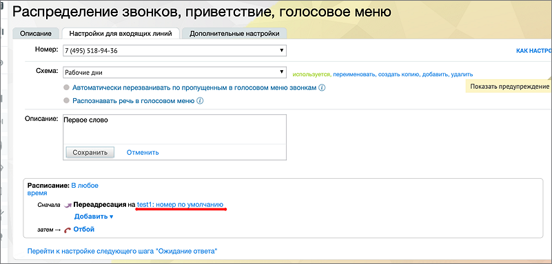

## 10.3. Точка входа «DID MANGO OFFICE»

> Трассировка: PDF §10.3 · сквозные стр. 121-122 · источники: ч.1 `kb/sources/speech-analytics/RECHEVAYA-ANALITIKA_1.26.42.pdf` с.121-122.

1) Подключение услуги Речевая аналитика; 2) Создание сотрудника;

3) Настройка схемы распределения звонков в Личном кабинете

Подключите услугу Речевая аналитика и создайте сотрудника, как указано выше. Далее переходите к Настройке схемы распределения звонков в Личном кабинете.

**Настройка схемы распределения звонков в Личном**

**кабинете**

После создания сотрудника настраиваем переадресацию на DID MANGO на сторонней ВАТС.

> **Описание иллюстрации SA-§10.3-1** · к разделу §10.3 «Точка входа «DID MANGO OFFICE»» · стр. 122 · снимок экрана / схема, 801×384 px.
> Относится к тексту руководства: «После создания сотрудника настраиваем переадресацию на DID MANGO на сторонней ВАТС.»
> Текст на изображении (OCR, требует сверки): Распределение звонков, приветств; Описание; Настройки для входящих линий; Дополнительные настройки; Номер: 7 (495) 518-94-36; КАК HACTPG; Схема: `Рабочие дни; используется, переименовать, создать копию, добавить, удалить; © Автоматически перезванивать по пропущенным в голосовом меню звонкам (0); © Распознавать речь в голосовом меню @; Сохранить; Отменить; Расписание: В любое; время; Сначала я Переадресация ia test}: номер по умолчанию.; Добавитьу; Перейти к настройке следующего шага “Ожидание ответа"; LL ce
