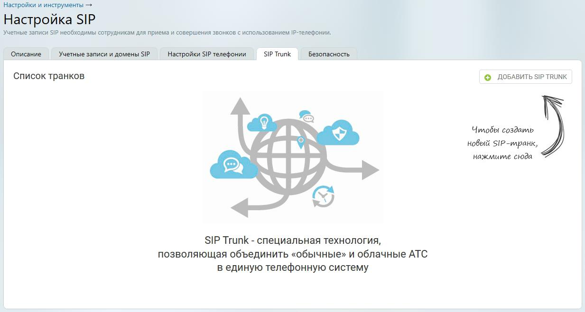
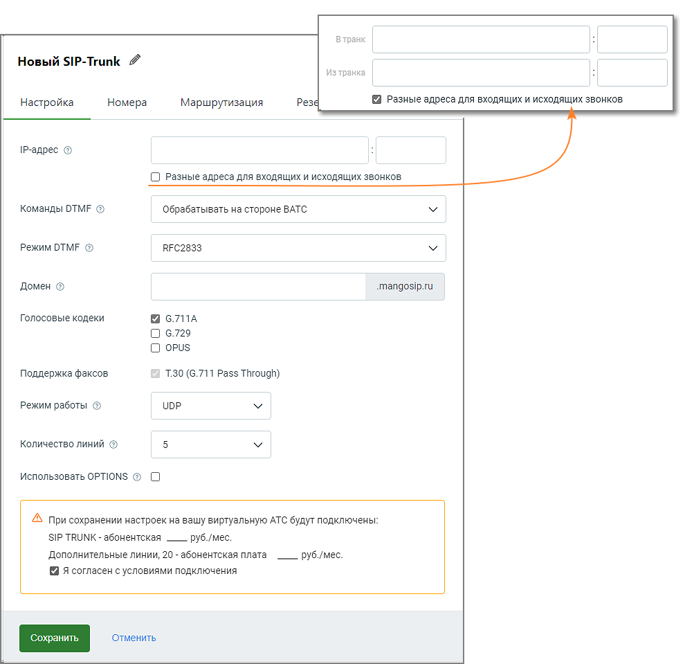
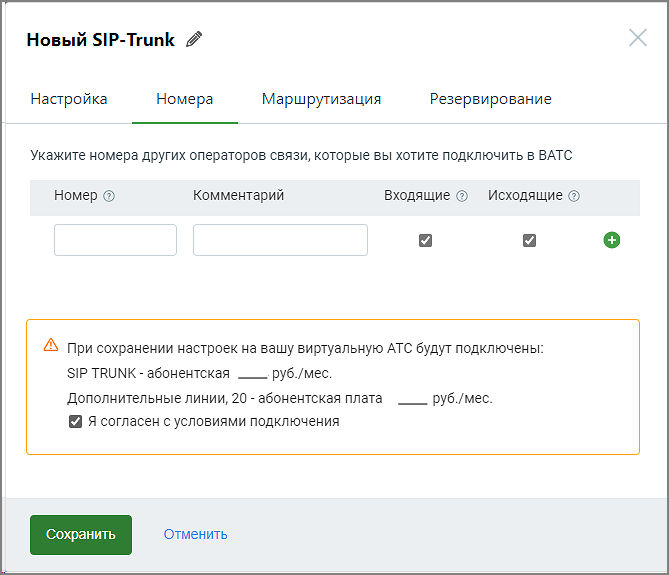

## 10.4. Точка входа «SIP Trunk»

> Трассировка: PDF §10.4 · сквозные стр. 122-127 · источники: ч.1 `kb/sources/speech-analytics/RECHEVAYA-ANALITIKA_1.26.42.pdf` с.122-127.

1) Добавление SIP Trunk 2) Активация SIP Trunk в карточке сотрудника 3) Настройка схемы распределения звонков в Личном кабинете

Откройте личный кабинет по ссылке lk.mango-office.ru. На главной странице Личного кабинета ВАТС выберите раздел Общие настройки, пункт меню Настройка SIP. На вкладке SIP Trunk кликните по кнопке Добавить SIP Trunk / Внешний

> **Описание иллюстрации SA-§10.4-1** · к разделу §10.4 «Точка входа «SIP Trunk»» · стр. 123 · снимок экрана / схема, 1233×659 px.
> Относится к тексту руководства: «Откройте личный кабинет по ссылке lk.mango-office.ru. На главной странице Личного кабинета ВАТС выберите раздел Общие настройки, пункт меню Настройка SIP. На вкладке SIP Trunk кликните по кнопке Добавить SIP Trunk / Внешний»
> Следующий за иллюстрацией текст: «Вкладка Настройка»
> Текст на изображении (OCR, требует сверки): Настройки и инструменты —; Настройка SIP; Учетные записи SIP необходимы сотрудникам для приема и совершения звонков с использованием -телефонии.; "Описание.; SIP Trunk; Безопасность; Учетные записи и домены SIP; Настройки SIP телефонии; Список транков; © ДОБАВИТЬ SIP TRUNK; Чилобы создаиль,; Ab; новый SIP-mpauk,; 4248kn; Hakmume сюда.; Чи; SIP Trunk - специальная технология,; позволяющая объединить «обычные» и облачные АТС; в единую телефонную систему

**Вкладка Настройка**

> **Описание иллюстрации SA-§10.4-2** · к разделу §10.4 «Точка входа «SIP Trunk»» · стр. 124 · снимок экрана / схема, 990×959 px.
> Относится к тексту руководства: «Откройте личный кабинет по ссылке lk.mango-office.ru. На главной странице Личного кабинета ВАТС выберите раздел Общие настройки, пункт меню Настройка SIP. На вкладке SIP Trunk кликните по кнопке Добавить SIP Trunk / Внешний»
> Следующий за иллюстрацией текст: «В открывшейся вкладке Настройка заполните поля: IP-адрес и порт - укажите в них IP-адрес и порт вашей кАТС (они должны быть известны системному администратору вашей компании). Поле обязательно для зап…»
> Текст на изображении (OCR, требует сверки): Новый SIP-Trunk 7; Изтранка; Реза; Разные адреса для входящих и исходящих звонков; Настройка; Номера; Маршрутизация; IP-anpec ©; О Разные адреса для входящих и исходящих звонков; Команды ОТМЕ ©; обрабатывать на стороне ВАТС; Режим ОТМЕ ©; ВЕС2833; Домен ©; „тапдозрли; Голосовые кодеки; 6.7ПА; О 6.729; О opus; Поддержка факсов; 1.30 (6.711 Pass Through); Режим работы ©; ЦОР; Количество линий ©; Использовать OPTIONS © О; AS при сохранении настроек на вашу виртуальную АТС будут подключены:; SIP TRUNK - абонентская — руб./мес.; Дополнительные линии, 20 - абонентская плата; руб./мес; Я согласен с у…

В открывшейся вкладке Настройка заполните поля:

IP-адрес и порт - укажите в них IP-адрес и порт вашей кАТС (они должны быть известны системному администратору вашей компании). Поле обязательно для заполнения. Допускается ввод нескольких портов, с использованием:

• числа – для указания порта;

• знаков "," (запятая) и ";" (точка с запятой) – для перечисления портов;

• знаков "-" (тире или дефис) – для указания диапазона портов;

• знака " " (пробел).

Разные адреса для входящих и исходящих звонков – если чекбокс проставлен, открывается дополнительное поле для ввода IP-адреса и порта. Таким образом разделяется IP клиентской АТС: отдельно для входящих звонков из ВАТС в клиентскую АТС и исходящих звонков из клиентской АТС в ВАТС.

Команды DTMF - обрабатывать или не обрабатывать DTMF-команды на стороне ВАТС.

Если включено, ВАТС будет пытаться выполнить известные ей команды (например, удержание или перевод вызова). В таком случае рекомендуем отключить обработку DTMF на стороне кАТС во избежание возможной двойной реакции на некоторые команды (одновременно со стороны ВАТС и кАТС).

Если выключено, ВАТС будет просто передавать все DTMF-сигналы в кАТС, в таком случае обработка команд должна быть настроена на стороне кАТС.

Режим DTMF -

• RFC2833 - в этом случае известные DTMF-команды передаются в формате RFC2833, передача идет отдельно от голосового канала;

• INBAND - в этом случае известные DTMF-команды передаются в формате Inband, с передачей в голосовом канале;

Домен - домен для удобства адресации звонков. Вместо того чтобы вводить IP SIP-шлюза MANGO OFFICE, вы можете создать домен и прописать в настройках клиентской АТС именно домен. Поле необязательно для заполнения.

Если вы не создали домен, то при настройке вашей кАТС используйте следующие данные SIP- шлюза MANGO OFFICE:

host = 81.88.86.55

port = 5060

Адрес может измениться. За информацией по новым параметром обратитесь к сотруднику техподдержки MANGO OFFICE, заполнив форму в Личном кабинете.

СОВЕТ: Для более стабильной работы сип-транка во время тестового периода, в настройках кАТС рекомендуется указывать именно IP-адрес и порт, а не создавать домен.

Голосовые кодеки - для звонков, проходящих через транк, используются выбранные для данного транка кодеки (алгоритмы сжатия голоса). Если ваша кАТС не поддерживает какие-то из них, отключите их. В общем случае рекомендуется использовать тот же кодек, который используется в вашей кАТС как основной.

Поддержка факсов - поддержка факсов возможна только по одному протоколу и активна всегда;

Режим работы - выбор между UDP и TCP определяет протокол, который будет использоваться для установления связи между клиентской АТС (кАТС) и SIP-шлюзом MANGO OFFICE. Выбор между UDP и TCP зависит от требований. Если стабильность и надежность соединения важнее, то TCP может быть более подходящим выбором. Если важна низкая задержка, а некоторая потеря данных в режиме реального времени не критична, то UDP может быть предпочтительным вариантом. Важно также удостовериться, что клиентская АТС поддерживает выбранный протокол

Количество линий - максимальное число одновременных звонков между ВАТС и кАТС. Сюда относятся входящие, исходящие и внутренние звонки. Допускается выбор от 5 до 100 линий;

Если количество линий достигло максимального значения, при попытке дозвона пользователь получит сообщение “Линия занята”;

Использовать OPTIONS - если чек-бокс включен, то SIP-шлюз MANGO OFFICE будет проверять доступность клиентской АТС посредством посылки пакетов OPTIONS.

• Если кАТС в ответ на запросы OPTIONS возвращает код ответа сервера «200 OK», она считается доступной.

• Если кАТС в ответ на запросы OPTIONS возвращает иной код ответа сервера, она считается недоступной, о чем появляется соответствующее системное уведомление.

В случае наличия разных адресов для входящих и исходящих вызовов статус подключения и полученные ошибки будут отображаться только для транка, указанного в параметре «В транк».

**Вкладка Номера**

> **Описание иллюстрации SA-§10.4-3** · к разделу §10.4 «Точка входа «SIP Trunk»» · стр. 126 · снимок экрана / схема, 669×575 px.
> Относится к тексту руководства: «В случае наличия разных адресов для входящих и исходящих вызовов статус подключения и полученные ошибки будут отображаться только для транка, указанного в параметре «В транк».»
> Следующий за иллюстрацией текст: «Заполните поля: Номер - если к вашей АТС подключены номера какого-то оператора связи, и вы хотите сделать их доступными через сип-транк, их необходимо указать здесь. Формат ввода номера - E.164 без пр…»
> Текст на изображении (OCR, требует сверки): Новый SIP-Trunk 4; Настройка; Номера; Маршрутизация; Резервирование; Укажите номера других операторов связи, которые вы хотите подключить в ВАТС; Номер ©; Комментарий; Входящие @ Исходящие ©; А при сохранении настроек на вашу виртуальную АТС будут подключены:; SIP TRUNK - абонентская — руб./мес.; Дополнительные линии, 20 - абонентская плата; руб./мес.; Я согласен с условиями подключения

Заполните поля:

Номер - если к вашей АТС подключены номера какого-то оператора связи, и вы хотите сделать их доступными через сип-транк, их необходимо указать здесь. Формат ввода номера - E.164 без пробелов, например 74951234567.

Комментарий - информация произвольного характера, не более 50 символов. Поле не обязательно для заполнения;

Укажите желаемые направление вызовов. В зависимости от выбора направления через SIP Trunk пользователь cможет:

1. Входящие - номер будет отображен в списке номеров других операторов связи в разделе “Номера, подключенные к АТС”. Это позволит настроить для него голосовое меню IVR и правила переадресации (распределения) звонков.

2. Исходящие - номер будет отображен в списке доступных для выбора исходящих линий в карточках сотрудников ВАТС. При выборе его в качестве исходящий линии и совершении сотрудником исходящего звонка, он будет направлен в сип-транк. Если номер используется (например, в схеме переадресации), при редактировании транка отключить чекбокс «звонить» невозможно.

> **Описание иллюстрации SA-§10.4-4** · к разделу §10.4 «Точка входа «SIP Trunk»» · стр. 127 · пиктограмма (значок элемента интерфейса), 17×18 px.
> Относится к тексту руководства: «…и выборе его в качестве исходящий линии и совершении сотрудником исходящего звонка, он будет направлен в сип-транк. Если номер используется (например, в схеме переадресации), при редактировании транка отключить чекбокс «звонить» невозможно.»
> Следующий за иллюстрацией текст: «Чтобы удалить введенный номер, кликните по пиктограмме в строке выбранного номера. Если для данного номера настроены схемы распределения вызовов, переадресация или он используется в качестве исходящег…»
> Текста на изображении нет; назначение значка — см. текст, к которому он относится.

Чтобы удалить введенный номер, кликните по пиктограмме в строке выбранного номера. Если для данного номера настроены схемы распределения вызовов, переадресация или он используется в качестве исходящего номера абонента, номер не может быть удален.

Далее полную настройку SIP Trunk можно посмотреть в Руководстве пользователя SIP Trunk

**Вкладка Телефония**

В поле Исходящий̆ номер выберите из выпадающего списка номер SIP Trunkа. Сохраните внесенные изменения кнопкой̆ Сохранить.

Примеры: ПРИМЕР 1: Сотрудник ВАТС, у которого в качестве исходящего номера указан номер транка, набирает номер 456, который̆ не является внутренним номером другого сотрудника данной̆ ВАТС, при этом во вкладке Маршрутизация настроен транк с префиксом "45". Результат: звонок инициируется через определённый̆ транк с префиксом "45". ПРИМЕР 2: Сотрудник ВАТС, у которого в качестве исходящего номера указан номер транка, набирает номер 789, который̆ не является внутренним номером другого сотрудника данной ВАТС, при этом нет настроенных транков с префиксом "78". Результат: звонок инициируется через транк, выбранный̆ в качестве исходящего номера сотрудника. ПРИМЕР 3: Сотрудник ВАТС, у которого в качестве исходящего номера указан номер транка, набирает номер 123, который является внутренним номером другого сотрудника данной ВАТС. Результат: звонок будет направлен сотруднику ВАТС с номером 123.
