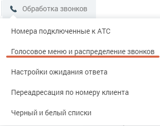
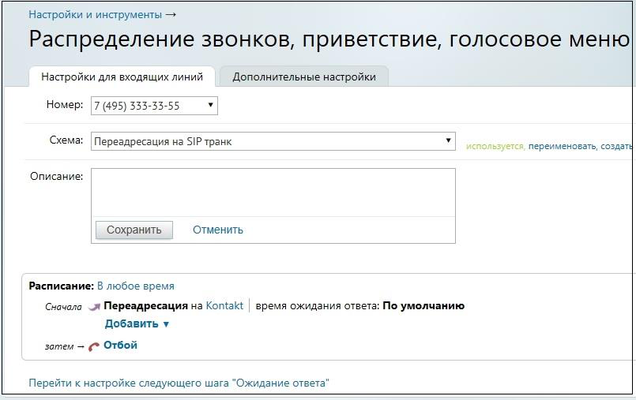

### 10.4.2. Настройка схемы распределения звонков в Личном кабинете

> Трассировка: PDF §10.4.2 · сквозные стр. 127-129 · источники: ч.1 `kb/sources/speech-analytics/RECHEVAYA-ANALITIKA_1.26.42.pdf` с.127-129.

Для настройки схемы распределения звонков откройте подраздел “Голосовое меню и распределение звонков” в разделе “Обработка звонков” в Личном кабинете пользователя ВАТС.

Панель настройки содержит вкладки:

• Настройки для входящих линий

• Дополнительные настройки

Выберите из списка телефонный̆ номер, подключённый̆ через SIP Trunk, для которого

будет настраиваться схема.

Далее действуйте согласно инструкции о создании схем переадресации. См. раздел «Обработка звонков» в Справочнике ВАТС.

> **Описание иллюстрации SA-§10.4.2-1** · к разделу §10.4.2 «Настройка схемы распределения звонков в Личном кабинете» · стр. 128 · снимок экрана / схема, 315×247 px.
> Относится к тексту руководства: «Далее действуйте согласно инструкции о создании схем переадресации. См. раздел «Обработка звонков» в Справочнике ВАТС.»
> Следующий за иллюстрацией текст: «Для создания схемы, включающей̆ переадресацию звонков на SIP Trunk кликните по ссылке “не указано”.»
> Текст на изображении (OCR, требует сверки): & Обработка звонков; Номера подключенные к АТС; Голосовое меню и распределение 3BOHKOB; Настройки ожидания ответа; Переадресация по номеру клиента; черный и белый списки

Для создания схемы, включающей̆ переадресацию звонков на SIP Trunk кликните по ссылке “не указано”.

> **Описание иллюстрации SA-§10.4.2-2** · к разделу §10.4.2 «Настройка схемы распределения звонков в Личном кабинете» · стр. 128 · снимок экрана / схема, 805×507 px.
> Относится к тексту руководства: «Для создания схемы, включающей̆ переадресацию звонков на SIP Trunk кликните по ссылке “не указано”.»
> Следующий за иллюстрацией текст: «В открывшейся форме выберите вкладку SIP Trunk. В выпадающем окне содержится список всех активных транков. При выборе транка в окне отображаются его параметры.»
> Текст на изображении (OCR, требует сверки): Настройки и инструменты —; Распределение звонков, приветствие, голосовое меню; Настройки для входящих линий; Дополнительные настройки; Номер: 7 (495) 333-53-55; Схема:; Переадресация на SIP транк; переименовать, создать; Описание:; Сохранить; Отменить; Расписание: В любое время; Сначала м Переадресация на Kontakt; время ожидания ответа: По умолчанию; Добавить v; затем — ¢* Отбой; Перейти к настройке следующего шага "Ожидание ответа"

В открывшейся форме выберите вкладку SIP Trunk. В выпадающем окне содержится список всех активных транков. При выборе транка в окне отображаются его параметры.

> **Описание иллюстрации SA-§10.4.2-3** · к разделу §10.4.2 «Настройка схемы распределения звонков в Личном кабинете» · стр. 128 · снимок экрана / схема, 329×117 px.
> Относится к тексту руководства: «В открывшейся форме выберите вкладку SIP Trunk. В выпадающем окне содержится список всех активных транков. При выборе транка в окне отображаются его параметры.»
> Следующий за иллюстрацией текст: «SIP Trunk настроен и может совершать входящие и исходящие звонки.»
> Текст на изображении (OCR, требует сверки): Расписание: В любое время; Сначала и Переадресация на не указано; Добавить у; затем = ¢* Отбой

SIP Trunk настроен и может совершать входящие и исходящие звонки.

Важно: интеграция по SIP Trunk не имеет привязки к сотруднику, таким образом аналитика по сотруднику не доступна. Функционал возможностей Речевой аналитики в этом случае будет ограничен.
