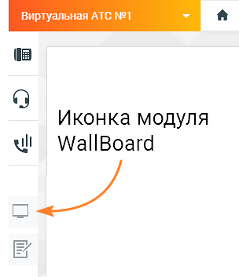
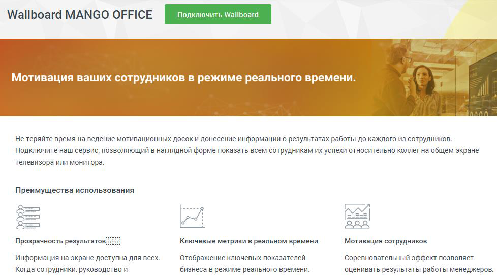

## 1.1. Подключение модуля Программа для ЭВМ "Wallboard Mango Office" в Личном кабинете ВАТС

> Трассировка: PDF §1.1 · сквозные стр. 3-4 · источники: ч.1 `kb/sources/wallboard/Programma-dlya-EVM-Wallboard-Mango-Office_v7.22.25.pdf` с.3-4.

> **Описание иллюстрации WB-§1.1-1** (к §1.1 «Подключение модуля Программа для ЭВМ "Wallboard Mango Office" в Личном кабинете ВАТС», стр. 3; 24×20 px). Пиктограмма (значок элемента интерфейса).
> Относится к тексту руководства: «…Доступ к модулю есть у пользователей ВАТС с ролью Администратор. В противном случае пункт меню "Wallboard" не отображается.».
> Текста на изображении нет; назначение элемента — см. текст, к которому он относится.

Для подключения кликните по иконке модуля в левом вертикальном меню Личного кабинета пользователя ВАТС.

> **Описание иллюстрации WB-§1.1-2** (к §1.1 «Подключение модуля Программа для ЭВМ "Wallboard Mango Office" в Личном кабинете ВАТС», стр. 3; 304×353 px). Снимок экрана / схема.
> Относится к тексту руководства: «…Для подключения кликните по иконке модуля в левом вертикальном меню Личного кабинета пользователя ВАТС.».
> Текст на изображении (OCR, требует сверки): К м; Иконка модуля; ul; WallBoard; Ey

Ознакомьтесь с информацией в окне подключения, нажмите кнопку Подключить Wallboard.

> **Описание иллюстрации WB-§1.1-3** (к §1.1 «Подключение модуля Программа для ЭВМ "Wallboard Mango Office" в Личном кабинете ВАТС», стр. 4; 978×541 px). Снимок экрана / схема.
> Относится к тексту руководства: «…Ознакомьтесь с информацией в окне подключения, нажмите кнопку Подключить Wallboard.».
> Текст на изображении (OCR, требует сверки): Wallboard MANGO OFFICE; Мотивация ваших сотрудников в режиме реального времени.; Не теряйте время на ведение мотивационных досок и донесение информации о результатах работы до каждого из сотрудников.; Подключите наш сервис, позволяющий в наглядной форме показать всем сотрудникам их; спехи относительно коллег на общем экране; телевизора или монитора.; Преимущества использования; Прозрачность результатов 2; Ключевые метрики в реальном времени; Мотивация сотрудников; Информация на экране доступна для всех.; Отображение ключевых показателей; Соревновательный эффект позволяет; Когда сотрудники, рук…
