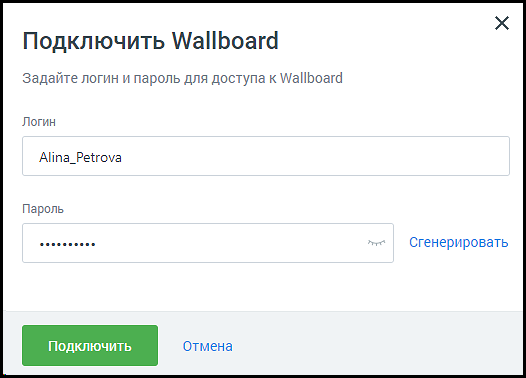

## 1.2. Создание аккаунта Wallboard

> Трассировка: PDF §1.2 · сквозные стр. 4-6 · источники: ч.1 `kb/sources/wallboard/Programma-dlya-EVM-Wallboard-Mango-Office_v7.22.25.pdf` с.4-6.

Заполните поля формы создания аккаунта Wallboard. Пароль должен содержать не менее 8 символов, включать строчные, заглавные латинские буквы и цифры.

> **Описание иллюстрации WB-§1.2-1** (к §1.2 «Создание аккаунта Wallboard», стр. 4; 526×378 px). Снимок экрана / схема.
> Относится к тексту руководства: «…Заполните поля формы создания аккаунта Wallboard. Пароль должен содержать не менее 8 символов, включать строчные, заглавные латинские буквы и цифры.».
> Текст на изображении (OCR, требует сверки): Подключить Wallboard; Задайте логин и пароль для доступа к Wallboard; Логин; Alina_Petrova; Пароль; secccccese; Сгенерировать

После подключения услуги иконка модуля перемещается выше, в раздел подключенных продуктов. По клику на иконку открывается страница услуги «Мои Wallboard».

> **Описание иллюстрации WB-§1.2-2** (к §1.2 «Создание аккаунта Wallboard», стр. 5; 752×644 px). Снимок экрана / схема.
> Относится к тексту руководства: «…После подключения услуги иконка модуля перемещается выше, в раздел подключенных продуктов. По клику на иконку открывается страница услуги «Мои Wallboard».».
> Текст на изображении (OCR, требует сверки): Мои Wallboard; Wallboard Отдела продаж; Wallboard 1 (A) Быстрый переход (4; — Я Полный доступ; Логин; Alina_Petrova; Скопировать; Пароль; Показать; Отправить данные на почту или телефон; Отправить данные для входа в Wallboard; Взедите e-mail или номер телефона на который хотите отправить данные; Email; — В Гостевой доступ только просмотр ———; Создать гостевую учетную запись; Телефон; В Гостевой доступ только просмотр; Отмена; Alina_Petrova_guest; © отправить данные на почту или телефон

На странице доступны следующие действия:

• Переименование Wallboard – для переименования кликните по пиктограмме «карандаш»; • Быстрый переход к Wallboard – по клику на ссылке открывается монитор показателей. Для новых аккаунтов – открывается окно настроек Wallboard; • Изменение данных аккаунта – для изменения данных аккаунта нажмите кнопку «Изменить»; • Копирование данных аккаунта – логин или пароль аккаунта копируются в буфер обмена; • Отправка данных аккаунта на почту или телефон; • Просмотр пароля к аккаунту; • Создание гостевой учетной записи – для каждого Wallboard может быть создана дополнительная гостевая учетная запись для доступа только в режиме просмотра; • Изменение/удаление гостевой учетной записи – для изменения данных или удаления гостевого аккаунта нажмите кнопку «Изменить»; • Удаление учетной записи Wallboard – для удаления учетной записи кликните по кнопке «Отключить» в правом верхнем углу в разделе соответствующего аккаунта на странице «Мои Wallboard». Подтвердите свое согласие на отключение; • Подключение новой учетной записи – чтобы подключить новый аккаунт Wallboard, нажмите кнопку «Подключить новый».

> **Описание иллюстрации WB-§1.2-3** (к §1.2 «Создание аккаунта Wallboard», стр. 6; 326×171 px). Снимок экрана / схема.
> Относится к тексту руководства: «…ard». Подтвердите свое согласие на отключение; • Подключение новой учетной записи – чтобы подключить новый аккаунт Wallboard, нажмите кнопку «Подключить новый».».
> Текст на изображении (OCR, требует сверки): Отключить

совет

| Настройки Wallboard хранятся для каждой учетной записи отдельно. Подключая две учетные |  |
| --- | --- |
| записи, компания может использовать два Wallboard с разными настройками. Например, один |  |
| для отдела продаж, второй для отдела обслуживания клиентов. |  |

Настройки Wallboard хранятся для каждой учетной записи отдельно. Подключая две учетные записи, компания может использовать два Wallboard с разными настройками. Например, один для отдела продаж, второй для отдела обслуживания клиентов.
