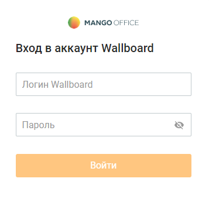

# 2. Страница авторизации

> Трассировка: PDF §2 · сквозные стр. 6-7 · источники: ч.1 `kb/sources/wallboard/Programma-dlya-EVM-Wallboard-Mango-Office_v7.22.25.pdf` с.6-7.

Доступ к модулю Программа для ЭВМ "Wallboard Mango Office" осуществляется по адресу https://tv.mango-office.ru/, введенному пользователем в адресной строке встроенного браузера TV либо в браузере компьютера.

> **Описание иллюстрации WB-§2-1** (к §2 «Страница авторизации», стр. 7; 357×340 px). Снимок экрана / схема.
> Относится к тексту руководства: «…ngo Office" осуществляется по адресу https://tv.mango-office.ru/, введенному пользователем в адресной строке встроенного браузера TV либо в браузере компьютера.».
> Текст на изображении (OCR, требует сверки): @ mancoorrice; Вход в аккаунт Wallboard; | Логин Wallboard; | Пароль

Авторизуйте свой аккаунт и переходите к настройкам модуля.

внимание

Гостевые аккаунты могут использовать Wallboard только в режиме просмотра.
