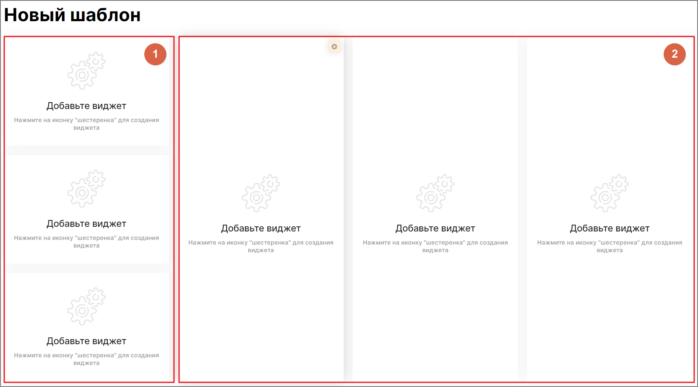

## 3.2. Настройка «своего шаблона» показателей Wallboard

> Трассировка: PDF §3.2 · сквозные стр. 9-11 · источники: ч.1 `kb/sources/wallboard/Programma-dlya-EVM-Wallboard-Mango-Office_v7.22.25.pdf` с.9-11.

При выборе собственного варианта отображения монитора показателей открывается экран с пустыми областями для последующей настройки. Доступны виджеты общего группового показателя (блок 1) и виджеты персонального показателя – рейтинга (блок 2).

> **Описание иллюстрации WB-§3.2-1** (к §3.2 «Настройка «своего шаблона» показателей Wallboard», стр. 10; 1645×913 px). Снимок экрана / схема.
> Относится к тексту руководства: «…ан с пустыми областями для последующей настройки. Доступны виджеты общего группового показателя (блок 1) и виджеты персонального показателя – рейтинга (блок 2).».
> Текст на изображении (OCR, требует сверки): Новый шаблон; Добавьте виджет; Нажмите на иконку "шестеренка" для создания; виджета

> **Описание иллюстрации WB-§3.2-2** (к §3.2 «Настройка «своего шаблона» показателей Wallboard», стр. 10; 19×18 px). Пиктограмма (значок элемента интерфейса).
> Относится к тексту руководства: «…ан с пустыми областями для последующей настройки. Доступны виджеты общего группового показателя (блок 1) и виджеты персонального показателя – рейтинга (блок 2).».
> Текста на изображении нет; назначение элемента — см. текст, к которому он относится.

Для настройки каждого из виджетов нажмите пиктограмму в правом верхнем углу виджета. После чего откроется окно настройки.
