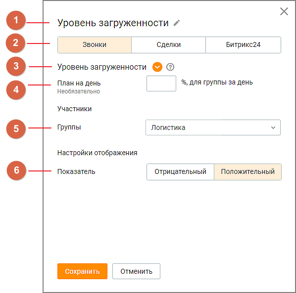

### 3.2.1. Настройка виджета общего группового показателя

> Трассировка: PDF §3.2.1 · сквозные стр. 11-13 · источники: ч.1 `kb/sources/wallboard/Programma-dlya-EVM-Wallboard-Mango-Office_v7.22.25.pdf` с.11-13.

> **Описание иллюстрации WB-§3.2.1-1** (к §3.2.1 «Настройка виджета общего группового показателя», стр. 11; 598×593 px). Снимок экрана / схема.
> Относится к тексту руководства: «…Для настройки каждого из виджетов нажмите пиктограмму в правом верхнем углу виджета. После чего откроется окно настройки.».
> Подпись в руководстве: «Рис. 3.2.1 – Окно настройки виджета общего группового показателя.».
> Текст на изображении (OCR, требует сверки): Уровень загруженности #; Звонки; Сделки; Битрикс24; Уровень загруженности @ @; План на день; Необязательно; | %, для группы за день; Участники; Группы; Логистика; Настройки отображения; Показатель; Отрицательный; Положительный |

Рис. 3.2.1 – Окно настройки виджета общего группового показателя.

Заполните следующие поля:

1. Название - наименование виджета, не более 60 символов;

2. Группа показателей - доступен выбор одной из вкладок:

• «Звонки» (по умолчанию) • «Сделки» • «Битрикс24»

3. Показатель - список показателей производительности, соответствующий выбранной в п.2 группе показателей. Для выбора доступен только один показатель. Подробное описание показателей приведено здесь;

4. План - поле ввода значения плана для выбранного показателя. Не является обязательным для заполнения;

5. Группы – поле обязательное для выбора. Для общего группового показателя можно выбрать только одну группу из списка;

6. Показатель - характеристика показателя: отрицательный или положительный. Для сохранения внесенных изменений нажмите кнопку «Сохранить».
