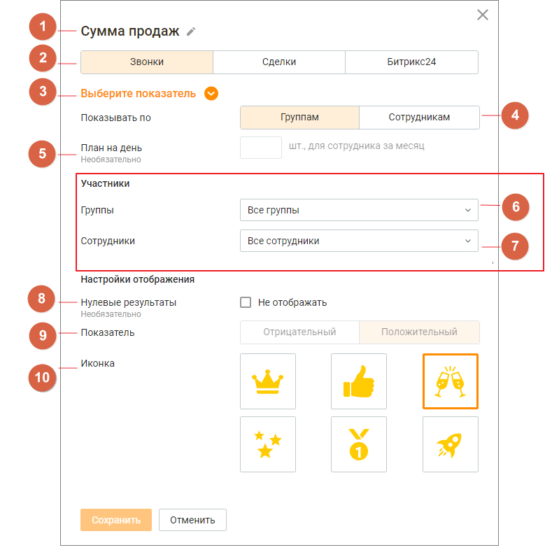

### 3.2.2. Настройка виджета персонального показателя (рейтинга)

> Трассировка: PDF §3.2.2 · сквозные стр. 13-14 · источники: ч.1 `kb/sources/wallboard/Programma-dlya-EVM-Wallboard-Mango-Office_v7.22.25.pdf` с.13-14.

> **Описание иллюстрации WB-§3.2.2-1** (к §3.2.2 «Настройка виджета персонального показателя (рейтинга)», стр. 13; 799×786 px). Снимок экрана / схема.
> Относится к тексту руководства: «…6. Показатель - характеристика показателя: отрицательный или положительный. Для сохранения внесенных изменений нажмите кнопку «Сохранить».».
> Подпись в руководстве: «Рис. 3.2.2 – Окно настройки виджета персонального показателя (рейтинга).».
> Текст на изображении (OCR, требует сверки): 1 Сумма продаж г; Звонки; Сделки; Битрикс24; 3 Выберите показатель @; Показывать по; Группам; Сотрудникам; План на день; шт., для сотрудника за месяц; Необязательно; Участники; Группы; Все группы; Сотрудники; Все сотрудники; Настройки отображения; +-— Нулевые результаты; (-] Не отображать; Отрицательный; Положительный; о | Показатель; © Иконка; av Vi; Ww; Отменить; Сохранить

Рис. 3.2.2 – Окно настройки виджета персонального показателя (рейтинга).

Заполните следующие поля:

1. Название - наименование виджета, не более 60 символов;

2. Группа показателей - доступен выбор одной из вкладок:

• «Звонки» (по умолчанию) • «Сделки» • «Битрикс24»

3. Показатель - список показателей производительности, соответствующий выбранной в п.2 группе показателей. Для выбора доступен только один показатель. Подробное описание показателей приведено здесь;

4. Отображение - переключатели настроек:

• «по группам» - в рейтинге будут отображаться результаты групп по групповым показателям; • «по сотрудникам» - в рейтинге будут отображаться результаты сотрудников по персональным показателям;

5. План - поле ввода значения плана для выбранного показателя. Не является обязательным для заполнения;

6-7. Участники - списки групп и сотрудников ВАТС. Содержит поля:

• Группы – поле обязательное для выбора. Для персональных показателей (рейтингов) доступен выбор нескольких групп; • Сотрудники - доступно только для персональных показателей при выбранной в п. 4 настройке отображения «По сотрудникам». Включает в себя список сотрудников ВАТС, относящихся к выбранным в поле «Группа» группам;

8. Нулевые результаты - настройка отображения:

• если чекбокс проставлен - нулевые результаты будут отображаться в рейтинге; • если чекбокс не проставлен - нулевые результаты исключаются из рейтинга;

9. Показатель - характеристика показателя: отрицательный или положительный;

10. Иконка - выбранная картинка будет отображаться рядом с аватаром лидера рейтинга. Доступен выбор одной иконки. Для сохранения внесенных изменений нажмите кнопку «Сохранить».
